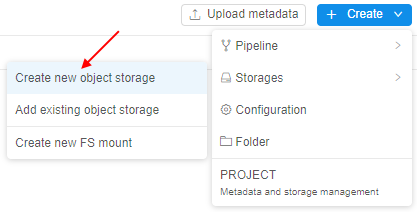
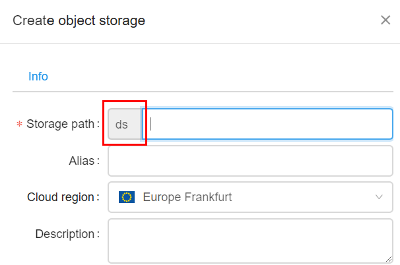
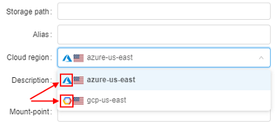
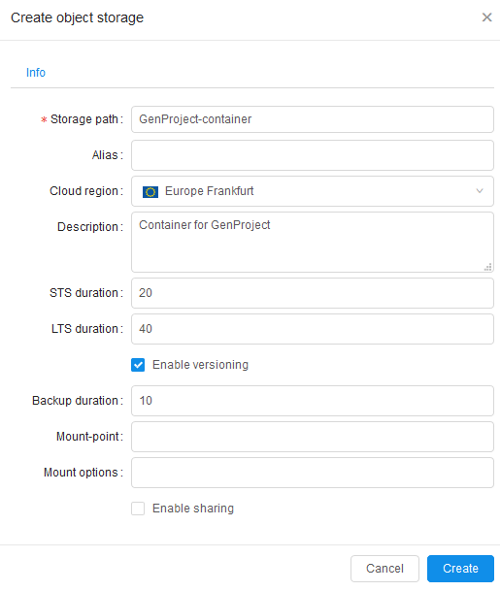
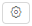
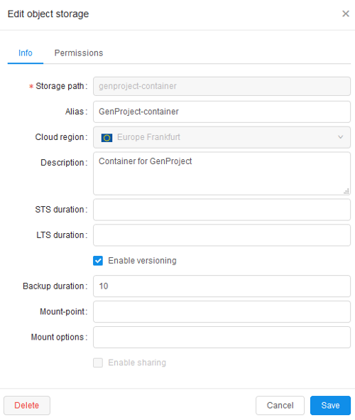

# 8.1. Create and edit storage

- [Create object storage](#create-object-storage)
- [Edit storage](#edit-storage)
- [Register an S3 access point alias](#register-an-s3-access-point-alias)

> To create a **Storage** in a **Folder** you need to have **WRITE** permission for that folder and the **ROLE\_STORAGE\_MANAGER** role. For more information see [13. Permissions](../13_Permissions/13._Permissions.md).
>
> You also can create **Storage** via **CLI**. See [14.3. Manage Storage via CLI](../14_CLI/14.3._Manage_Storage_via_CLI.md#create-a-datastorage).

## Create object storage

1. Navigate to the folder where you want to create data storage.
2. Click **+ Create → Storage → Create new object storage**.  
    **_Note_**: choose **Add existing object storage** to use an already existing cloud storage for this data storage.  
      
    **_Note_**: how to create FS mount see [here](8.7._Create_shared_file_system.md).  
3. Fill in the "**Info**" form:  
    - **Storage path** - path to access the storage (cloud storage name).  
    If on **Data storage** tab in **Preferences** section of system-level settings **storage.object.prefix** (see [v.0.14 - 12.10. Manage system-level settings](../12_Manage_Settings/12.10._Manage_system-level_settings.md#data-storage)) is set - all new storages will be created with this prefix (e.g. "*ds*"):  
    
    - **Alias** - object storage name (if not specified, it is set equal to the **Storage path**).
    - **Cloud region** - location region of a data storage. This select allows to decrease time of data movement for huge data volumes by choosing the nearest region.  
        Please note, if a non-default region is selected - certain CP features may be unavailable:  
        - FS mounts usage from the another region (e.g. "_EU West_" region cannot use FS mounts from the "_US East_"). Regular storages will be still available.
        - If a specific tool, used for a run, requires an on-premise license server (e.g. monolix, matlab, schrodinger, etc.) - such instances shall be run in a region, that hosts those license servers.  

        Also note, if a specific platform deployment has a number of Cloud Providers registered (e.g. `AWS`+`Azure`, `GCP`+`Azure`) - in that case auxiliary Cloud Provider icons are additionally displayed, e.g.:  
        

    - **Description** - description of the data storage and comments.
    - **STS duration** - short-term storage support (in days). Allows to set duration of data store period in a "usual" object storage. After this period, the data will be transferred to the long-term storage.
    - **LTS duration** - long-term storage support (in days). Allows to set duration of the data store period in a long-term storage (e.g. `S3 Glacier` for `AWS`), where the data is transferred after the STS duration expiration. After LTS period expiration, the data will be removed permanently. Long-term storage is a secure, durable, and low-cost storage compared to a "usual" object storage, but using of such storage intends not so fast and frequently access to the data. So, long-term storages are ideal for archives where data is regularly retrieved and some of the data may be needed in minutes.
    - **Enable versioning** box - allows to enable versioning for the storage files.
    - **Backup duration** - how long backup is stored (days). After this period expiration all backup-versions "older" than specified period will be removed. This setting is available only if versioning is enabled.  
        **_Note_**: If you want to store data permanently, leave fields empty.
    - **Mount-point** - specific mount-point.
    - **Mount options** - specific mount options.
    - **Enable sharing** box - allows to share storage content with other users (see [here](8.8._Data_sharing.md)).  
        
4. Click **"Create"** button.

## Edit storage

> You also can edit **Storage** via **CLI**. See [14.3. Manage Storage via CLI](../14_CLI/14.3._Manage_Storage_via_CLI.md#edit-a-datastorage).

You may change **Alias**, **Description**, **STS** and **LTS duration**, **Mount-point** and **Mount options**. Example:

1. Select storage.
2. Click  icon.
3. Change number of days in **STS** and **LTS** duration fields.  
    If you want to store data permanently, leave fields empty.  
    
4. Click **"Save"** button.

## Register an S3 access point alias

An object storage can use an S3 access point alias as its **Storage path**. For example, the alias of an access point attached to an `FSx for NetApp ONTAP` volume looks like `<name>-<suffix>-ext-s3alias`.

AWS checks a request made through an alias against the ARN of the access point, not against the alias. So the platform needs this ARN to issue temporary credentials for the storage - for the `pipe storage` commands, and for file download and upload links in the GUI. Without it, these operations fail with an error like `AccessDenied ... because no session policy allows the s3:ListBucket action`.

The ARN is kept in the `accessPointArn` field of the storage. This field is set via the REST API only - the `/datastorage/save` and `/datastorage/update` methods of the API endpoint (see `base.api.host` in [12.10. Manage system-level settings](../12_Manage_Settings/12.10._Manage_system-level_settings.md)).

The ARN format is `arn:aws:s3:<region>:<account id>:accesspoint/<access point name>`. To find it, use one of these commands in the AWS account that owns the access point:

- `aws fsx describe-s3-access-point-attachments` - for an access point attached to an `FSx` volume. See the `S3AccessPoint.Alias` and `S3AccessPoint.ResourceARN` fields.
- `aws s3control list-access-points --account-id <account id>`. See the `Alias` and `AccessPointArn` fields.

**_Note_**: the role used for the temporary credentials still needs access to the access point on the AWS side - in its own IAM policy and in the access point policy.

### Register a new storage

Anyone who can create a storage in the folder can set the ARN. Send `POST /datastorage/save`:

```json
{
    "name": "<storage name>",
    "path": "<access point alias>",
    "type": "S3",
    "parentFolderId": <folder id>,
    "accessPointArn": "arn:aws:s3:<region>:<account id>:accesspoint/<access point name>"
}
```

### Set the ARN for an existing storage

> Only users with the **ROLE\_ADMIN** or **ROLE\_STORAGE\_ADMIN** role can set or clear the ARN of an existing storage. The ARN widens the access of the issued credentials, so the storage **OWNER** cannot change it.

Send `POST /datastorage/update`:

```json
{
    "id": <storage id>,
    "parentFolderId": <current folder id>,
    "mountPoint": "<current mount point>",
    "mountOptions": "<current mount options>",
    "accessPointArn": "arn:aws:s3:<region>:<account id>:accesspoint/<access point name>"
}
```

**_Note_**: this method always replaces the parent folder and the mount point of the storage with the values from the request, and resets empty mount options to the default ones. So pass their current values. Omitted name and description stay as they are.

The `accessPointArn` value works as follows:

- not specified (or `null`) - the current ARN stays as it is
- an empty string - the ARN is removed
- any other value - the ARN is replaced. A value in a wrong format is rejected.

**_Note_**: when a folder is cloned, its storages get new buckets, so the copies do not get the ARN.
