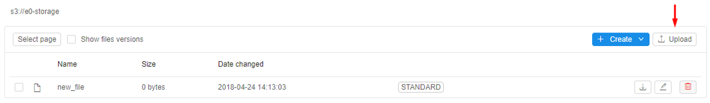
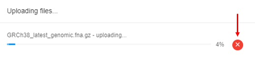
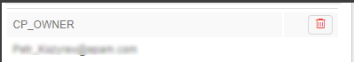
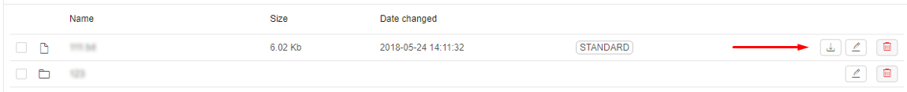
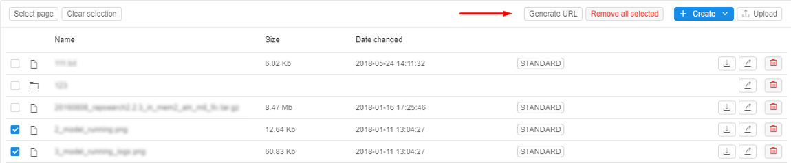
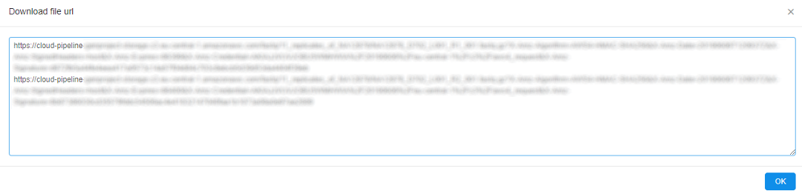

# 8.2. Upload/Download data

- [Upload data](#upload-data)
- [Download data](#download-data)
- [Extract an archive already in the storage](#extract-an-archive-already-in-the-storage)
- [Download as archive](#download-as-archive)
- [Generate URL](#generate-url)

> To edit a **Storage** you need to have **WRITE** permission for the **Storage**. For more information see [13. Permissions](../13_Permissions/13._Permissions.md).
>
> You also can upload and download data via CLI. See [14.3. Manage Storage via CLI](../14_CLI/14.3._Manage_Storage_via_CLI.md#upload-and-download-data).

## Upload data

1. Click **Upload** button in the storage and folder of your choice:  
    
2. Browse file(s) to upload.  
    **_Note_**: make sure size doesn't exceed 5 Gb.  
    **_Note_**: you can cancel upload process by clicking the **"Cancel"** button.  
    
3. If the files you picked include an archive - one of `ZIP`, `TAR`, `TAR.GZ`, `TGZ`, `TAR.BZ2`, `TAR.XZ`, `GZ`, `BZ2` or `XZ`, matched by the file name in any letter case - and the storage is one where this mode is offered (see the note below), the **Upload files** pop-up appears before anything is uploaded. It lists the name of every file you picked, and offers three buttons:  
    - **Cancel** - uploads nothing and closes the pop-up.
    - **Upload and extract** - uploads every selected file. Then it queues one background task for each archive among them that uploaded successfully, and closes the pop-up as an ordinary upload does. Each archive is extracted into a **new folder beside it, named after the archive without its extension**: `data/reports.tar.gz` is extracted into `data/reports/`. An archive that failed to upload, or that you aborted, is skipped. A message confirms how many extractions have been queued. Its **Show storage tasks** link opens the **Storage tasks** window, where each of them is listed as an **Extract archive** task.
    - **Upload** - the default button. It uploads every selected file as the next step describes, archives included, with no extraction.  
    **_Note_**: the archive itself is kept - extracting it does not delete it. A file that is already in the destination folder **is** replaced by the archive's own copy of it.  
    **_Note_**: one archive is one task, and the platform limits how many archive tasks one user may have in progress at once. Archive downloads use the same allowance (see [Download as archive](#download-as-archive) below). The pop-up checks the allowance as it opens: until the answer comes, **Upload** and **Upload and extract** are unavailable, and **Cancel** stays available. Then it checks again every few seconds while it is open. If you do not have enough of the allowance left for every archive you picked, **Upload and extract** is greyed out and the pop-up shows the reason. **Upload** and **Cancel** work as usual - the files can still be uploaded, just not extracted. You can wait in the open pop-up for one of your archive tasks to finish, or cancel one in the **Storage tasks** window: the button becomes available again on its own.  
    **_Note_**: this pop-up is offered only for a data storage on AWS S3, or for an NFS storage whose share is mounted as NFS - not for Azure, GCP or an omics store. On any other storage, or for a selection with no archive in it, picking files uploads them right away, as described below.
4. As a result, the file will be uploaded to the CP system.  
    **Note:** the uploaded file will be tagged with auto-created attribute:  
    - **CP\_OWNER**. The value of the attribute will be set as a user ID.  
        The exception is that the storage is based on FS mount. Files in such data storage don't have attributes at all.

    

## Download data

1. Click the **Download** button next to a file name.  
    
2. Specify where to download in the pop-up window.
3. As a result, the file will be downloaded via your browser to the specified location.

## Extract an archive already in the storage

An archive that is already in a storage - uploaded with **Upload**, or put there any other way - is extracted from the storage's selection menu, with no pop-up.

1. Select exactly one archive file in the storage using its checkbox.
2. Click the selection button (shown as **"1 item selected"**) and choose the **Extract archive** item.
3. A background task is queued at once - there is nothing further to confirm. The archive is extracted into a new folder beside it, named after the archive without its extension, as [Upload data](#upload-data) above describes. The archive itself is kept.
4. A message confirms that the extraction has been queued. Its **Show storage tasks** link opens the **Storage tasks** window, where the task is listed as an **Extract archive** task.  
    **_Note_**: **one archive at a time.** The item is offered only for a selection of exactly one archive, so that a bulk extraction cannot be started by mistake: **Select page** takes a whole page in one click. A selection of two archives, or of an archive together with any other item, does not offer the item at all. Neither does a folder, whatever its name is. To queue a second archive, select it on its own.  
    **_Note_**: [Upload data](#upload-data) above is different: there you picked the files yourself, so **Upload and extract** takes the whole batch and queues one task for each archive in it.  
    **_Note_**: the item is offered only where the pop-up of [Upload data](#upload-data) is - an AWS S3 storage, or an NFS storage whose share is mounted as NFS - and only to a user who may write to the folder, since the extraction writes into it.  
    **_Note_**: the archive-task allowance applies here as well. When you have none of it left, the item is greyed out, and an information icon beside it explains why - hover it to read the reason. Wait for one of your archive tasks to finish, or cancel one in the **Storage tasks** window, and open the menu again.

***

## Download as archive

Besides downloading files one by one (see [Download data](#download-data) above), a selection of files **and folders** can be downloaded as a single `ZIP` archive. This is the only download option that takes folders. A single selected **file** is not offered as an archive: use its own **Download** button (see [Download data](#download-data) above). A single selected **folder** is offered, as this is the only way to download a folder.

The archive holds what you selected and nothing above it: a selected folder is unpacked under its own name, with its own tree inside it, and a selected file is unpacked on its own, with no folder around it. So selecting `ggplot2` inside `R/x86_64-pc-linux-gnu-library` gives you a `ggplot2` folder at the top of the archive, rather than an `R` folder to walk down to reach it.

1. Select one folder, or several files and/or folders, in the storage using checkboxes.
2. Click the selection button (shown as **"N items selected"**) and choose the **Download archive** item.  
    **_Note_**: **Download archive** is offered only on AWS S3 storages and on NFS storages whose share is mounted as NFS. On other storages (Azure, GCP, or an SMB or Lustre share) there is no **Download archive** item. A sensitive storage, which allows no download, has none either.  
    **_Note_**: an omics store offers no **Download archive** item. A sequence store has a **Download** item of its own instead.
3. In the **Download archive** pop-up, edit the **Archive name** field, or leave it as is. For a single selected folder, it is filled with the folder name, e.g. `ggplot2.zip`. For a selection of several items, it is filled with a name built from the current date and time, e.g. `archive-2026-10-21 13-13-02`. The filled name has only the characters that the next note allows: other characters of the folder name are replaced. Where nothing readable is left after that - e.g. a name written entirely in a non-Latin script - the date-and-time name is used instead.  
    **_Note_**: do not add a `.zip` extension yourself - it is added automatically where it is missing, and never doubled where it is already there.  
    **_Note_**: the name may only contain letters, digits, spaces, underscores (`_`), hyphens (`-`) and periods (`.`). An empty name, or a name with any other character, shows the reason under the **Archive name** field at once, and keeps **OK** disabled until the name is fixed.
4. Click **OK** to queue the archive, or **Cancel** to queue nothing. Once you click **OK**, the pop-up blocks all its other controls - the **Archive name** field, **Cancel**, the close cross, a click outside the pop-up and the **Esc** key - and **OK** shows a spinner until the server answers.
5. The archive is prepared in the background, so confirming only queues a task - nothing is downloaded at once. The pop-up stays open while the task is being queued, and closes once that succeeds. If queuing fails, a notification over the page explains why, and the pop-up stays open with all its controls enabled again: the name can be fixed and **OK** pressed again.  
    **_Note_**: the platform limits how many archive tasks one user may have in progress at once. This is one allowance for every kind of archive task, not for downloads alone. The limit is checked when you click **Download archive**, and again when you confirm the pop-up. If you are already at it, a notification says so, nothing is queued, and the pop-up stays open - wait for one of your tasks to finish, or cancel one, then press **OK** again. The count comes from the server each time, so it includes archives you queued in another browser tab or on another computer.
6. Open the **Storage tasks** window to track and manage the queued tasks. It is not a page of its own: click the button with the grid icon, among the buttons at the top right of the storage view, to open the presentation menu, and choose **Show storage tasks** - the last item in that menu.  
    Every kind of archive task is listed there, named in the **Type** column: **Download archive** for the task this section describes, and **Extract archive** for the task that [Upload data](#upload-data) and [Extract an archive already in the storage](#extract-an-archive-already-in-the-storage) above queue.  
    For a download task, the **Archive** column shows the archive name (with its `.zip` extension) and how many items went into it, e.g. `report.zip (3 items)` - hover the count to list them. The window also shows the **Source**, the archive **Size** once it is known, and the **Status** (colour-coded, with a spinner while the task is still active). An extraction task shows the name of the archive being extracted, with no item count, and its size is how much it has written to the storage. Only a download task offers the **Download** button of step 9 - an extraction writes into the storage itself, so there is nothing to fetch afterwards.  
    The **Source** column reads `<storage name>/<folder>` and is a link to that folder in the storage. For a single selected folder, that folder is the source. For anything else - one file, or several items - it is the folder they are in, i.e. the folder you were in when you queued the task. A long path is shortened to fit the column; hover it to read all of it. Following the link closes the **Storage tasks** window.  
    The table can be filtered by task type, with the filter in the **Type** column header, and by status, with the checkbox filter in the **Status** column header. An administrator or a user with the **ROLE\_STORAGE\_ADMIN** role can also filter by the task owner, with the filter in the **Owner** column header. Other users see neither that column nor its filter, and always see only their own tasks.  
    The **Type** filter offers one option per kind of task, plus **Any type**, and takes one at a time. The **Status** filter lists a checkbox per status, and above them one box that ticks or unticks the whole list at once. That box reads **Unselect all** when every status is ticked, and **Select all** otherwise. Each filter applies what is chosen when you click **OK**, or when you click outside it. Each filter also offers **Reset to defaults**, which puts back that column's default (see the note below).  
    The table is paged: once more tasks match than fit on one page, page controls appear under it.  
    **_Note_**: by default the table shows every task type, every status *except* cancelled and expired, and - for an administrator or a **ROLE\_STORAGE\_ADMIN** - only your own tasks. To see a cancelled or expired task, tick its status in the **Status** filter. To see the tasks of every user, delete the user name from the **Owner** filter field and click **OK**.  
    **_Note_**: the **Owner** filter takes a user picked from its own suggestion list. While its field holds a name you only typed, the filter says so and applies nothing - by **OK**, by **Enter**, or by a click outside it. When you leave the field, such a name is dropped, and the field gets back the name it held before you typed (or stays empty, if you emptied it first).  
    **_Note_**: unticking *every* status in the **Status** filter does not restore the default: the table then applies no status filter at all, and shows tasks of every status, cancelled and expired included. **Reset to defaults** brings the default selection back.  
    **_Note_**: the table refreshes itself every few seconds while the window is open, so a task that finishes updates its own row.
7. While a task is still active, click **Cancel** on its row to request its cancellation.  
    **_Note_**: a task that has not started yet is cancelled at once. A task that is already running is only *asked* to stop, so its status may stay `CANCEL_REQUESTED` or `STOPPING` for a while before it actually stops.
8. A notification appears whenever one of your archive tasks finishes - successfully or with an error - whichever page you are on at that moment. While the **Storage tasks** window is open, the task row shows the outcome instead.  
    A finished extraction reads `Archive "<name>" has been extracted.`, or says that it has failed and why. It has no link, since its result is already in the storage, and it disappears on its own as other messages do.  
    When an archive download is queued, the notification reads `Archive download has been queued. Follow its progress under "Show storage tasks".` Its **Show storage tasks** is a link that opens the window of step 6. The task is listed there at once, in its initial pending state.  
    For a finished archive, the notification reads `Archive "<name>" is ready. Download it now.`, where **Download it** is a link that fetches the archive at once. Unlike most other notifications, it does **not** disappear on its own: it stays on screen until you click it - the message text or the **Download it** link, which also starts the download.  
    **_Note_**: the browser remembers which of your tasks it waits for, so closing the tab or reloading the page does not lose the notification - it appears when you come back. Tasks queued on another computer are picked up as well, when the application is opened. A task is only waited for on behalf of the user who is signed in, so signing in as another user on a shared computer stops the notifications of the previous user there.
9. Once a task succeeds, click **Download** on its row in the **Storage tasks** window to fetch the archive via your browser.  
    **_Note_**: the download link of a finished archive expires after some time - see the preference below.

The administrator sets the following limits of the archive downloads in the **`system.async.tasks.config`** system preference (see [12.10. Manage system-level settings](../12_Manage_Settings/12.10._Manage_system-level_settings.md#system)). They depend on the deployment, so no values are given here:

- the total size of the archive (`tasks.storageDownloadAsArchive.maxSizeBytes`)
- the number of files and folders it may contain (`tasks.storageDownloadAsArchive.maxFilesCount`)
- how long a finished archive is kept before it expires (`tasks.storageDownloadAsArchive.ttlDays`)
- how many archive tasks a single user may have in progress at once (`maxUserTasks`)

**_Note_**: the first three are in the `tasks.storageDownloadAsArchive` section of the preference, which holds the limits of the archive downloads alone. `maxUserTasks` is at the top level of the preference, because it is one allowance for every kind of archive task - the allowance that the note of step 5 describes.

**_Note_**: the size and file-count limits are checked while the task runs, not when it is queued. So a selection over either of them is accepted, and then fails as a task in the **Storage tasks** window - the pop-up does not refuse it.

***

## Generate URL

You can use this to generate URLs for a number of files and then download them manually one by one or via scripts.

1. Select files using a checkbox.
2. Click the **Generate URL** button.  
    
3. A list of URLs (one for each file) will be generated.  
    