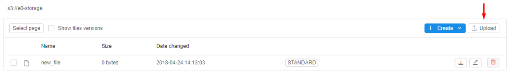
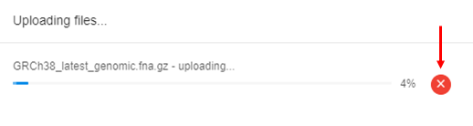
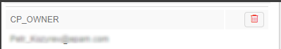
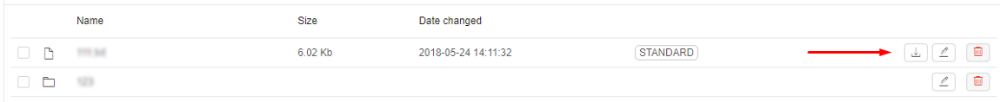
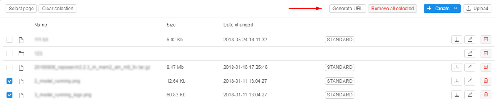
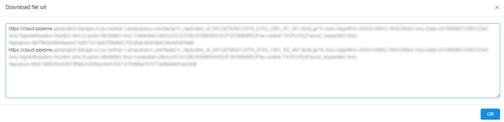

# 8.2. Upload/Download data

- [Upload data](#upload-data)
- [Download data](#download-data)
- [Download as archive](#download-as-archive)
- [Generate URL](#generate-url)

> To edit a **Storage** you need to have **WRITE** permission for the **Storage**. For more information see [13. Permissions](../13_Permissions/13._Permissions.md).
>
> You also can upload and download data via CLI. See [14.3. Manage Storage via CLI](../14_CLI/14.3._Manage_Storage_via_CLI.md#upload-and-download-data).

## Upload data

1. Click **Upload** button in the storage and folder of your choice:  
    
2. Browse file(s) to upload.  
    **_Note_**: make sure size doesn't exceed 5 Gb.  
    **_Note_**: you can cancel upload process by clicking the **"Cancel"** button.  
    
3. As a result, the file will be uploaded to the CP system.  
    **Note:** the uploaded file will be tagged with auto-created attribute:  
    - **CP\_OWNER**. The value of the attribute will be set as a user ID.  
        The exception is that the storage is based on FS mount. Files in such data storage don't have attributes at all.

    

## Download data

1. Click the **Download** button next to a file name.  
    
2. Specify where to download in the pop-up window.
3. As a result, the file will be downloaded via your browser to the specified location.

## Download as archive

Besides downloading files one by one (see [Download data](#download-data) above), a selection of files **and folders** can be downloaded as a single `ZIP` archive. This is the only download option that accepts folders. The plain **Download** item ignores any folder in the selection and works on the selected files alone, and it is offered for **one to three** of them - four files or more are covered by **Download archive** alone. Conversely, **Download archive** is the item that disappears for a single selected **file**, which **Download** and the file's own row button (see [Download data](#download-data) above) already cover; for a single selected **folder** it stays, being the only way to download one.

1. Select one or more files and/or folders in the storage using checkboxes.
2. Click the selection button (shown as **"N items selected"**) and choose the **Download archive** item. Where the selection also holds one to three downloadable files, it is listed right next to **Download** - any folders among them are not counted towards that. A selection of exactly one file is the one case with no **Download archive** item; a selection of four files or more is the one case with no **Download** item.  
    **_Note_**: this describes a regular object storage. A sequence (omics) store offers neither of these two items - it has a **Download** item of its own instead, with no limit on how many items it takes.
3. In the appeared pop-up, edit the **Archive name** field, or leave it as is. What it is pre-filled with depends on the selection: the name of the single file or folder you selected, e.g. `report.csv.zip`, or - for a selection of several items - a name built from the current date and time, e.g. `archive-2026-10-21 13-13-02`.  
    **_Note_**: do not add a `.zip` extension yourself - it is appended automatically where it is missing, and never doubled where it is already there.  
    **_Note_**: the name may only contain letters, digits, spaces, underscores (`_`), hyphens (`-`) and periods (`.`). Any other character is rejected with an error message once you confirm.
4. Click **OK** to queue the archive, or **Cancel** to queue nothing.
5. The archive is prepared asynchronously, so confirming only queues a task - it does not download anything right away.  
    **_Note_**: the platform limits how many archive downloads one user may have in progress at once. That limit is counted when you click **Download archive**, and again when you confirm the pop-up: if you are already at it, a message says so and nothing is queued - wait for one of them to finish, or cancel one. The count comes from the server each time, so it includes archives you queued in another browser tab or on another computer.
6. Open the **Downloads** window to track and manage the queued archive-download task(s). It is not a page of its own: click the button with the grid icon, among the buttons at the top right of the storage view, to open the presentation dropdown, and choose **Show downloads** - it is the last item in that menu.  
    For each task, the window shows the archive name (with its `.zip` extension) followed by how many items went into it, e.g. `report.zip (3 items)` - hover the name to list them - plus the storage, the archive's size once it is known, the current status (colour-coded, with a spinner while the task is still active), and when the task was created and (once finished) completed.  
    The table can be filtered by status - via a checkbox filter on the **Status** column's own header - and, for an administrator or a user with the **ROLE_STORAGE_ADMIN** role, by the task's owner, via a matching filter on the **Owner** column's own header; anyone else sees neither that column nor its filter, and always sees their own tasks.  
    **_Note_**: a **ROLE_STORAGE_ADMIN** who is not a full administrator sees the **Owner** column and its filter, but only ever gets their own tasks back from them - neither picking another owner nor clearing the filter widens what the server returns for this role.  
    The table is also paged: once more tasks match than fit on one page, numbered page controls appear underneath it, and they cover every matching task rather than only the page on screen.  
    **_Note_**: by default the table shows every status *except* cancelled and expired, and - for an administrator - only your own tasks. To see a cancelled or expired task, tick it in the **Status** column's filter as well; a full administrator clears the **Owner** filter to see every user's tasks.  
    **_Note_**: the table refreshes itself every few seconds while the window is open, so a task that finishes updates its own row without any action from you.
7. While a task is still active, click **Cancel** on its row to request its cancellation.  
    **_Note_**: a task that has not started yet is cancelled right away. A task that is already running is only *asked* to stop, so its status may stay `CANCEL_REQUESTED`/`STOPPING` for a while before it actually does.
8. A notification appears whenever one of your archive-download tasks finishes - successfully or with an error - whichever page you are on at that moment, except while the **Downloads** window is open, where the task's own row shows the outcome instead.  
    The notification raised when an archive is queued reads `Archive download has been queued. It will appear under "Show downloads" once it is ready.` - it names the menu item from step 6 above rather than linking anywhere.  
    For a finished archive, the notification reads `Archive "<name>" is ready. Download it now.`, where **Download it** is a link that fetches the archive there and then. Unlike the queued notification (and unlike most other notifications in the application), it does **not** disappear on its own: it stays on screen until you click it - either the message text itself or the **Download it** link, which dismisses it as well as starting the download.  
    **_Note_**: the browser remembers which of your tasks it is waiting on, so closing the tab or reloading the page does not cost you the notification - it appears when you come back, however long afterwards that is. Tasks queued on another computer are picked up as well, when the application is opened. A task is only waited on for the user who is signed in, so signing in as someone else on a shared computer stops the previous user's notifications there.
9. Once a task succeeds, click **Download** on its row in the **Downloads** window to fetch the resulting archive via your browser.  
    **_Note_**: the download link for a finished archive expires after some time - see the preference mentioned below.

The following limits for archive downloads are controlled by the admin via the `storage.download.archive.config` preference. They are deployment-specific and are therefore not given concrete values here:

- the total size of the archive (`maxSizeBytes`)
- the number of files and folders it may contain (`maxFilesCount`)
- how long a finished archive is kept before it expires (`ttlDays`)
- how many archive-download tasks a single user may have in progress at once (`maxUserTasks`)

## Generate URL

You can use this to generate URLs for a number of files and then download them manually one by one or via scripts.

1. Select files using a checkbox.
2. Click the **Generate URL** button.  
    
3. A list of URLs (one for each file) will be generated.  
    