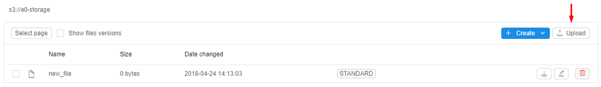
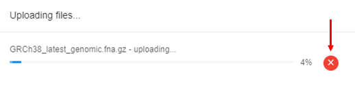
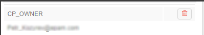
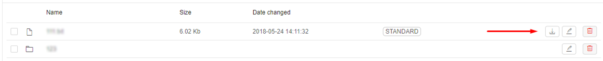
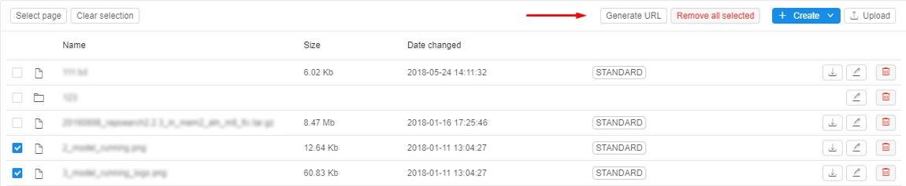
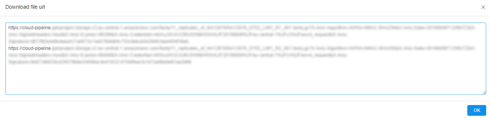

# 8.2. Upload/Download data

- [Upload data](#upload-data)
- [Download data](#download-data)
- [Download as archive](#download-as-archive)
- [Generate URL](#generate-url)

> To edit a **Storage** you need to have **WRITE** permission for the **Storage**. For more information see [13. Permissions](../13_Permissions/13._Permissions.md).
>
> You also can upload and download data via CLI. See [14.3. Manage Storage via CLI](../14_CLI/14.3._Manage_Storage_via_CLI.md#upload-and-download-data).

## Upload data

1. Click **Upload** button in the storage and folder of your choice:  
    
2. Browse file(s) to upload.  
    **_Note_**: make sure size doesn't exceed 5 Gb.  
    **_Note_**: you can cancel upload process by clicking the **"Cancel"** button.  
    
3. If the files you picked include an archive - one of `ZIP`, `TAR`, `TAR.GZ`, `TGZ`, `TAR.BZ2`, `TAR.XZ`, `GZ`, `BZ2` or `XZ`, matched case-insensitively against the file name - and the storage is one where this mode is offered (see the note below), a pop-up appears before anything is uploaded. It lists the name of every file you picked, and offers three buttons:  
    - **Cancel** - uploads nothing and closes the pop-up.
    - **Upload and extract** - uploads every selected file, then queues one background task per archive among them that uploaded successfully, and closes the pop-up the same way an ordinary upload does. Each archive is extracted into a **new folder beside it, named after the archive without its extension**: `data/reports.tar.gz` is extracted into `data/reports/`. An archive that failed to upload, or that you aborted, is skipped. A message confirms how many extractions have been queued, and its **Show storage tasks** is a link that opens the **Storage tasks** window, where each of them is listed as an **Extract archive** task.
    - **Upload** - highlighted as the default action; uploads every selected file exactly as the next step describes, archives included, with no extraction step.  
    **_Note_**: the extraction tasks are queued but not yet carried out - the service that runs them is not part of this version. A queued task is listed in the **Storage tasks** window, stays in its pending state, and no archive is actually extracted. Cancel such a task from that window as you would any other.  
    **_Note_**: the archive itself is kept - extracting it does not delete it. A file already in the destination folder **is** replaced by the archive's own copy of it.  
    **_Note_**: as the pop-up opens it checks your archive-task allowance, and both **Upload** and **Upload and extract** are unavailable for the moment that takes - so a choice made before the answer arrives cannot queue more than the allowance holds. **Cancel** stays available throughout.  
    **_Note_**: one archive is one task, and the platform limits how many archive tasks one user may have in progress at once - the same allowance archive downloads use (see [Download as archive](#download-as-archive) below). The pop-up checks that allowance as it opens, and keeps checking every few seconds while it is open: if you do not have enough of it left for every archive you picked, **Upload and extract** is greyed out and the pop-up shows the reason, leaving **Upload** and **Cancel** to work as usual - the files can still be uploaded, just not extracted. You can wait in the open pop-up for one of your archive tasks to finish, or cancel one in the **Storage tasks** window, and the button becomes available again on its own - there is no need to close the pop-up and pick the files afresh.  
    **_Note_**: this pop-up is offered only for a data storage on AWS S3, or for an NFS storage whose share is mounted as NFS - not for Azure, GCP, or an omics (sequence) store. On any other storage, or for a selection with no archive in it, picking files uploads them right away, as described below.
4. As a result, the file will be uploaded to the CP system.  
    **Note:** the uploaded file will be tagged with auto-created attribute:  
    - **CP\_OWNER**. The value of the attribute will be set as a user ID.  
        The exception is that the storage is based on FS mount. Files in such data storage don't have attributes at all.

    

## Download data

1. Click the **Download** button next to a file name.  
    
2. Specify where to download in the pop-up window.
3. As a result, the file will be downloaded via your browser to the specified location.

## Extract an archive already in the storage

An archive that is already in a storage - whether it was uploaded with **Upload** or put there any other way - is extracted from the storage's own selection menu, with no pop-up in between.

1. Select one or more archive files in the storage using checkboxes. A folder is never an archive, whatever it is called, and is ignored by this item.
2. Click the selection button (shown as **"N items selected"**) and choose the **Extract archive** item, right below **Download archive**.
3. One background task per selected archive is queued at once - there is nothing further to confirm. Each archive is extracted into a new folder beside it, named after the archive without its extension, exactly as [Upload data](#upload-data) above describes, and the archive itself is kept.
4. A message confirms how many extractions have been queued, and its **Show storage tasks** is a link that opens the **Storage tasks** window, where each is listed as an **Extract archive** task.
    **_Note_**: the item is offered only where the pop-up in [Upload data](#upload-data) is - an AWS S3 storage, or an NFS storage whose share is mounted as NFS - and only to a user who may write to the folder, since extracting writes into it. Unlike **Download archive**, it is offered for a single selected file too.
    **_Note_**: the archive-task allowance applies here as well. Where you do not have enough of it left for every archive you selected, the item is greyed out, and an information icon beside it explains why - hover it to read the reason. Wait for one of your archive tasks to finish, or cancel one in the **Storage tasks** window, and open the menu again.

***

## Download as archive

Besides downloading files one by one (see [Download data](#download-data) above), a selection of files **and folders** can be downloaded as a single `ZIP` archive. This is the only download option that accepts folders. The plain **Download** item ignores any folder in the selection and works on the selected files alone, and it is offered for **one to three** of them - four files or more are covered by **Download archive** alone. Conversely, **Download archive** is the item that disappears for a single selected **file**, which **Download** and the file's own row button (see [Download data](#download-data) above) already cover; for a single selected **folder** it stays, being the only way to download one.

1. Select one or more files and/or folders in the storage using checkboxes.
2. Click the selection button (shown as **"N items selected"**) and choose the **Download archive** item. Where the selection also holds one to three downloadable files, it is listed right next to **Download** - any folders among them are not counted towards that. A selection of exactly one file is the one case with no **Download archive** item; a selection of four files or more is the one case with no **Download** item.  
    **_Note_**: **Download archive** is offered only on AWS S3 storages and on NFS storages whose share is mounted as NFS. On other storages (Azure, GCP, or an SMB or Lustre share) there is no **Download archive** item, and **Download** has no limit of three files.  
    **_Note_**: this describes a regular object storage. A sequence (omics) store offers neither of these two items - it has a **Download** item of its own instead, with no limit on how many items it takes.
3. In the appeared pop-up, edit the **Archive name** field, or leave it as is. What it is pre-filled with depends on the selection: the name of the single file or folder you selected, e.g. `report.csv.zip`, or - for a selection of several items - a name built from the current date and time, e.g. `archive-2026-10-21 13-13-02`. The pre-filled name is already restricted to the characters the next note allows, so a selected file or folder whose own name holds other characters is offered with them replaced; where nothing recognisable survives that replacing - a name written entirely in a non-Latin script, for example - the date-and-time name is offered instead, the same as for a selection of several items.  
    **_Note_**: do not add a `.zip` extension yourself - it is appended automatically where it is missing, and never doubled where it is already there.  
    **_Note_**: the name may only contain letters, digits, spaces, underscores (`_`), hyphens (`-`) and periods (`.`). An empty name, or one holding any other character, shows the reason under the **Archive name** field right away and keeps **OK** disabled until the name is fixed.
4. Click **OK** to queue the archive, or **Cancel** to queue nothing. Once you click **OK**, the pop-up blocks every other control - the **Archive name** field, **Cancel**, the close cross, clicking outside the pop-up, and the **Esc** key - and **OK** itself shows a spinner until the server answers.
5. The archive is prepared asynchronously, so confirming only queues a task - it does not download anything right away. The pop-up stays open while the task is being queued, and closes once that succeeds. If queuing fails instead, a notification over the page explains why - the **Archive name** field's own message area, from step 3, only ever shows the naming rule - and the pop-up itself stays open with every control enabled again, so the name can be corrected and **OK** pressed again.  
    **_Note_**: the platform limits how many archive tasks one user may have in progress at once - one allowance, covering every kind of archive task rather than downloads alone. That limit is counted when you click **Download archive**, and again when you confirm the pop-up: if you are already at it, a notification says so, nothing is queued, and the pop-up stays open rather than closing - wait for one of them to finish, or cancel one, then press **OK** again. The count comes from the server each time, so it includes archives you queued in another browser tab or on another computer.
6. Open the **Storage tasks** window to track and manage the queued task(s). It is not a page of its own: click the button with the grid icon, among the buttons at the top right of the storage view, to open the presentation dropdown, and choose **Show storage tasks** - it is the last item in that menu.  
    Every kind of archive task is listed there, named in the **Type** column: **Download archive** for the task this section describes, and **Extract archive** for the one [Upload data](#upload-data) above queues.  
    For a download task, the window shows the archive name (with its `.zip` extension) followed by how many items went into it, e.g. `report.zip (3 items)` - hover the name to list them - plus the storage, the archive's size once it is known, the current status (colour-coded, with a spinner while the task is still active), and when the task was created and (once finished) completed. An extraction task shows the name of the archive being extracted, with no item count, and its size is how much it has written to the storage. Only a download task offers the **Download** button described in step 9 - an extraction writes into the storage itself, so there is nothing to hand over afterwards.  
    The table can be filtered by task type - via a filter on the **Type** column's own header - by status, via a checkbox filter on the **Status** column's own header - and, for an administrator or a user with the **ROLE_STORAGE_ADMIN** role, by the task's owner, via a matching filter on the **Owner** column's own header; anyone else sees neither that column nor its filter, and always sees their own tasks.  
    The **Type** filter offers one option per kind of task, plus **Any type**, and takes one at a time - unlike the **Status** filter, which lists a checkbox per status with a single box above them, separated by a line, that ticks or unticks the whole list at once. That box names what clicking it will do: it reads **Unselect all** only when every status is already ticked, and **Select all** otherwise. Every filter applies what is chosen when you click **OK**, and each offers **Reset to defaults**, which puts that column's own default back (see the note below) - and clicking outside a filter applies it as well, rather than dropping what was chosen.  
    The table is also paged: once more tasks match than fit on one page, numbered page controls appear underneath it, and they cover every matching task rather than only the page on screen.  
    **_Note_**: by default the table shows every task type, every status *except* cancelled and expired, and - for an administrator or a **ROLE_STORAGE_ADMIN** - only your own tasks. To see a cancelled or expired task, tick it in the **Status** column's filter as well. To see every user's tasks, delete the user name from the **Owner** filter's field and click **OK**.  
    **_Note_**: the **Owner** filter takes a user picked from its own suggestion list. While its field holds a name you only typed, the filter says so and applies nothing - by **OK**, by **Enter**, or by clicking outside it. Leaving the field drops such a name: it goes back to the name it held before you typed - empty, if you emptied it first.  
    **_Note_**: unticking *every* status in the **Status** filter does not restore the default - the table then applies no status filter at all, and so shows tasks of every status, cancelled and expired included. **Reset to defaults** is what brings the default selection back.  
    **_Note_**: the table refreshes itself every few seconds while the window is open, so a task that finishes updates its own row without any action from you.
7. While a task is still active, click **Cancel** on its row to request its cancellation.  
    **_Note_**: a task that has not started yet is cancelled right away. A task that is already running is only *asked* to stop, so its status may stay `CANCEL_REQUESTED`/`STOPPING` for a while before it actually does.
8. A notification appears whenever one of your archive tasks finishes - successfully or with an error - whichever page you are on at that moment, except while the **Storage tasks** window is open, where the task's own row shows the outcome instead.  
    A finished extraction reads `Archive "<name>" has been extracted.`, or names the reason it failed. Unlike a finished download it carries no link, since its result is already in the storage; it disappears on its own like any other message.  
    The notification raised when an archive is queued reads `Archive download has been queued. Follow its progress under "Show storage tasks".` - its **Show storage tasks** is a link that opens the window from step 6 above when clicked, rather than only naming the menu item. The task is listed there straight away, in its initial pending state, not only once the archive is ready.  
    For a finished archive, the notification reads `Archive "<name>" is ready. Download it now.`, where **Download it** is a link that fetches the archive there and then. Unlike the queued notification (and unlike most other notifications in the application), it does **not** disappear on its own: it stays on screen until you click it - either the message text itself or the **Download it** link, which dismisses it as well as starting the download.  
    **_Note_**: the browser remembers which of your tasks it is waiting on, so closing the tab or reloading the page does not cost you the notification - it appears when you come back, however long afterwards that is. Tasks queued on another computer are picked up as well, when the application is opened. A task is only waited on for the user who is signed in, so signing in as someone else on a shared computer stops the previous user's notifications there.
9. Once a task succeeds, click **Download** on its row in the **Storage tasks** window to fetch the resulting archive via your browser.  
    **_Note_**: the download link for a finished archive expires after some time - see the preference mentioned below.

The following limits for archive downloads are controlled by the admin via the `system.async.tasks.config` preference. They are deployment-specific and are therefore not given concrete values here:

- the total size of the archive (`tasks.storageDownloadAsArchive.maxSizeBytes`)
- the number of files and folders it may contain (`tasks.storageDownloadAsArchive.maxFilesCount`)
- how long a finished archive is kept before it expires (`tasks.storageDownloadAsArchive.ttlDays`)
- how many archive tasks a single user may have in progress at once (`maxUserTasks`)

**_Note_**: the first three sit in the preference's own `tasks.storageDownloadAsArchive` section, which holds what applies to archive downloads alone. `maxUserTasks` sits above it, at the top level of the preference, because it is a single allowance shared by every kind of archive task rather than a limit on downloads only - the same allowance step 5's note describes.

**_Note_**: unlike that allowance, the size and file-count limits are applied while the task runs, not when it is queued. So a selection over either of them is accepted, and then fails as a task in the **Storage tasks** window - it is not refused by the pop-up.

## Generate URL

You can use this to generate URLs for a number of files and then download them manually one by one or via scripts.

1. Select files using a checkbox.
2. Click the **Generate URL** button.  
    
3. A list of URLs (one for each file) will be generated.  
    