# 9.1. Hot node pools

- [Overview](#overview)
- [Node pools management](#node-pools-management)
    - [Pool creation](#pool-creation)
    - [Future dated node pools](#future-dated-node-pools)
    - [View existing pools](#view-existing-pools)
    - [Edit existing pool](#edit-existing-pool)
    - [Delete existing pool](#delete-existing-pool)
- [Example](#example-of-using)
- [Example of the "autoscaled" node pool](#example-of-using-of-the-autoscaled-node-pool)
- [Pool utilization](#pool-utilization)
    - [Navigation from the Hot node pool tab](#navigation-from-the-hot-node-pool-tab)
    - [Managing preferences](#managing-preferences)

> To create a node pool you need the **ROLE\_ADMIN** or **ROLE\_RUN\_ADMIN** role, or the **ROLE\_NODE\_POOL\_MANAGER** role (restricted to a **Future dated** pool - see [Future dated node pools](#future-dated-node-pools)). To view, edit or remove an existing pool you need **ROLE\_ADMIN** or **ROLE\_RUN\_ADMIN**; a **ROLE\_NODE\_POOL\_MANAGER** may also edit or remove a pool it owns.

For some jobs, a waiting for a node launch can be too long. It is convenient to have some scope of the running nodes in the background that will be always or on schedule be available.

**Cloud Pipeline** allows controlling the number of persistent compute nodes in the cluster - i.e. a certain number (**`cluster.min.size`**) of the nodes of a specified size (**`cluster.instance.type`**/**`cluster.instance.hdd`**) will be always available in the cluster (even if there is no workload) - see details about System Preferences could be applied for the cluster [here](../12_Manage_Settings/12.10._Manage_system-level_settings.md#cluster).  
This is useful to speed up the compute instances creation process (as the nodes are already up and running).  
But this mechanism can be expanded and be a bit more flexible by another platform ability - it is the ability to create "**_hot node pools_**".

## Overview

Administrators and users with the **ROLE\_RUN\_ADMIN** role can create and manage node pools in either mode. A user with the **ROLE\_NODE\_POOL\_MANAGER** role can also create a **Future dated** node pool (see [Future dated node pools](#future-dated-node-pools)), and can open, edit or remove a pool they own, but cannot reach a pool owned by somebody else:

- each pool contains _one or several identical nodes_ - admin specifies the node configuration (instance type, disk, Cloud Region, etc.) and a corresponding number of such nodes. This count can be fixed or flexible ("autoscaled")
- each pool has _the schedule of these nodes creation/termination_. E.g. the majority of the new compute jobs are started during the workday, so no need to keep these persistent instances over the weekends. For the pool, several schedules can be specified
- for each pool can be configured additional filters - to restrict its usage by the specific users/groups or for the specific pipelines/tools etc.

When the pool is created, corresponding nodes are being up (_according to pool's schedule(s)_) and waiting in background. If the user starts a job in this time and the instance requested for a job matches to the pool's node - such running node from the pool is automatically being assigned to the job.

**_Note_**: removing an existing pool is available only for admins and **ROLE\_RUN\_ADMIN**, who may also view and edit any pool. Creating a **Future dated** node pool is also available to a **ROLE\_NODE\_POOL\_MANAGER**, who may additionally view and edit the pools it owns - see [Future dated node pools](#future-dated-node-pools). Usage of pool nodes is available for any user.

## Node pools management

For the node pools management a new tab is implemented in the **Cluster State** section - **HOT NODE POOLS** tab:  
    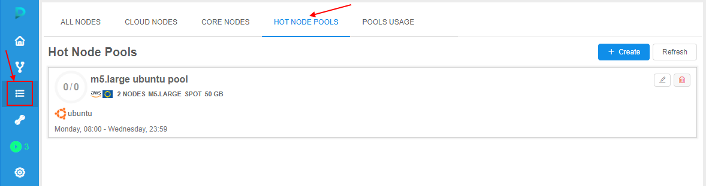

**_Note_**: the **HOT NODE POOLS** tab is shown to admins and to users with the **ROLE\_RUN\_ADMIN**, **ROLE\_CLUSTER\_READER** or **ROLE\_NODE\_POOL\_MANAGER** role - a **ROLE\_NODE\_POOL\_MANAGER** reaches it to create a **Future dated** pool. The neighbouring **POOLS USAGE** tab is shown to admins and to the **ROLE\_CLUSTER\_READER** role.

### Pool creation

To create a new pool:

1. At the **HOT NODE POOLS** tab, click the "**+ Create**" button.
2. The pop-up appears:  
    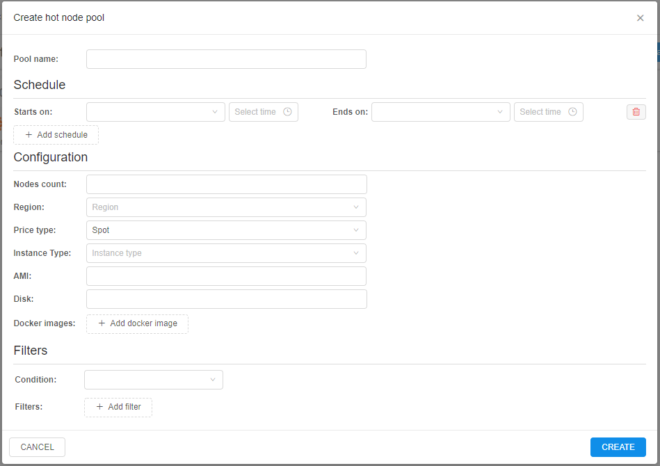
3. Specify the pool name
4. Specify the **Pool type**:
    - **Standard** - a pool node runs one job at a time, as every pool does today.
    - **Shareable node** - several jobs may share one pool node, which the platform divides between them.  
    The pool type is chosen when the pool is created and cannot be changed afterwards.
5. Specify the pool schedule - weekly time period during which the pool nodes will be up (running and waiting for the jobs):
    - specify the day of the week and the time of the day for the _beginning_ of the period, e.g.:  
        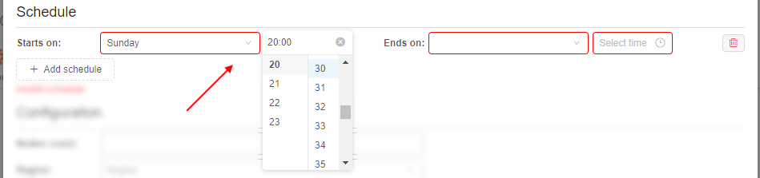
    - specify the day of the week and the time of the day for the _finish_ of the period, e.g.:  
        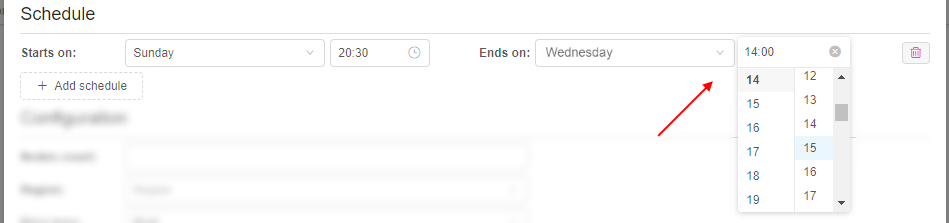
    - if you wish, you can add several schedule periods for the pool. For that, click the "**+ Add schedule**" button and repeats actions described above for a new period:  
        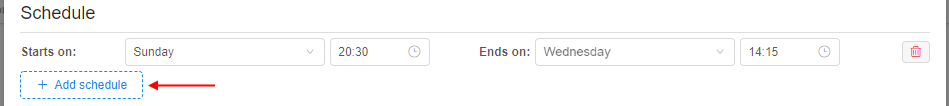
    - remove the unnecessary schedule you can by the corresponding button  next to the schedule  
    **_Note_**: the pool shall have at least one schedule
6. Specify the pool nodes count, e.g.:  
    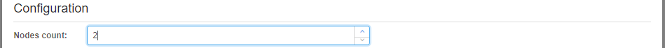  
    It is the number of nodes in the creating pool (nodes count that will be run according to the schedule and wait for jobs).  
    Also you can set the checkbox **Autoscaled** - it allows to create instance pools with _non-static_ size. In such case, the node pool size will be automatically adjust according to current cluster workload: increase pool size if most of its instances are assigned to active runs and decrease pool size if most of its instances are idle:
    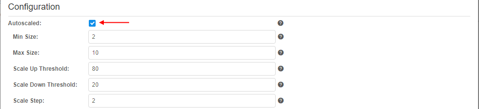  
    In case of **Autoscaled** node pool, additional fields appear:  
    - **_Min Size_** - pool size cannot be decreased below this value. This count of nodes will be always run in cluster (_according to the schedule(s)_)
    - **_Max Size_** - pool size cannot be increased above this value
    - **_Scale Up Threshold_** - sets the threshold in percent. If percent of occupied instances of the pool is higher than this value, pool size shall be increased
    - **_Scale Down Threshold_** - sets the threshold in percent. If percent of occupied instances of the pool is lower than this value, pool size shall be decreased
    - **_Scale Step_** - pool size shall be decreased/increased with this step
7. Specify the **Cloud Provider**/**Region** from where the pool nodes will be run:  
    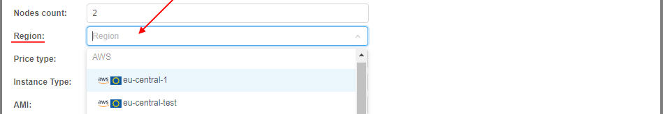
8. Specify the price type for the pool nodes (_Spot_ by default):  
    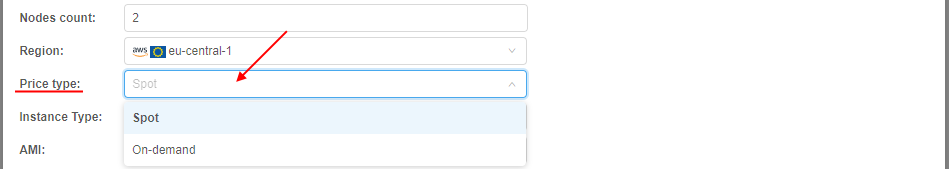
9. Specify the instance type that will be used for the pool nodes:  
    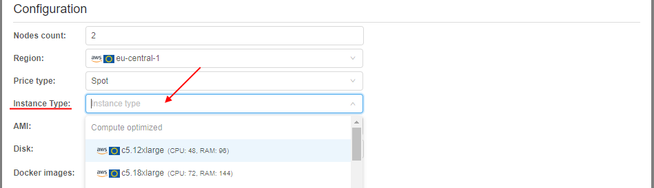
10. If you wish, you may specify the **AMI** that will be used for the pool nodes. It is non-required. Without specifying - the default deployment **AMI** will be used.
11. Specify the disk size (in `Gb`) for the pool nodes, e.g.:  
    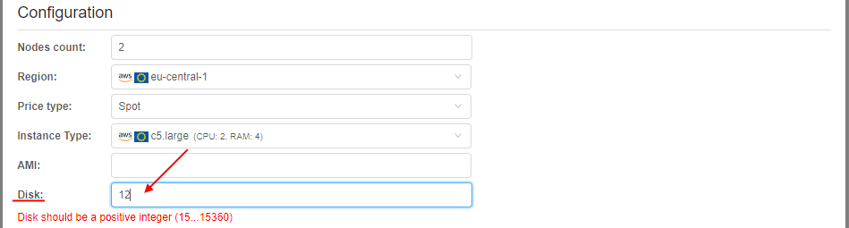  
    **_Note_**: the pool node will be assign to the job only if user request for a job a smaller disk than pool node has. Also note that the _real_ disk size used for a job differs upwards from the user request - both these notes should be considered. E.g. if user requests 30 GB disk, _real_ node disk may be 40 GB. Then if the pool node has disk setting 35 GB - it will not be assigned to the user job (as the _real_ disk size 40 GB is more than the pool node disk size 35 GB). But if the pool node has disk setting 45 GB - it **will be** assigned normally to the user job. So, the pool disk should be set with a margin - of course, if the admin knows the disk size usually requested by the user.  
    On the other hand, the pool node disk size can be purposely set as a large volume. In that case, it would be inefficient to use such pool nodes for user "small" requests. For resolve that issue, the certain system preference is implemented - **`cluster.reassign.disk.delta`** - this delta sets the **max** possible difference that could be between the pool node disk size and the _real_ disk size requested by the user for a job. E.g. if the _real_ disk size requested by the user is 100 GB, the pool node has disk setting 500 GB and **`cluster.reassign.disk.delta`** is set 300 GB - the pool node will not be assigned to the such user requested job (as the difference is more than delta). But if the _real_ disk size requested by the user is 250 GB - the pool node **will be** assigned to the such requested job.
12. Specify Docker image(s) that should be pre-uploaded to the pool nodes:
    - click the "**+ Add docker image**" button:  
        
    - select the image in the appeared dropdown list, e.g.:  
        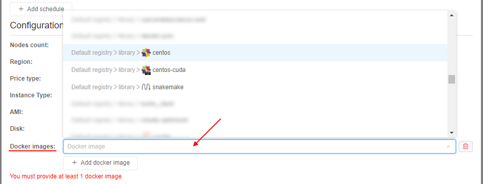
    - select the image version in the appeared additional dropdown list:  
        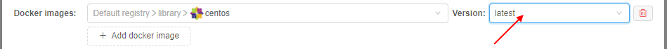
    - you may add several images analogically as described above  
    **_Note_**: at least one Docker image shall be added. Select of these images means that they will be pre-uploaded to the pool nodes. But such nodes also can be assigned to other jobs (with non-selected images) if other pool settings match the user request. In this case necessary requested image will be uploaded during the job initialization (so, it will just take longer).
13. If you wish you can set additional filters for the pool usage. They can be customized at the **Filters** panel:  
    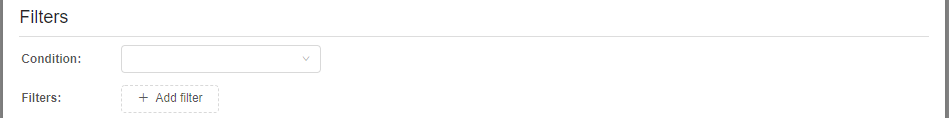  
    **Condition** field allows to set which condition will use for the set filters:  
        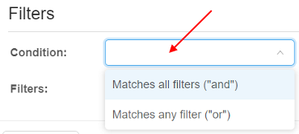  
    **Filters** section allows to add any count of additional filters for the created pool.  
    Click the button  to add a filter.  
    In the appeared field select a property that will be used for the filtering:  
        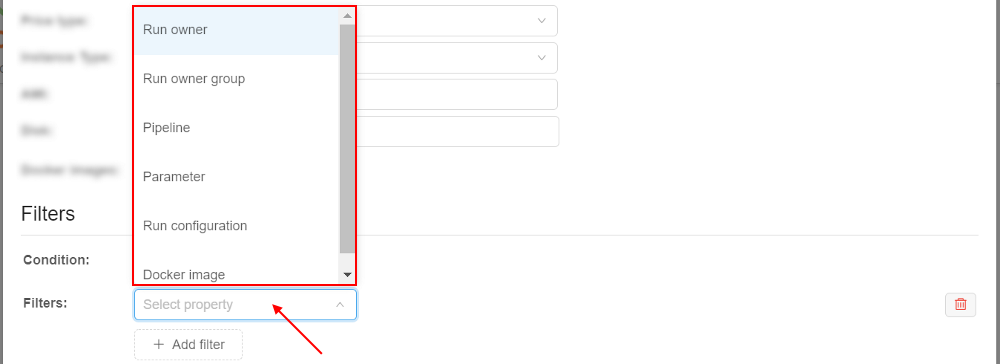  
    Possible properties:  
    - **Run owner** - allows to set user restrictions for the current pool usage
    - **Run owner group** - allows to set user group restrictions for the current pool usage
    - **Pipeline** - allows to set pipeline restrictions for the current pool usage
    - **Parameter** - allows to set parameter (and its value) restrictions for the current pool usage
    - **Run configuration** - allows to set detach configuration restrictions for the current pool usage
    - **Docker image** - allows to set docker image restrictions for the current pool usage  
    Set the desired property in the list, e.g.:  
        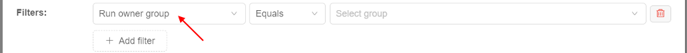  
    For the selected property set the condition:  
        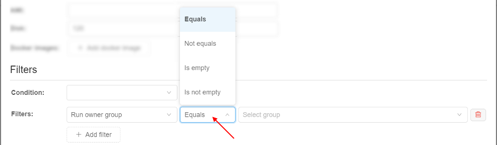  
    For the selected property specify/select the value, e.g.:  
        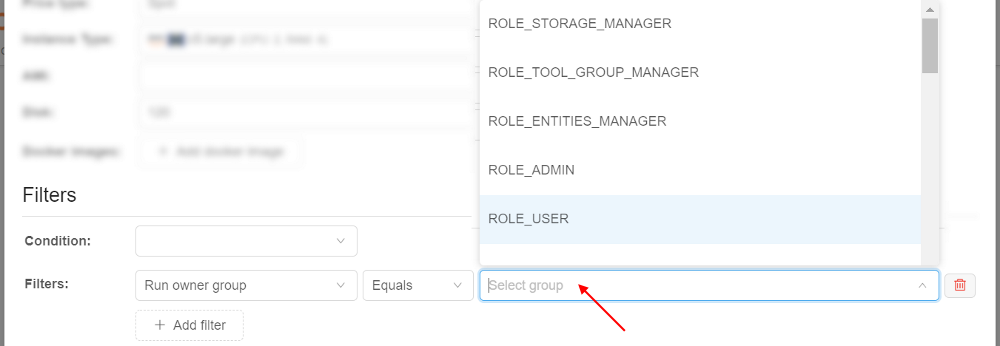  
    You can select any count of properties in the same way as described above, e.g.:  
        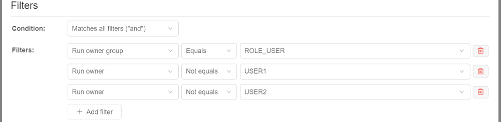  
    In the example above, nodes from the pool will be assigned to the job only if it will be launched by any user (except _USER1_ and _USER2_) with the _ROLE\_USER_ role (of course, if other settings match).  
    To remove the filter use the corresponding button  in the filter row
14. To confirm the pool creation, click the **CREATE** button. While the pool is being created, that button shows a progress indicator and the whole form is blocked - every field, the **Add schedule** button and the schedule rows included - so the request cannot be sent twice or the form edited while it runs. The **SAVE** button of an existing pool behaves the same way
15. Created pool will appear in the list:  
    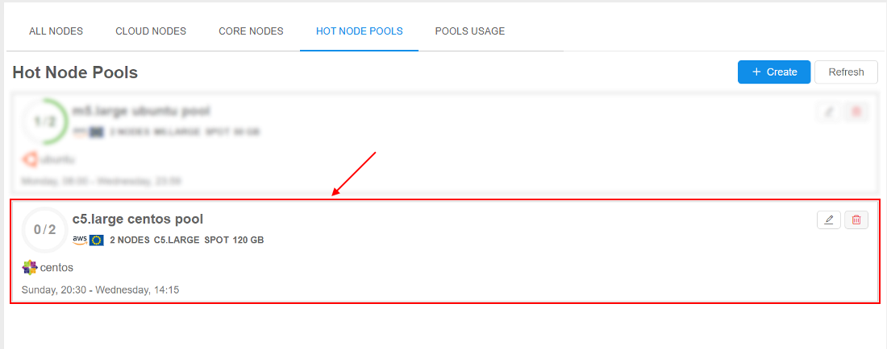

### Future dated node pools

1. At the **HOT NODE POOLS** tab, click the "**+ Create**" button. The pop-up now starts with a **Mode** field:
    - **Default** - the pool described in [Pool creation](#pool-creation) above. This is the preselected value.
    - **Future dated** - a pool that reserves a block of capacity for a single, one-time commitment window instead of a weekly recurring schedule.  
    **_Note_**: **Mode** can only be chosen while creating a pool - it is disabled when [editing](#edit-existing-pool) an existing pool. Reopening an existing **Future dated** pool correctly shows **Future dated**, not **Default**.
2. Both pool types from [Pool creation](#pool-creation) are available in **Future dated** mode. A **new** **Future dated** pool opens with its **Filters** panel already pre-filled with one criterion - **Run owner** **Equals** `<your login>` - and the **Condition** set to `Matches all filters ("and")`. This is a starting point, not a locked value: you may edit or remove it, and it applies the same way for either pool type. Opening an *existing* pool for editing never re-adds or changes this criterion, so it is never rewritten to whoever happens to open the pool.
3. For a **Future dated** pool, the **Schedule** panel shows a single one-time commitment window instead of the weekly recurring schedule:
    - **Search from** - the earliest moment the reservation may begin. Together with **Search until** it defines a search window: the cloud provider reserves the requested **Duration (days)** somewhere inside that window, as soon as matching capacity becomes available, so the dates actually granted are chosen for the reservation, not these two values. **Search from** must be between **5** and **120** days from now.
    - **Search until** - the end of the search window; the reservation must finish by then. It must be later than **Search from**.
    - **Duration (days)** - the committed length, in whole days, with a minimum of **14**. It must fit between **Search from** and **Search until**. A hint under the fields tells you whether the current window covers the duration.
4. The following constraints also apply when creating a **Future dated** pool:
    - **Spot pricing is not available** - only on-demand price type can be used for a reservation.
    - **Nodes count must be at least 1** when you create the pool - but once created, **the pool shows no nodes until the reservation is activated**: the platform sets the pool's node count to the reserved amount when the reservation starts, and back to zero once it ends.
    - **Autoscaling is not available for Future dated pools** - the **Autoscaled** checkbox and its settings (described in step 6 of [Pool creation](#pool-creation)) are not shown. A **Future dated** pool always keeps the fixed pool nodes count.
5. The rest of the pool settings - **Cloud Provider**/**Region**, instance type, **AMI**, disk size, docker images, node labels - are specified exactly as for a **Default** pool (price type is restricted as described in step 4 above).
6. Click the **CREATE** button to confirm. The reservation is **submitted to the platform for approval** rather than applied immediately, and the platform may still reject it for provider-side limits (for example a minimum total vCPU count, or an instance family that is not allowed for reservations) - in which case the error is reported right after clicking **CREATE**.

**Who may create what**: administrators and users with the **ROLE_RUN_ADMIN** role can create pools in either mode, and can view, edit or remove any existing pool. A user with the **ROLE_NODE_POOL_MANAGER** role also sees the "**+ Create**" button, but can create **Future dated** pools only - the **Mode** field is not shown to such a user. Such a user may open, edit or remove the pools it owns, which are the ones it created, and cannot reach a pool owned by anybody else. Node pools are becoming permission-managed, shareable objects on the backend, but the GUI does not yet expose per-pool sharing, so ownership is the whole of a **ROLE_NODE_POOL_MANAGER**'s access to an existing pool.

Reopening an existing **Future dated** pool whose reservation has already been scheduled shows the granted window as read-only text under **Reservation window:**, instead of the editable **Search from** / **Search until** / **Duration (days)** controls. If the reservation has not been scheduled yet, those three controls are shown instead, as read-only (disabled) controls carrying the originally requested values, together with a notice stating what the reservation is doing - waiting for an administrator's approval, waiting to be placed with the cloud provider, being assessed by it - or, where it will never be placed, why: the reservation was cancelled, failed, or has ended. **Nodes count** is shown as read-only text in the form `0 out of N` (N being the reserved instance count), because the pool's own node count stays `0` until the reservation is activated. The price type is also disabled on an existing reservation pool, because neither it nor the window can be changed through this form once the pool exists.

### View existing pools

At the **HOT NODE POOLS** tab, you can view all existing node pools, their schedules, settings, states.

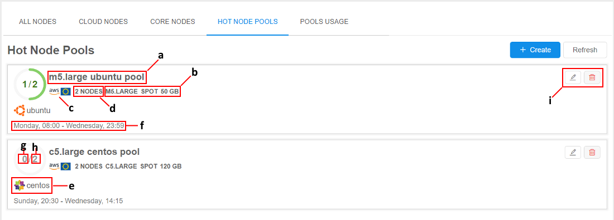

Where:

- **a** - pool name
- **b** - pool nodes settings (instance type, price type, disk size)
- **c** - pool nodes **Cloud Provider** / **Region**
- **d** - the summary count of nodes in the pool. In case of "autoscaled" pool, this count is displayed as an interval, e.g.: 
- **e** - the list of pre-uploaded docker images on the pool nodes
- **f** - the list of pool schedules
- **g** - the count of pool nodes assigned to jobs in the current moment
- **h** - the summary count of pool nodes running in the current moment (in background or assigned to jobs)
- **i** - controls to edit/remove the pool, and to open its utilization. Each appears only where it can be used: editing and removing for an administrator, a **ROLE\_RUN\_ADMIN** or the pool's owner, and the utilization chart for whoever may open the **Pools usage** tab behind it - an administrator, a **ROLE\_RUN\_ADMIN** or a **ROLE\_CLUSTER\_READER**

A **Future dated** pool's card additionally carries a reservation badge, reflecting the reservation's own status as reported by the platform - one of _Requires approval_, _Approved_, _Assessing by cloud provider_, _Scheduled_, _Active_, _Finalizing_, _Finished_, _Purchase failed_, _Failed_ or _Cancelled_. While the reservation is not yet activated, the card shows the reserved instance count as its total node count instead of `0` - e.g. `0 / 3` for a reservation of 3 instances, rather than `0 / 0` - and such a pool is still **not** marked `(disabled)`, unlike a **Default** pool with a node count of `0`, which still is.

While a reservation is **Active**, its pool's instance type is offered as reserved capacity on the pipeline launch form - see [6. Manage Pipeline](../06_Manage_Pipeline/6._Manage_Pipeline.md#configuration) - to any user who can read the pool, not only to the one who created it.

To view the pool state, click it in the list, e.g.:  
    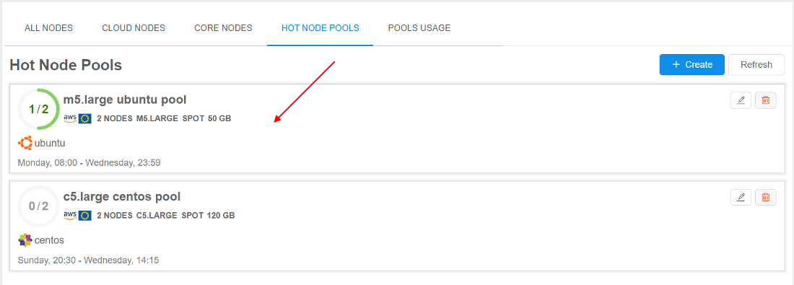

The pool nodes list will appear:  
    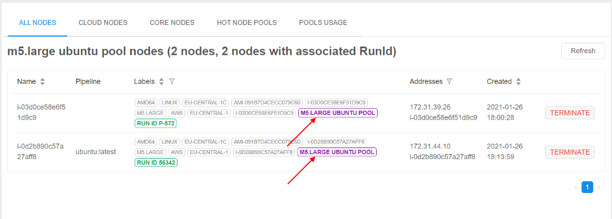  
Nodes from the pool are marked by violet labels with the pool name.  
Pool nodes that are running in background but not assigned to jobs yet have _Run ID_ with format `P-<number>`.

### Edit existing pool

To edit the existing pool, click the corresponding button on its tile:  
    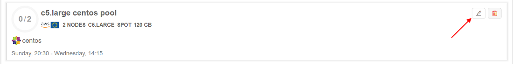

The edit pop-up will be open:  
    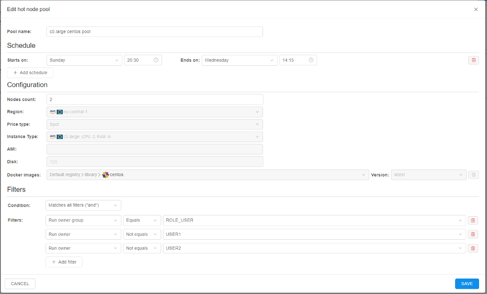  
You can edit only pool name, pool schedules, pool nodes count (and "autoscaled" property/settings) and filters.

Make changes and click the **SAVE** button to confirm.

### Delete existing pool

To delete a pool, click the corresponding button on its tile. A confirmation pop-up asks
"**Are you sure you want to delete "`<pool name>`" pool?**".

For a **Future dated** pool whose capacity reservation is still open - any status but
_Requires approval_, _Finished_, _Purchase failed_, _Failed_ or _Cancelled_ (see
[Future dated node pools](#future-dated-node-pools)) - the pop-up additionally shows a
warning: deleting the pool gives the reservation up too, and the cloud provider may still
charge for the capacity it already committed. The **DELETE** button stays disabled until
the **Force deletion** checkbox is ticked, confirming the deletion is wanted despite that.
This applies equally to an administrator and to the **ROLE_NODE_POOL_MANAGER** who owns the
pool - neither role waives the warning. A **Default** pool, and a **Future dated** one
whose reservation has already reached one of the statuses above, show no warning and no
checkbox: the **DELETE** button is enabled right away.

## Example of using

1. For example, there is the nodes pool that was created as described [above](#pool-creation):  
    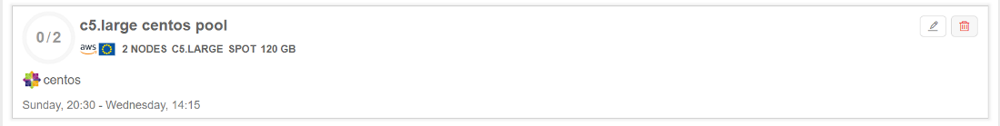
2. User launches the tool (in any time moment according to the schedule) with settings corresponding to pool nodes settings (same region, instance type, price type, smaller _real_ disk size and **in accordance with all configured filters**), e.g.:  
    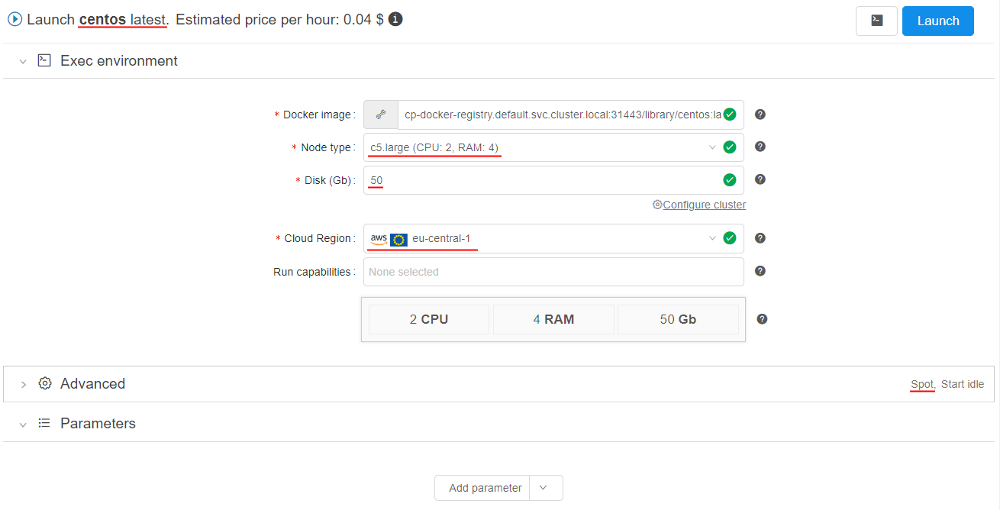
3. After the launch, the system checks if there are any empty nodes in the cluster. If not, then system checks are there any empty nodes in the "**hot node pools**" match the requested job - and uses such hot node pool if it matches:  
    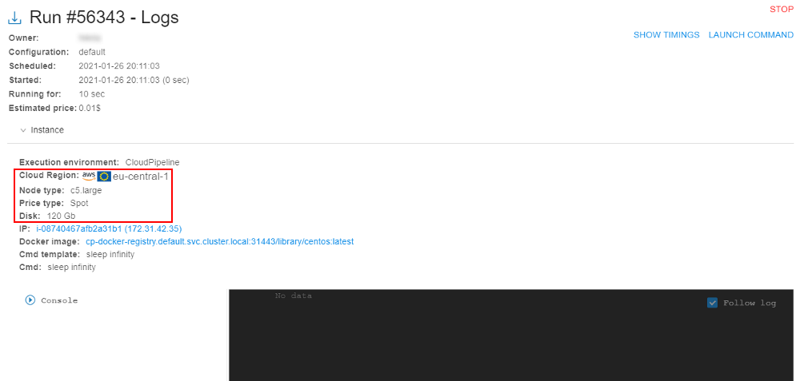  
    So, the running node from the "hot node pool" is assigned to the job after just several seconds.  
    Please note, that the disk was changed according to the configured one for the pool node.
4. Click the **IP** hyperlink to open node info:  
    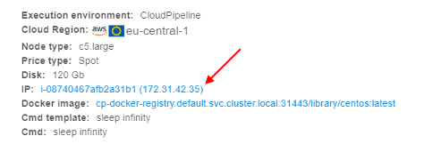
5. At the node monitor page, you can see that it is the node from the pool:  
    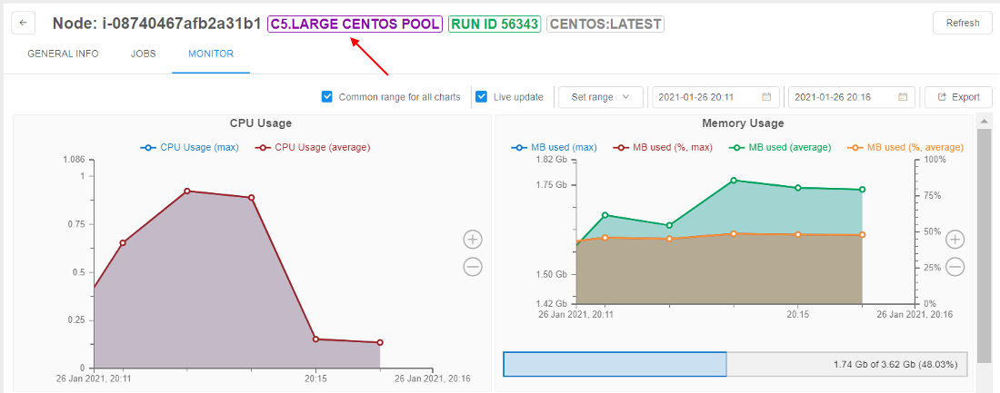
6. Open the **HOT NODE POOLS** tab of the **Cluster state** section:  
    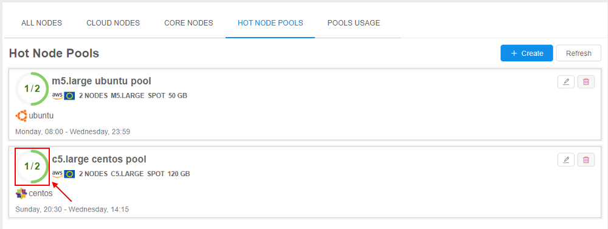  
    See that the pool state is changed (one node from two is occupied).

## Example of using of the "autoscaled" node pool

1. Open the static-size node pool, e.g.:  
    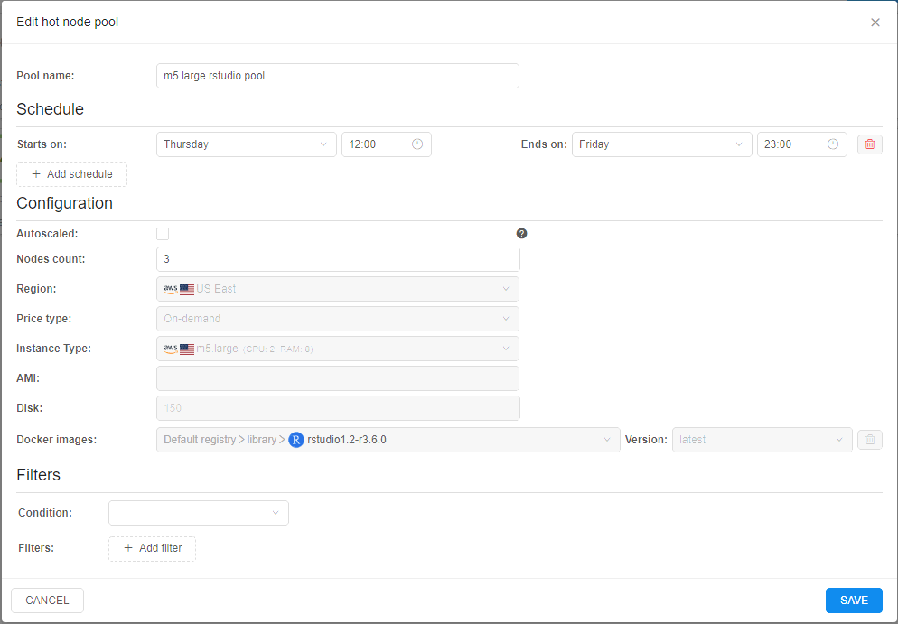
2. Set the **Autoscaled** checkbox
3. Specify the following autoscaled settings:  
    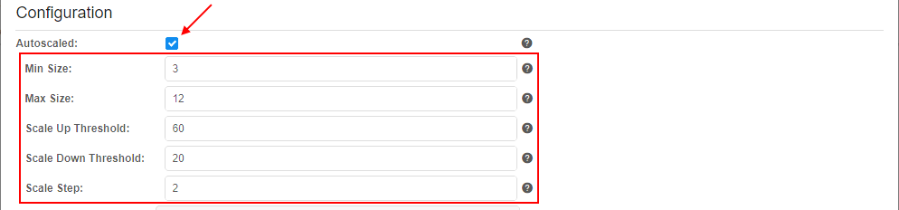
4. Save changes:  
    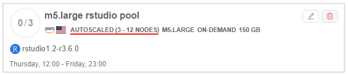
5. Launch at least 2 runs with settings corresponding to pool nodes settings - to occupy 2 of 3 nodes:  
    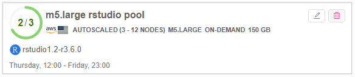
6. As the occupied instances percent of the pool is higher than specified **_Scale Up Threshold_** (60%) - pool size will be automatically increased by the **_Scale Step_** size (2) in some time:  
    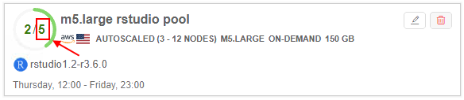  
    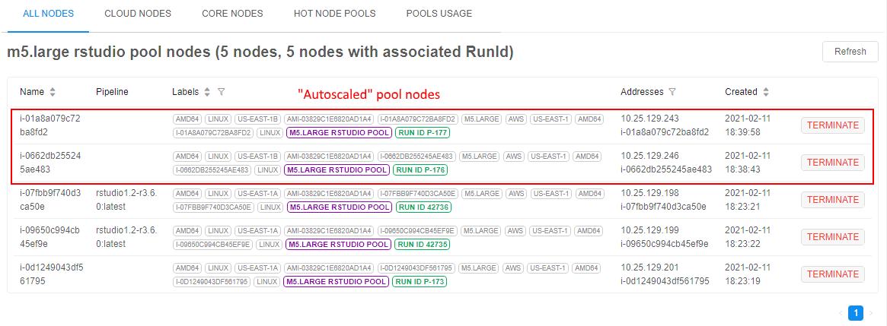

## Pool utilization

Additionally, admins have the following abilities:

- view charts with hot node pools utilization per day/month
- enable a new type of the email notification - about the event when all pool node instances are used

For the viewing of the hot node pool utilization, there is a separate tab **Pools usage** in the **Cluster state** section:  
    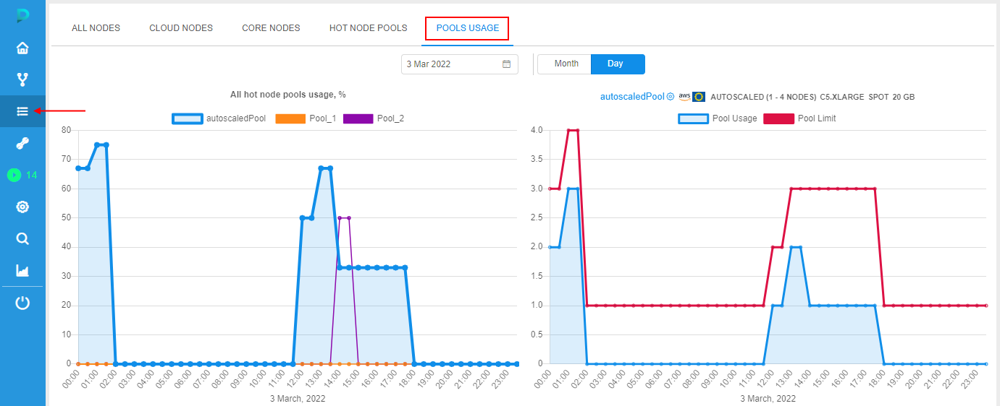

At this tab, there are:

- panel with a chart showing the utilization of all existing hot node pools (_left_ chart):
    - info is being displayed as line chart for each hot node pool - with time on X-axis and pools utilization (in **percent**) on Y-axis
    - user can hover any point of the desired hot node pool - the following info will appear:
        - time range of the point
        - hot node pool name
        - maximum utilization (in _percent_) of that pool on that time range - i.e. the ratio of the maximum number of busy nodes to the total possible number of nodes on that time range  
        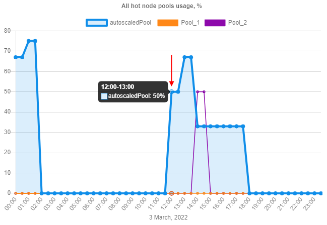
- panel with a chart showing the utilization of a certain selected hot node pool (_right_ chart):
    - info is being displayed as 2 line charts - with time on X-axis and a certain pool utilization (**nodes under load count**) on Y-axis:
        - first line chart (with underlying) - the chart of the selected hot node pool utilization. Hot node pool can be selected by the dropdown list above the diagram. By default, the first hot node pool (by alphabetical ascending sorting) is auto selected. Highlighting of the currently selected pool chart for both diagrams (left and right) is the same
        - second line chart (always red) - the chart of the selected hot node pool limit, i.e. it is the line that shows what was the maximum possible size of the pool at that time range
    - user can hover any point of the selected hot node pool - the following info will appear:
        - time range of the point
        - hot node pool name
        - maximum utilization (nodes under load count) of that pool on that time range  
        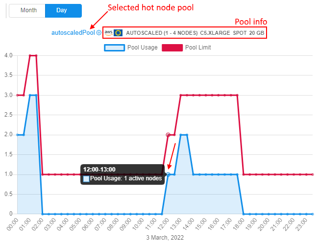
    - user can hover any point of the hot node pool "limit" line - the following info will appear:
        - time range of the point
        - maximum possible size of that pool on that time range (nodes count)  
        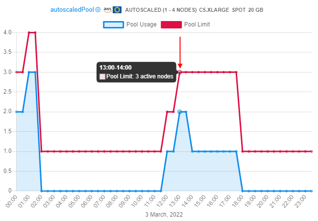

By default, charts are shown for the today. Via the **Calendar** control above the charts, there is the ability to select another day. Charts will be redrawn:  
    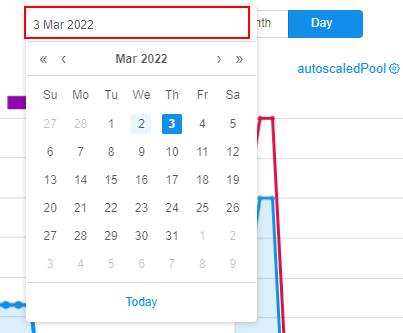

Also, period of the report can be change from the "_Day_" to "_Month_" - by the corresponding control above the charts. In this case, charts will be redrawn for the current month, e.g.:  
    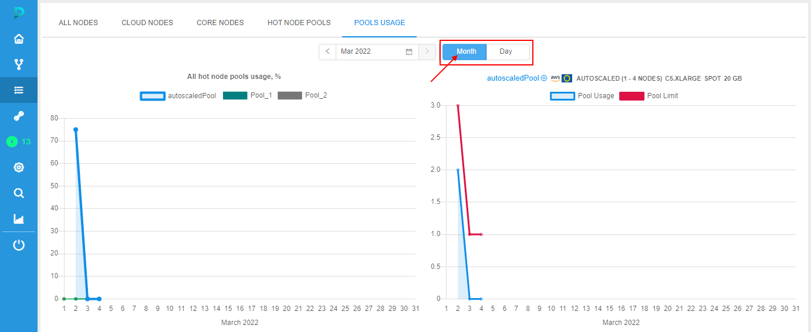

Via the **Calendar** control above the charts, there is the ability to select another month:  
    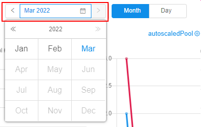

To view details of the another hot node pool utilization - select it in the dropdown above the right chart, e.g.:  
    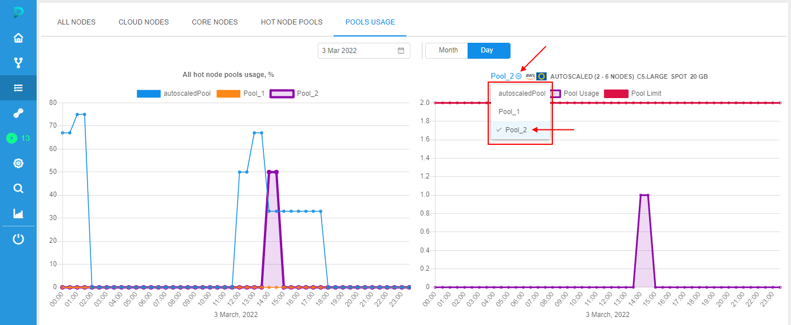

### Navigation from the Hot node pool tab

There is the ability to open the utilization for the certain hot node pool from the **Hot node pools** tab at the **Cluster state** section.  
For that, click the "chart" button at the pool's tile:  
    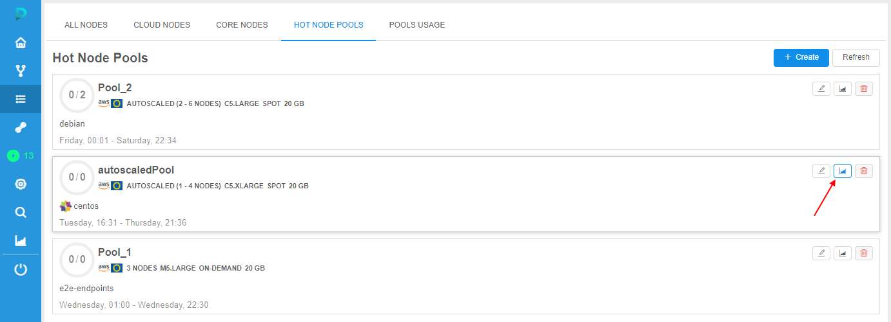

By click this button:

- the **Pools usage** tab will be opened
- at the left panel, the chart showing the utilization of all existing hot node pools will appear
- at the right panel, the chart showing utilization details of the selected hot node pool (that pool at which tile the button was clicked) will appear

### Managing preferences

There are the following system preferences to manage monitoring of the hot node pool usage:

| Preference | Description |
|---|---|
| **`monitoring.node.pool.usage.enable`** | Allows to enable monitoring of the hot node pools usage |
| **`monitoring.node.pool.usage.delay`** | Determines the frequency of pools load measurements (in _milliseconds_). Default - 5 minutes |
| **`monitoring.node.pool.usage.store.days`** | Determines the storing period for the monitoring data (in _days_) - all data older that period will be cleaned if `monitoring.node.pool.usage.clean.enable` set to `true`. Default value - 365 days |
| **`monitoring.node.pool.usage.clean.enable`** | Allows to enable cleaning of the hot node pools usage monitoring data |
| **`monitoring.node.pool.usage.clean.delay`** | Determines the frequency of cleaning of pools usage monitoring data (in _milliseconds_). Data will be cleaned every `monitoring.node.pool.usage.clean.delay` period, if `monitoring.node.pool.usage.clean.enable` is set to `true`. Default value - 24 hours |
