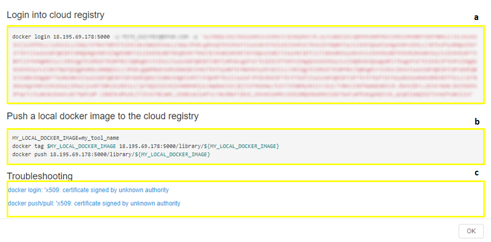
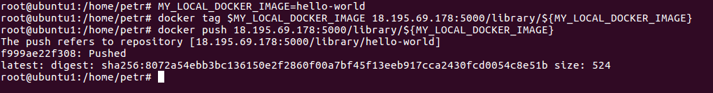
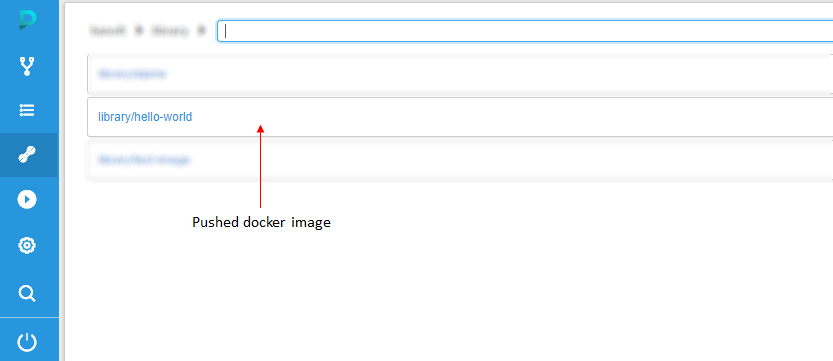
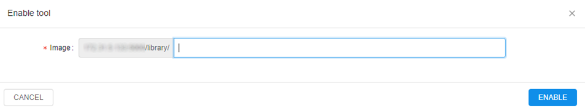

# 10.3. Add a Tool

This page describes the process of adding new Docker image to the Docker registry.

> **Docker CLI** has to be installed.
>
> A registry has to be configured to use **Cloud Pipeline (CP) authentication system** (see [10.1. Add/Edit a Docker registry](10.1._Add_Edit_a_Docker_registry.md)). In case of registry doesn't use CP authentication system - contact your system administrators for registry access details.

1. Go to the **Tools** tab and choose a registry.
2. Click the **Gear** icon → **How to configure?**
3. Copy and paste a command from the **Login into cloud registry** section (**a**) into the Terminal, then run it. This command installs registry certificate and uses docker login command to access the registry.  
    **_Note_**: this command requires "root" rights.  
    

    Copy and run instructions from the **Push a local docker image to the cloud registry** section (**b**) consequentially to add the Tool to the registry:

    1. Create environment variable (**`MY_LOCAL_DOCKER_IMAGE`**) that holds the name of the Docker image;
    2. Tag the image you want to push with the domain name or IP address and the port of the Docker registry;
    3. Push the image to the registry.  
        **_Example_**: here we push "**hello-world**" image to the registry "**18.195.69.178:5000**", "**library**" Tool group.  
        

    **Troubleshooting** section (**c**) contains information about fixing common problems that may appear during the execution of **docker login** or **docker pull/push** commands.

4. Make sure that image was pushed to the registry and enabled in the **Tools** tab.  
    **_Note_**: Tool will be automatically enabled only if CP authentication is configured for the registry.  
    

**_Note_**: If registry doesn't use CP authentication system, after the image was pushed do the following:

1. Navigate to the **Tools** tab.
2. Choose a **Registry** and a **Tool group**.
3. Click the **Gear** icon → **+ Enable Tool**.  
4. Write the name of the pushed image. Registry and Tool group will be already written for you.  
    

## Image requirements

When a run starts, the platform installs its own software into the container of the Tool:

- the platform's Python 3.12 distribution, into `/usr/local/python3.12`. `CP_PYTHON_PATH` points to it
- the `pipeline` Python package (`pipe-common`), with this Python 3.12. The platform's scripts of the run use it
- the `pipe` CLI

So the image of a Tool must meet these requirements:

- **`glibc` 2.17 or later**, e.g. CentOS / RHEL 7, Amazon Linux 2, Ubuntu 16.04, Debian 9 or later, for the platform's Python 3.12, the `pipeline` package and the `pipe` CLI.
- **`tar` with `gzip`**, to unpack the distribution and the package. The run installs `wget` and `curl`, if the image has none.
- **The distribution URL of the platform reachable from the run** (`GLOBAL_DISTRIBUTION_URL`, or `CP_PYTHON3_DISTRO_URL`), unless the image has a Python 3.12 already. The run downloads `tools/python/3/python3.12.tar.gz` from it, without a check of the server certificate.

The Python 3.12 distribution carries its own libraries (OpenSSL, libffi, SQLite, ncurses, libedit and others). So its modules, but `crypt`, need no library of the image besides `glibc`. From the image, they take:

- **`libcrypt.so.1`**, for the `crypt` module. Rocky Linux 9 and RHEL 9 have it only with the `libxcrypt-compat` package. The module is deprecated, and removed in Python 3.13.
- **The CA certificates**, for the `ssl` module: the `/etc/ssl/certs` folder (Debian, Ubuntu) or `/etc/pki/tls/cert.pem` (CentOS, RHEL, Rocky Linux, Amazon Linux). Minimal Debian and Ubuntu images have none until the `ca-certificates` package is installed. `pip` and `requests` work without them: they trust their own CA bundle.
- **The terminfo database**, for the `curses` module: `/etc/terminfo`, `/lib/terminfo` or `/usr/share/terminfo`.

The distribution has no `dbm.gnu`, `dbm.ndbm`, `nis` or `tkinter` modules. Its `readline` module uses libedit.

If the distribution cannot be downloaded, the run uses the Python 3.12 that the image already has: the one in `/usr/local/python3.12` (e.g. an image committed from a run), or else a `python3.12` in `PATH`. If the image has neither, the run fails at startup. A `python3.12` from `PATH` must have `pip` and accept packages, e.g. the one of the `python:3.12` images from Docker Hub. A Python of the OS packages, e.g. `/usr/bin/python3.12` of Ubuntu 24.04, does not do: it has no `pip`, or its `pip` refuses to install into it (PEP 668), and the run fails. The run installs `pipe-common` into that Python with `pip install -I`: this replaces the versions of the packages that `pipe-common` needs (e.g. `requests`, `urllib3`, `cryptography`, `setuptools`, `click`) that the image has there.

### The platform's Python and the Python of the image

In a run, the platform's Python 3.12 comes before the Python of the image:

- The run puts `/usr/local/python3.12/bin` first in `PATH`, for its command and for its SSH sessions (`/etc/cp_env.sh`), and links `/usr/local/bin/python3` and `/usr/local/bin/pip3` to the platform's Python 3.12. It replaces `/usr/local/python3.12` of the image, if it has one, at every start.
- So the image's own `python3` and `pip3` are shadowed in a run and in its SSH sessions, including those of conda (e.g. `/opt/conda/bin`) and of the `python` images from Docker Hub (`/usr/local/bin`). So are the commands of the packages installed into the platform's Python, e.g. `luigi`. `python` and `pip` are not linked: they stay the ones of the image.
- A tool that starts with `#!/usr/bin/env python3` runs on the platform's Python 3.12, and does not see the modules of the image's own Python.
- Packages installed with `pip3` go into the platform's Python 3.12, and are lost at the next run start, also in an image committed from the run. Install them into the image's own Python by its full path (e.g. `/opt/conda/bin/pip`), or into a virtual environment (e.g. `python3 -m venv /opt/venv`), instead.
- To call the Python of the image, use its full path (e.g. `/opt/conda/bin/python3`) or its version (e.g. `python3.11`). To call the platform's Python, e.g. for a script that imports the `pipeline` package, use `$CP_PYTHON_PATH`.

The run keeps `/usr/local/openssl` of the image, unless the distribution has one of its own: `python3.12.tar.gz` has none, the previous `python3.12.0.tar.gz` has one.

### Supported OS families

A run reads the OS of the image from `/etc/os-release`: its `ID` becomes `CP_OS`, and its `VERSION_ID` becomes `CP_VER` (the major version is `CP_VER_MAJOR`). The run and its capabilities set the image up by the OS family, `CP_OS_FAMILY`:

| `CP_OS_FAMILY` | `CP_OS` |
|---|---|
| `rhel` | `centos` (CentOS), `rocky` (Rocky Linux), `rhel` (Red Hat Enterprise Linux, also the UBI images), `fedora`, `ol` (Oracle Linux), `amzn` (Amazon Linux) |
| `debian` | `ubuntu`, `debian` |
| `linux` | any other `ID`, e.g. `alpine` |

Some steps of a run depend on `CP_OS` itself:

- On CentOS, Rocky Linux and RHEL, the run installs the packages of `CP_CAP_EXTRA_PKG_RHEL`, and starts systemd if the run has `CP_CAP_SYSTEMD_CONTAINER` or `CP_CAP_KUBE` and the image has `systemctl`. On Debian and Ubuntu, it installs the packages of `CP_CAP_EXTRA_PKG_DEB`. The packages of `CP_CAP_EXTRA_PKG` are installed on any OS with `apt-get`, `yum` or `apk`.
- On Rocky Linux and RHEL, `procps` is installed as `procps-ng`, and `coreutils` is not installed if the image has `coreutils-single`. Docker in Docker (`CP_CAP_DIND_CONTAINER`) installs docker `20.10.24` there, and `18.09.6` on the other OS, unless `CP_CAP_DIND_VERSION` is set.
- The run adds the Cloud Pipeline package repository (`CP_REPO_ENABLED`) on CentOS, Rocky Linux, Debian and Ubuntu, if it has the packages for that version. The public repository has no RHEL packages. On RHEL, the run adds it only if `CP_REPO_BASE_URL_DEFAULT` (by default `tools/repos` of the distribution URL) has a folder for that RHEL version, e.g. `rhel/8.10`. It checks this once, within `CP_REPO_ACCESS_TIMEOUT_SEC` (30 seconds by default). Otherwise, the run uses the repositories of the image only, and says so in its log.

**RHEL and UBI images.** The UBI images (e.g. `registry.access.redhat.com/ubi8/ubi` and `ubi9/ubi`) have no subscription. So they have the UBI repositories only, which have a part of the RHEL packages. Checked on UBI 8.10 and 9.8, these packages that the run and its capabilities install are not there:

- `e2fsprogs` and `xfsprogs`, for Docker in Docker. Without them, the Docker in Docker setup fails, and its log names them
- `nfs-utils` and `cifs-utils`, for the NFS and SMB mounts

Slurm, Lmod and NICE DCV need many packages that the UBI repositories do not have. They need the RHEL repositories (a subscription) in the image, and EPEL for some packages. E.g.:

- Slurm: `munge`, `mariadb-server`, `pam-devel` and `hwloc-devel`
- Lmod (`CP_CAP_MODULES_TYPE=lmod`): `lua-devel` and `lua-filesystem`, and also `tcl-devel` on UBI 8
- NICE DCV: the X server (`xorg-x11-server-Xorg`), the GNOME packages, and the `Xfce` package group, which is in EPEL

Install such packages into the image when you build it: the run does not install a package again that the image already has.
