# Cloud Pipeline v.0.16 - Release notes

- [Google Cloud Platform Support](#google-cloud-platform-support)
- [System logs](#system-logs)
- [Displaying Cloud Provider's icon](#displaying-cloud-providers-icon-for-the-storagecompute-resources)
- [Configurable timeout of GE Autoscale waiting](#configurable-timeout-of-ge-autoscale-waiting-for-a-worker-node-up)
- [Storage mounts data transfer restrictor](#storage-mounts-data-transfer-restrictor)
- [Extended recursive symlinks handling](#extended-recursive-symlinks-handling)
- [Displaying of the latest commit date/time](#displaying-of-the-latest-commit-datetime)
- [Renaming of the GitLab repository in case of Pipeline renaming](#renaming-of-the-gitlab-repository-in-case-of-pipeline-renaming)
- [Pushing pipeline changes to the GitLab on behalf of the user](#pushing-pipeline-changes-to-the-gitlab-on-behalf-of-the-user)
- [Allowing to expose compute node FS to upload and download files](#allowing-to-expose-compute-node-fs-to-upload-and-download-files)
- [Resource usage form improvement](#resource-usage-form-improvement)
- [View the historical resources utilization](#allow-to-view-the-historical-resources-utilization)
- [Ability to schedule automatic pause/restart of the running jobs](#ability-to-schedule-automatic-pauserestart-of-the-running-jobs)
- [Update pipe CLI version](#update-pipe-cli-version)
- [Blocking/unblocking users and groups](#blockingunblocking-users-and-groups)
- [Displaying additional node metrics](#displaying-additional-node-metrics-at-the-runs-page)
- [Export user list](#export-user-list)
- [Displaying SSH link for the active runs in the Dashboard view](#displaying-ssh-link-for-the-active-runs-in-the-dashboard-view)
- [Enable Slurm for the Cloud Pipeline's clusters](#enable-slurm-workload-manager-for-the-cloud-pipelines-clusters)
- [The ability to generate the `pipe run` command from the GUI](#the-ability-to-generate-the-pipe-run-command-from-the-gui)
- [`pipe` CLI: view tools definitions](#pipe-cli-view-tools-definitions)
- [Storage usage statistics retrieval via `pipe`](#storage-usage-statistics-retrieval-via-pipe)
- [GE Autoscaler respects CPU requirements of the job in the queue](#ge-autoscaler-respects-cpu-requirements-of-the-job-in-the-queue)
- [Search the tool by its version/package name](#the-ability-to-find-the-tool-by-its-versionpackage-name)
- [The ability to restrict which run statuses trigger the email notification](#the-ability-to-restrict-which-run-statuses-trigger-the-email-notification)
- [Restrictions of "other" users permissions for the mounted storage](#restrictions-of-other-users-permissions-for-the-storages-mounted-via-the-pipe-storage-mount-command)
- [Parallel mounting of data storages](#parallel-mounting-of-data-storages)
- [Checking of the Docker image version in `pipe run`](#checking-of-the-docker-image-version-in-pipe-run)
- [`pipe storage mount` waits for the mount point](#pipe-storage-mount-waits-for-the-mount-point)
- [Node start retries for a specific run](#node-start-retries-for-a-specific-run)
- [Group permissions](#group-permissions)
- [Investigate the failure reason of a run](#investigate-the-failure-reason-of-a-run)
- [Run controls for an unavailable node](#run-controls-for-an-unavailable-node)
- [Read and launch access to all pipelines](#read-and-launch-access-to-all-pipelines)
- [Access to the pipeline repositories for the pipeline roles](#access-to-the-pipeline-repositories-for-the-pipeline-roles)
- [GitLab 19 support](#gitlab-19-support)
- [VS Code extension: the folder opened on connect](#vs-code-extension-the-folder-opened-on-connect)
- [The `pipe` CLI on Python 3](#the-pipe-cli-on-python-3)
- [pipe-common requires Python 3.12](#pipe-common-requires-python-312)
- [Runs on Python 3.12](#runs-on-python-312)
- [The API service on Python 3.12 and Rocky Linux 9.8](#the-api-service-on-python-312-and-rocky-linux-98)
- [Rocky Linux 9.8 for the platform services](#rocky-linux-98-for-the-platform-services)
- [Python 3.12 for EDGE, WebDAV, FS Browser and the node reporter](#python-312-for-edge-webdav-fs-browser-and-the-node-reporter)
- [Python 3.12 in the node images](#python-312-in-the-node-images)
- [New and changed certificate files are checked between the daily scans](#new-and-changed-certificate-files-are-checked-between-the-daily-scans)
- [Amazon Linux 2023 node images built with Packer](#amazon-linux-2023-node-images-built-with-packer)

***

- [Notable Bug fixes](#notable-bug-fixes)
    - [Parameter values changes cannot be saved for a tool](#parameter-values-changes-cannot-be-saved-for-a-tool)
    - [Packages are duplicated in the tool's version details](#packages-are-duplicated-in-the-tools-version-details)
    - [Autoscaling cluster can be autopaused](#autoscaling-cluster-can-be-autopaused)
    - [`pipe`: not-handled error while trying to execute commands with invalid config](#pipe-not-handled-error-while-trying-to-execute-commands-with-invalid-config)
    - [Setting of the tool icon size](#setting-of-the-tool-icon-size)
    - [`NPE` while building cloud-specific environment variables for run](#npe-while-building-cloud-specific-environment-variables-for-run)
    - [Worker nodes fail due to mismatch of the regions with the parent run](#worker-nodes-fail-due-to-mismatch-of-the-regions-with-the-parent-run)
    - [Worker nodes shall not be restarted automatically](#worker-nodes-shall-not-be-restarted-automatically)
    - [Uploaded storage file content is downloaded back to client](#uploaded-storage-file-content-is-downloaded-back-to-client)
    - [GUI improperly works with detached configurations in a non-default region](#gui-improperly-works-with-detached-configurations-in-a-non-default-region)
    - [Detached configuration doesn't respect region setting](#detached-configuration-doesnt-respect-region-setting)
    - [Incorrect behavior of the "Transfer to the cloud" form in case when a subfolder has own metadata](#incorrect-behavior-of-the-transfer-to-the-cloud-form-in-case-when-a-subfolder-has-own-metadata)
    - [Incorrect displaying of the "Start idle" checkbox](#incorrect-displaying-of-the-start-idle-checkbox)
    - [Limit check of the maximum cluster size is incorrect](#limit-check-of-the-maximum-cluster-size-is-incorrect)
    - [Fixed cluster with SGE and DIND capabilities fails to start](#fixed-cluster-with-sge-and-dind-capabilities-fails-to-start)
    - [Azure: Server shall check Azure Blob existence when a new storage is created](#azure-server-shall-check-azure-blob-existence-when-a-new-storage-is-created)
    - [Azure: `pipe` CLI cannot transfer empty files between storages](#azure-pipe-cli-cannot-transfer-empty-files-between-storages)
    - [Azure: runs with enabled GE autoscaling doesn't stop](#azure-runs-with-enabled-ge-autoscaling-doesnt-stop)
    - [Incorrect behavior while download files from external resources into several folders](#incorrect-behavior-while-download-files-from-external-resources-into-several-folders)
    - [Detach configuration doesn't setup SGE for a single master run](#detach-configuration-doesnt-setup-sge-for-a-single-master-run)
    - [Broken layouts](#broken-layouts)
    - [Tool version with upper case letters is launched in lower case](#tool-version-with-upper-case-letters-is-launched-in-lower-case)
    - [Launch: a run name alias replaces the run's custom and required tags](#launch-a-run-name-alias-replaces-the-runs-custom-and-required-tags)
    - [New nodes stop being created after failed restarts in another region](#new-nodes-stop-being-created-after-failed-restarts-in-another-region)
    - [A run is restarted in a region where its instance type is not available](#a-run-is-restarted-in-a-region-where-its-instance-type-is-not-available)
    - [Unavailable cluster nodes are not detected](#unavailable-cluster-nodes-are-not-detected)
    - [The `OWNER_HOME` parameter of a run is ignored](#the-owner_home-parameter-of-a-run-is-ignored)
    - [Backup workers cannot copy the backups to the storage](#backup-workers-cannot-copy-the-backups-to-the-storage)
    - [The backup worker of the GitLab database always fails](#the-backup-worker-of-the-gitlab-database-always-fails)
    - [AWS: `pipe storage` commands fail for a storage registered by an S3 access point alias](#aws-pipe-storage-commands-fail-for-a-storage-registered-by-an-s3-access-point-alias)
    - [VS Code extension: the run owner's home folder is not opened on connect](#vs-code-extension-the-run-owners-home-folder-is-not-opened-on-connect)
    - [Users export: the names of the date columns depend on the API time zone](#users-export-the-names-of-the-date-columns-depend-on-the-api-time-zone)
    - [Launch form: the "Add system parameter" dialog drops the selected parameters](#launch-form-the-add-system-parameter-dialog-drops-the-selected-parameters)
    - [Detached configuration: the old name stays in the Library after a rename](#detached-configuration-the-old-name-stays-in-the-library-after-a-rename)
    - [Vulnerable dependencies of the SSH web terminal](#vulnerable-dependencies-of-the-ssh-web-terminal)
    - [The NFS mount observer of the WebDAV service does not start](#the-nfs-mount-observer-of-the-webdav-service-does-not-start)
    - [`sge create` and `sge configure` fail in tools without `diff`](#sge-create-and-sge-configure-fail-in-tools-without-diff)
    - [Vulnerable dependencies of the FS Browser client](#vulnerable-dependencies-of-the-fs-browser-client)
    - [Node reporter: package versions with known security advisories](#node-reporter-package-versions-with-known-security-advisories)
    - [The distribution build passes when the Linux build of the `pipe` CLI fails](#the-distribution-build-passes-when-the-linux-build-of-the-pipe-cli-fails)
    - [Slurm clusters and Rocky Linux runs: the MUNGE key is readable by all users, and other defects](#slurm-clusters-and-rocky-linux-runs-the-munge-key-is-readable-by-all-users-and-other-defects)
    - [A run stays at its start for good when `apt-get update` stalls](#a-run-stays-at-its-start-for-good-when-apt-get-update-stalls)
    - [The node logger and the search services do not use the docker registry login or prefix](#the-node-logger-and-the-search-services-do-not-use-the-docker-registry-login-or-prefix)
    - [A failed backup copy removes a good backup](#a-failed-backup-copy-removes-a-good-backup)
    - [`pipe storage cp` and `mv` fail with a file list on Windows and macOS](#pipe-storage-cp-and-mv-fail-with-a-file-list-on-windows-and-macos)
    - [The pipeline repository is not mounted in a run when `python` is not the Python of the platform](#the-pipeline-repository-is-not-mounted-in-a-run-when-python-is-not-the-python-of-the-platform)
    - [`pipe storage mount`: WebDAV mounts and extended attributes fail in the Windows and macOS builds](#pipe-storage-mount-webdav-mounts-and-extended-attributes-fail-in-the-windows-and-macos-builds)
    - [Runs on Amazon Linux 2023 nodes get no "OOM Logs" task](#runs-on-amazon-linux-2023-nodes-get-no-oom-logs-task)
    - [The notifier log names only the main recipient of an email](#the-notifier-log-names-only-the-main-recipient-of-an-email)
    - [Amazon Linux 2023 nodes do not join the cluster: the Docker install script is not found](#amazon-linux-2023-nodes-do-not-join-the-cluster-the-docker-install-script-is-not-found)
    - [Runs from RHEL images do not get the setup of the RHEL family](#runs-from-rhel-images-do-not-get-the-setup-of-the-rhel-family)
    - [System logs: no security event is stored once the `security_log` alias has no write index](#system-logs-no-security-event-is-stored-once-the-security_log-alias-has-no-write-index)
    - [GUI: library versions with security advisories](#gui-library-versions-with-security-advisories)
    - [GUI: the AWS HealthOmics library brings an XML parser with security advisories](#gui-the-aws-healthomics-library-brings-an-xml-parser-with-security-advisories)
    - [GUI build: the `sass` version is not pinned](#gui-build-the-sass-version-is-not-pinned)
    - [Rocky Linux 9, RHEL 9 and Amazon Linux 2023 runs: `curl-minimal` and `coreutils-single` stop the base packages install](#rocky-linux-9-rhel-9-and-amazon-linux-2023-runs-curl-minimal-and-coreutils-single-stop-the-base-packages-install)
    - [Filebeat of the API and TinyProxy services loads its own index template](#filebeat-of-the-api-and-tinyproxy-services-loads-its-own-index-template)
    - [The VM monitor does not check the open files on Amazon Linux 2023 nodes and other hosts with systemd 240 or later](#the-vm-monitor-does-not-check-the-open-files-on-amazon-linux-2023-nodes-and-other-hosts-with-systemd-240-or-later)
    - [Git synchronization: a new GitLab 9 user has to confirm the email](#git-synchronization-a-new-gitlab-9-user-has-to-confirm-the-email)
    - [The timeout of the API HTTP sessions cannot be set](#the-timeout-of-the-api-http-sessions-cannot-be-set)
    - [A new install points the API at the transport port of the search Elasticsearch](#a-new-install-points-the-api-at-the-transport-port-of-the-search-elasticsearch)

***

## Google Cloud Platform Support

One of the major **`v0.16`** features is a support for the **[Google Cloud Platform](https://cloud.google.com/)**.

All the features, that were previously used for **`AWS`** and **`Azure`**, are now available in all the same manner, from all the same GUI/CLI, for **`GCP`**.

This provides an even greater level of a flexibility to launch different jobs in the locations, closer to the data, with cheaper prices or better compute hardware in depend on a specific task.

## System logs

In the current version, the "Security Logging" was implemented.

Now, the system records audit trail events:

- users' authentication attempts
- users' profiles modifications
- platform objects' permissions management
- access to interactive applications from pipeline runs
- other platform functionality features

Logs are collected/managed at the `Elasticsearch` node and backed up to the object storage (that could be configured during the platform deployment).

The administrator can view/filter these logs via the GUI - in the System-level settings, e.g.:  
    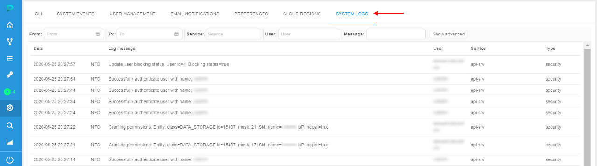

Each record in the logs list contains:

| Field | Description |
|-|-|
| **Date** | The date and time of the log event |
| **Log status** | The status of the log message (`INFO`, `ERROR`, etc.) |
| **Log message** | Description of the log event |
| **User** | User name who performed the event |
| **Service** | Service name that registered the event (`api-srv`, `edge`) |
| **Type** | Log message type (currently, only `security` type is available) |

For more details see [here](../../manual/12_Manage_Settings/12._Manage_Settings.md#system-logs).

## Displaying Cloud Provider's icon for the storage/compute resources

As presented in **[v0.15](../v.0.15/v.0.15_-_Release_notes.md#microsoft-azure-support)**, Cloud Pipeline can manage multi Cloud Providers in a single installation.

In the current version, useful icon-hints with the information about using Cloud Provider are introduced.  
If a specific platform deployment has a number of Cloud Providers registered (e.g. `AWS`+`Azure`, `GCP`+`Azure`) - corresponding icons/text information are displaying next to the cloud resource.

Such cloud resources are:

- **`Object/File Storages`** (icons in the **Library**, at the "DATA" panel of the **Dashboard** etc.)  
    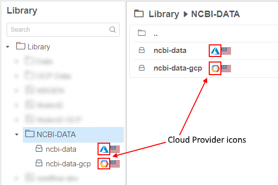  
    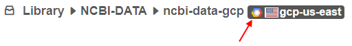
- **`Regions`** (icons in the **Cloud Regions** configuration, at the **Launch** form etc.)  
    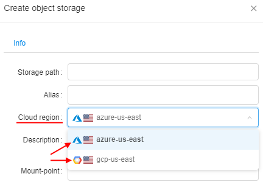  
    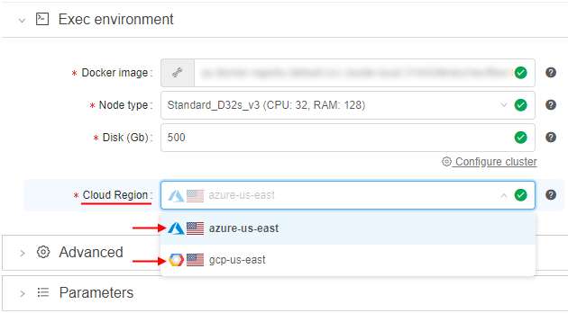  
- **`Running jobs`**:
    - text hints (at the **RUNS** page)  
        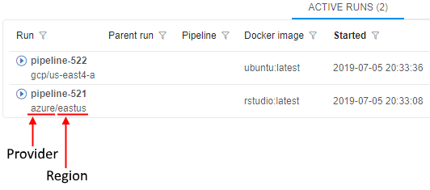
    - icons (at the **Run logs** page, at the "RUNS" panels of the **Dashboard**)  
        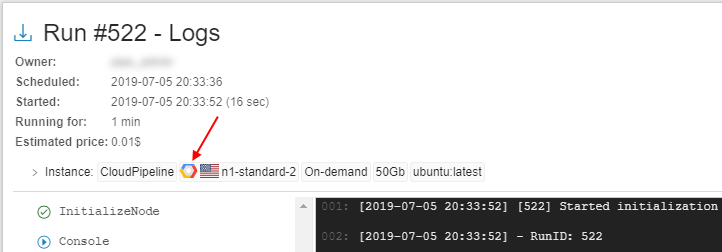  
        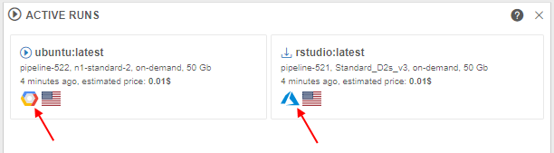

> **_Note_**: this feature is not available for deployments with a **_single_** Cloud Provider.

Examples of displaying Cloud Region icons/info see in sections [6. Manage Pipeline](../../manual/06_Manage_Pipeline/6._Manage_Pipeline.md), [7. Manage Detached configuration](../../manual/07_Manage_Detached_configuration/7._Manage_Detached_configuration.md), [8. Manage Data Storage](../../manual/08_Manage_Data_Storage/8._Manage_Data_Storage.md) and [18. Home page](../../manual/18_Home_page/18._Home_page.md).

## Configurable timeout of GE Autoscale waiting for a worker node up

Previously, `GE Autoscaler` waited for a worker node up for a fixed timeout. This could lead to incorrect behavior for specific **CLoud Providers**, because the timeout can be very different.

Current version extracts `GE Autoscaler` polling timeout to a new system preference **`ge.autoscaling.scale.up.polling.timeout`**.  
That preference defines how many seconds `GE Autoscaler` should wait for **pod initialization** and **run initialization**.  
Default value is `600` seconds (`10` minutes).

## Storage mounts data transfer restrictor

Users may perform `cp` or `mv` operations of the large files (50+ Gb) to and from the fuse-mounted storages.  
It is uncovered that such operations are not handled properly within the fuse implementations. Commands may hang for a long timeout or produce zero-sized result.  
The suggested more graceful approach for the copying of the large files is to use `pipe cp`/`pipe mv` commands, which are behaving correctly for the huge volumes.  
To avoid users of performing usual `cp` or `mv` commands for operations with the large files - now, **Cloud Pipeline** warns them about possible errors and suggest to use corresponding `pipe` commands.

Specified approach is implemented in the following manner:

- if a `cp`/`mv` command is called with the source/dest pointing to the storage (e.g. `/cloud-data/<storage_path>/...`) - the overall size of the data being transferred is checked - if that size is greater than allowed, a warning message will be shown, e.g.:  
    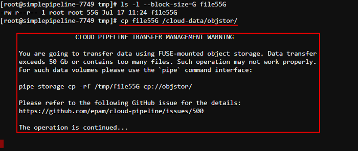
- this warning doesn't abort the user's command execution, it is continued
- appearance of this warning is configured by the following launch environment variables (values of these variables could be set only by admins via system-level settings):  
    - **`CP_ALLOWED_MOUNT_TRANSFER_SIZE`** - sets number of gigabytes that is allowed to be transferred without warning. By default _50 Gb_.
    - **`CP_ALLOWED_MOUNT_TRANSFER_SIZE_TIMEOUT`** - sets number of seconds that the transfer size retrieving operation can take. By default _5 seconds_.
    - **`CP_ALLOWED_MOUNT_TRANSFER_FILES`** - sets number of files that is allowed to be transferred without warning. Supported only for `Azure` Cloud Provider. By default _100 files_.

> **_Note_**: this feature is not available for `NFS`/`SMB` mounts, only for object storages.

## Extended recursive symlinks handling

There could be specific cases when some services execute tasks using the on-prem storages, where "recursive" symlinks are presented. This causes the Cloud Pipeline `Data transfer service` to follow symlinks infinitely.

In **`v0.16`**, a new feature is introduced for `Data transfer service` to detect such issues and skip the upload for files/folders, that cause infinite loop over symlinks.  
A new option `-sl` (`--symlinks`) was added to the `pipe storage cp` / `mv` operations to handle symlinks (for local source) with the following possible values:

- `follow` - follow symlinks (_default_)
- `skip` - do not follow symlinks
- `filter` - follow symlinks but check for cyclic links and skip them

Example for the folder with recursive and non-recursive symbolic links:  
    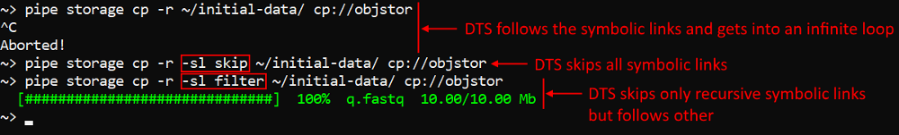

Also options were added to the `Data transfer service` to set symlink policy for transfer operations.

For more details about `pipe storage cp` / `mv` operations see [here](../../manual/14_CLI/14.3._Manage_Storage_via_CLI.md#upload-and-download-data).

## Displaying of the latest commit date/time

Users can modify existing tools and then commit them to save performed changes.  
It can be done by **COMMIT** button on the run's details page:  
    

Previously, if user committed some tool, only commit status was shown on the run's details page.  
In the current version, displaying of the date/time for the tool latest commit is added:  
    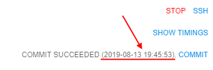

For more details about tool commit see [here](../../manual/10_Manage_Tools/10.4._Edit_a_Tool.md#commit-a-tool).

## Renaming of the GitLab repository in case of Pipeline renaming

**Pipeline** in the Cloud Pipeline environment is a workflow script with versioned source code, documentation, and configuration. Under the hood, it is a git repository.

Previously, if the **Pipeline** object was renamed - the underlying GitLab repository was keeping the previous name.  
In the current version, if user renames a **Pipeline** the corresponding GitLab repository will be also automatically renamed:  

- 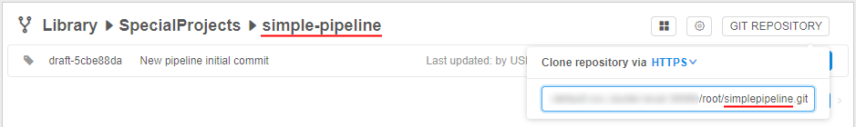
- 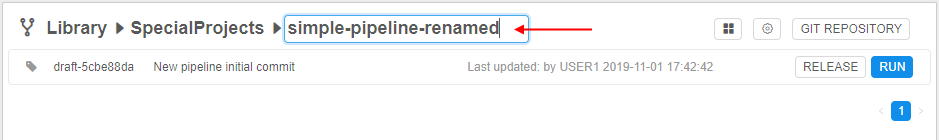
- 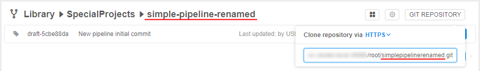

Need to consider in such case that the clone/pull/push URL changes too. Make sure to change the remote address, if you use the **Pipeline** somewhere else.

For more details see [here](../../manual/06_Manage_Pipeline/6.1._Create_and_configure_pipeline.md#edit-a-pipeline-info).

## Pushing pipeline changes to the GitLab on behalf of the user

If the user saves the changed **Pipeline** object - it actually means that a new commit is created and pushed to the corresponding GitLab repo.  
Previously, all the commits pushed to the GitLab via the Cloud Pipeline GUI were made on behalf of the `service account`. This could break traceability of the changes.

In current version, the author of the commit is displayed in the Web GUI (for all **Pipeline** versions - the draft and released), the commits are performed on behalf of the real user:  
    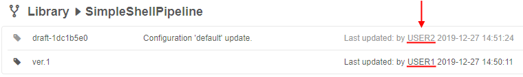

## Allowing to expose compute node FS to upload and download files

For the `interactive runs` users are processing data in ad-hoc manner, which requires upload data from the local storage to the cloud and download results from the cloud to the local storage.
Cloud Pipeline supports a number of options for the user to perform that data transfers for the interactive runs:

- via the Object Storage (using Web GUI or CLI)
- via the File Storage (using Web GUI, CLI, WebDav-mounted-drive)

Previously, view, download, upload and delete operations required an intermediate location (bucket or fs) to be used. It might confuse user when a small dataset shall be loaded to the specific location within a run's filesystem.

In the current version, direct exposure of the run's filesystem is supported. The **BROWSE** hyperlink is displayed on the **Run logs** page after a job had been initialized:  
    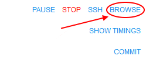

User can click the link and a Storage browser Web GUI will be loaded:  
    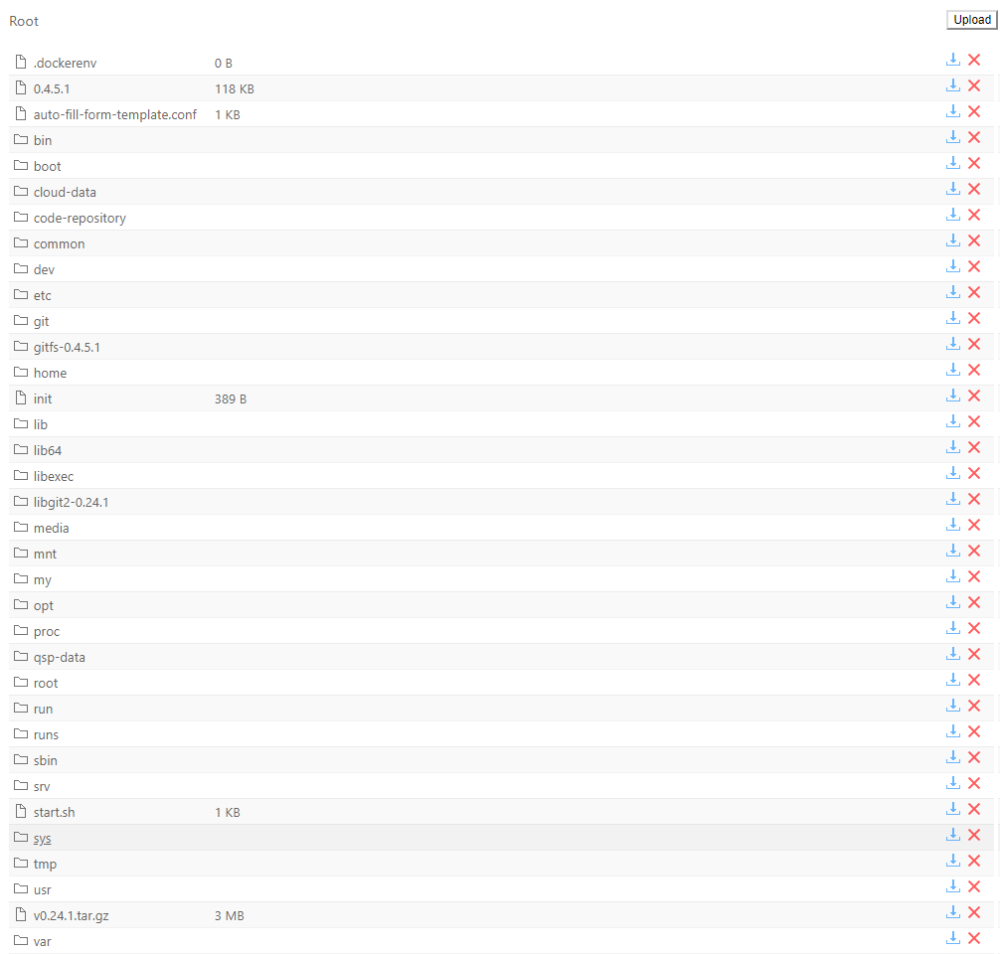

User is able to:

- view files and directories
- download and delete files and directories  
    
- upload files and directories  
    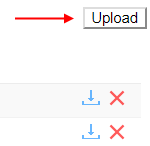
- search files and directories  
    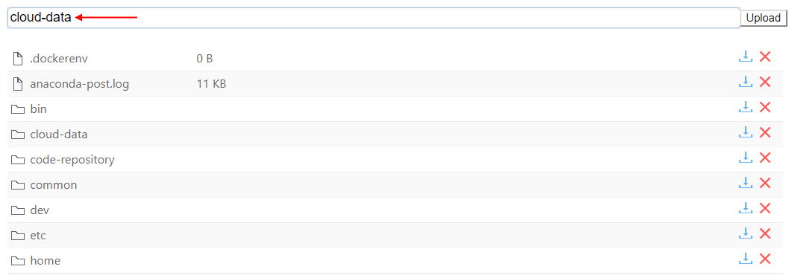

For more details see [here](../../manual/15_Interactive_services/15.3._Expose_node_filesystem.md).

## Resource usage form improvement

In **`v0.16`**, the number of filters were added to the [Monitor cluster nodes](../../manual/09_Manage_Cluster_nodes/9._Manage_Cluster_nodes.md) feature:

- *Common range for all charts*  
    User can synchronize the time period for all plots. To do so user should mark the "Common range for all charts" filter.  
    If this filter is unmarked, user can zoom any plot without any change for others.
- *Live update*  
    The plots data will be updated every 5 seconds in a real-time manner. The fields with dates will be updated as well.
- *Set range*  
    User can select the predefined time range for all plots from the list:
    - Whole range
    - Last week
    - Last day
    - Last hour
- *Date filter*  
    User can specify the Start and the End dates for plots. The system will substitute the node creating date as the Start date and current date for the End date, if user doesn't select anything.

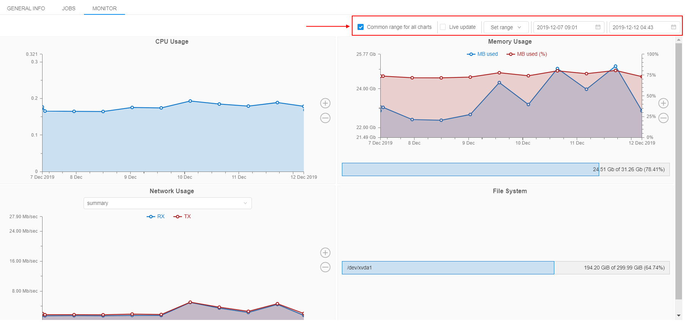

All filters are working for all plots simultaneously: data for all plots will be dynamically updated as soon as the user changes filter value.

For more details see [here](../../manual/09_Manage_Cluster_nodes/9._Manage_Cluster_nodes.md).

## Allow to view the historical resources utilization

Another convenient feature that was implemented in **`v0.16`** linked to the [Cluster nodes monitor](../../manual/09_Manage_Cluster_nodes/9._Manage_Cluster_nodes.md) is viewing of the detailed history of the resource utilization for any jobs.  
Previously, it was available only for active jobs. Now, users can view the utilization data even for completed (succeed/stopped/failed) jobs for debugging/optimization purposes.  

The utilization data for all runs is stored for a preconfigured period of time that is set by the system preference **`system.resource.monitoring.stats.retention.period`** (defaults to 5 days).  
I.e. if the job has been stopped and the specified time period isn't over - the user can access to the resources utilization data of that job:

- Open the **Run logs** page for the completed job:  
    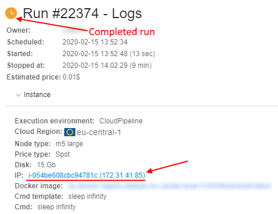  
    Click the node name hyperlink
- The **Monitor** page of the node resources utilization will be opened:  
    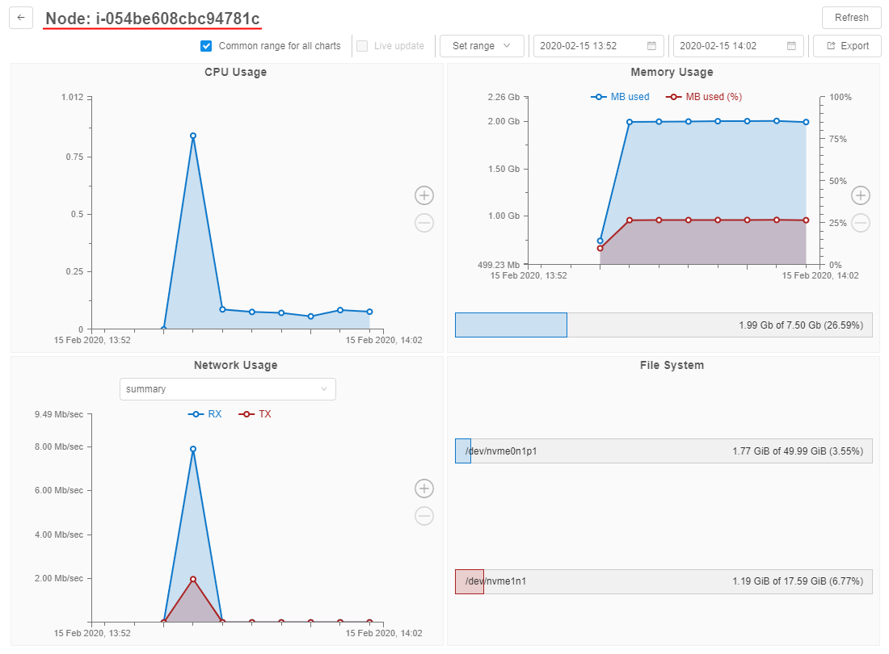

Also now, users have the ability to export the utilization information into a `.csv` file.  
This is required, if the user wants to keep locally the information for a longer period of time than defined by **`system.resource.monitoring.stats.retention.period`**:  
    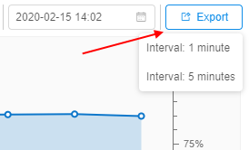  
The user can select the interval for the utilization statistics output and export the corresponding file.

For more details see [here](../../manual/09_Manage_Cluster_nodes/9._Manage_Cluster_nodes.md#monitor).

## Ability to schedule automatic pause/restart of the running jobs

For certain use cases (e.g. when `Cloud Pipeline` is used as a development/research environment) users can launch jobs and keep them running all the time, including weekends and holidays.  
To reduce costs, in the current version, the ability to set a **Run schedule** was implemented. This feature allows to automatically pause/resume runs, based on the configuration specified. This feature is applied only to the "Pausable" runs (i.e. "On-demand" and non-cluster):

- The user (who has permissions to pause/resume a run) is able to set a schedule for a run being launched:  
    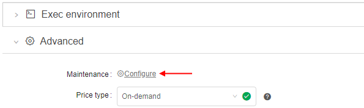
- Schedule is defined as a list of rules - user is able to specify any number of them:  
    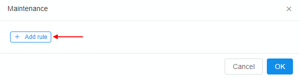  
    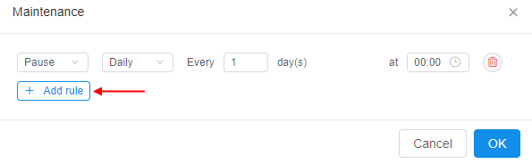
- For each rule in the list user is able to set the action (`PAUSE`/`RESUME`) and the recurrence:  
    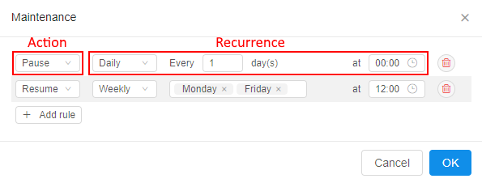

If any schedule rule is configured for the launched active run - that run will be paused/restarted accordingly in the scheduled day and time.  
Also, users (who have permissions to pause/resume a run) can create/view/modify/delete schedule rules anytime run is active via the **Run logs** page:  
    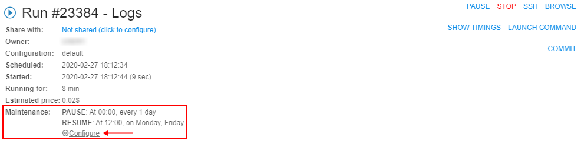

See more details [here](../../manual/06_Manage_Pipeline/6.2._Launch_a_pipeline.md) (item 5).

## Update `pipe` CLI version

Previously, if the user installed `pipe` CLI to his local workstation, used it some time - and the Cloud Pipeline API version could be updated during this period - so the user had to manually perform complete re-installing of `pipe` CLI every time to have an actual version.

Currently, the **`pipe update`** command to update the Cloud Pipeline CLI version was implemented.

This command compare the CLI and API versions. If the CLI version is less than the API one, it will update the CLI - the latest Cloud Pipeline CLI version will be installed. Otherwise no actions will be performed:

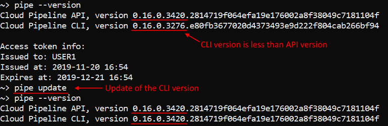

For more details see [here](../../manual/14_CLI/14.1._Install_and_setup_CLI.md#update-the-cli).

## Blocking/unblocking users and groups

In current version, the ability for administrators to set the "blocked" flag for the specific user or a whole group is implemented.  
This flag prevents user(s) to access Cloud Pipeline platform by the GUI.

Administrators can block or unblock users/groups via the **User management** tab of the System Settings dashboard.

For example, for a user:  
    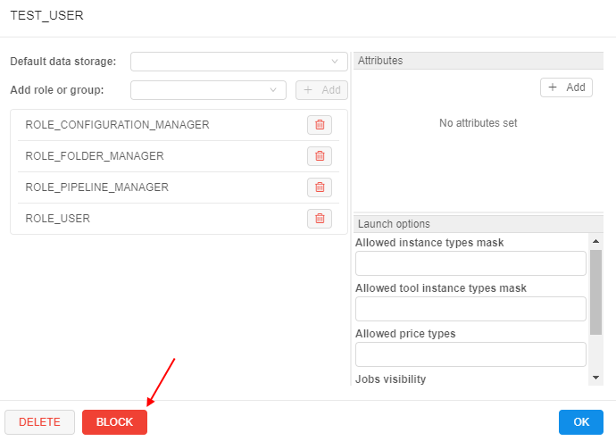  
For the blocked user the special label will be displayed aside to the user's name:  
      
The blocked user won't be able to access `Cloud Pipeline` via the GUI. The error message will be displayed when trying to login:  
    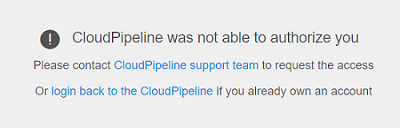  

> **_Note_**: any content generated by the blocked users is kept in the Cloud Pipeline, all the log trails on the users activities are kept as well. Only access to the platform is being restricted.

To unblock click the **UNBLOCK** button that appeared instead of the **BLOCK** button:  
    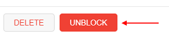  

All these actions could be performed also to a group. Users from a blocked group will not have access to the platform.

For more details about users blocking/unblocking see [here](../../manual/12_Manage_Settings/12.4._Edit_delete_a_user.md#blockunblock-a-user).  
For more details about groups blocking/unblocking see [here](../../manual/12_Manage_Settings/12.6._Edit_a_group_role.md#blockunblock-a-group).

## Displaying additional node metrics at the Runs page

In **`v0.16`**, the displaying of high-level metrics information for the Active Runs is implemented:

-  - "Idle" - this auxiliary label is shown when node's CPU consumption is lower than a certain level, defined by the admin. This label should attract the users attention cause such run may produce extra costs.
-  - "Pressure" - this auxiliary label is shown when node's Memory/Disk consumption is higher than a certain level, defined by the admin. This label should attract the users attention cause such run may accidentally fail.

These labels are displayed:  

- at the **Runs** page  
    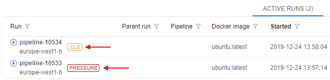
- at the **Run logs** page  
    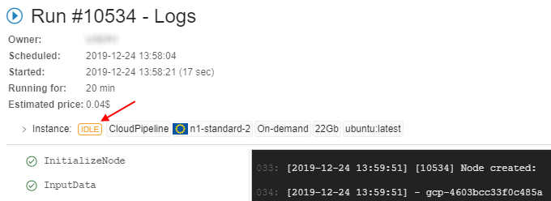
- at the main dashboard (the **ACTIVE RUNS** panel)  
    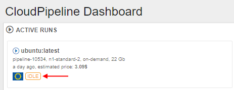

**_Note_**: if a user clicks this label from the **Runs** or the **Run logs** page the [Cluster node Monitor](../../manual/09_Manage_Cluster_nodes/9._Manage_Cluster_nodes.md#monitor) will be opened to view the current node consumption.

Admins can configure the emergence of these labels by the set of previous implemented system-level parameters.  
For the **`IDLE`** label:

- `system.max.idle.timeout.minutes` - specifies the duration in minutes how often the system should check node's activity
- `system.idle.cpu.threshold` - specifies the percentage of the CPU utilization, below which label will be displayed

For the **`PRESSURE`** label:

- `system.disk.consume.threshold` - specifies the percentage of the node disk threshold above which the label will be displayed
- `system.memory.consume.threshold` - specifies the percentage of the node memory threshold above which the label will be displayed

For more details see [here](../../manual/11_Manage_Runs/11._Manage_Runs.md#displaying-additional-node-metrics).

## Export user list

In the current version, the ability to export list of the platform users is implemented. This feature is available only for admins via **User management** tab of the system-level settings:  
    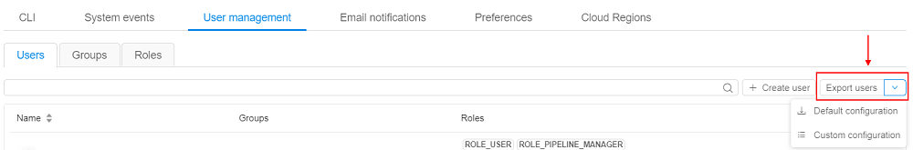  

Admin can download list with all users and their properties (user name, email, roles, attributes, state, etc.) by default or custom configure which properties should be exported:  
    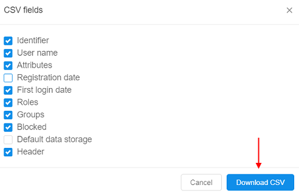  

The downloaded file will have the `.csv` format.

For more details see [here](../../manual/12_Manage_Settings/12._Manage_Settings.md#export-users).

## Displaying SSH link for the active runs in the Dashboard view

Users can run SSH session over launched container. Previously, SSH link is only available from the **Run logs** page.  
In **`v0.16`**, a new helpful capability was implemented that allows to open the SSH connection right from the **Active Runs** panel of the main Dashboard:  
    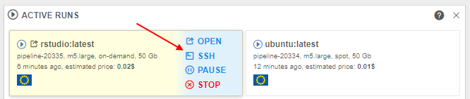  
    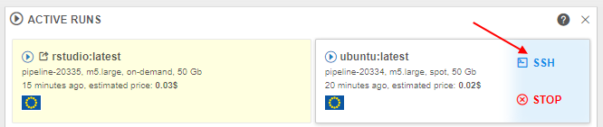

That SSH link is available for all the non-paused active jobs (interactive and non-interactive) after all run's checks and initializations have passed (same as at the **Run logs** page).

## Enable Slurm workload manager for the Cloud Pipeline's clusters

A new feature for the Cloud Pipeline's clusters was implemented in **`v0.16`**.  
Now, [**`Slurm`**](https://slurm.schedmd.com/overview.html) can be configured within the `Cluster` tab. It is available only for the fixed size clusters.

To enable this feature - tick the `Enable Slurm` checkbox and set the child nodes count at cluster settings. By default, this checkbox is unticked. Also users can manually enable `Slurm` functionality by the `CP_CAP_SLURM` system parameter:  
    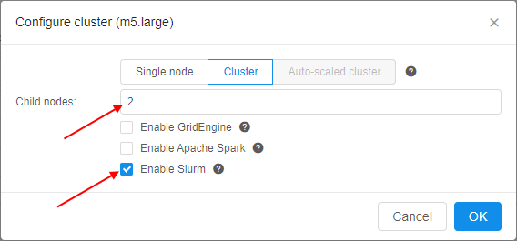

This feature allows you to use the full stack of `Slurm` cluster's commands to allocate the workload over the cluster, for example:  
    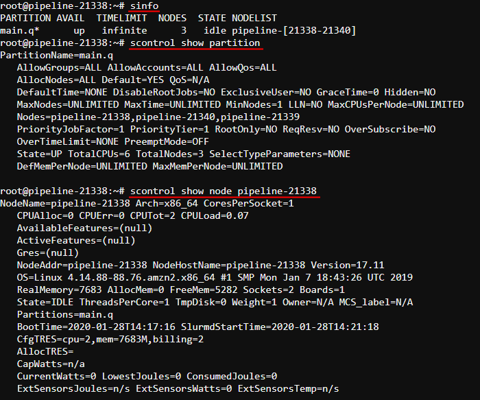

For more information about using `Slurm` via the `Cloud Pipeline` see
[here](../../manual/15_Interactive_services/15.2._Using_Terminal_access.md#example-using-of-slurm-for-the-cloud-pipelines-clusters).

## The ability to generate the `pipe run` command from the GUI

A user has a couple of options to launch a new job in the Cloud Pipeline:

- `API`
- `CLI`
- `GUI`

The easiest way to perform it is the `GUI`. But for automation purposes - the `CLI` is much more handy. Previously, users had to construct the commands manually, which made it hard to use.

Now, the ability to automatically generate the `CLI` commands for job runs appeared in the `GUI`.  
Now, users can get a generated `CLI` command (that assembled all the run information):

- at the **Launch** form:  
    
- at the **Run logs** form:  
      
    **_Note_**: this button is available for completed runs too

Once click these buttons - the popup with the corresponding `pipe run` command will appear:  
    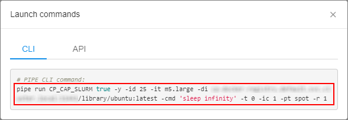  
User can copy such command and paste it to the `CLI` for further launch.  
Also user can select the **API** tab in that popup and get the `POST` request for a job launch:  
    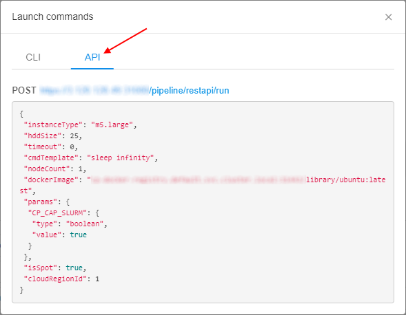

See an example [here](../../manual/14_CLI/14.5._Manage_pipeline_executions_via_CLI.md#generate-pipeline-launch-command-via-the-gui).

## `pipe` CLI: view tools definitions

In **`v0.16`** the ability to view details of a tool/tool version or tools group via the `CLI` was implemented.  
The general command to perform these operations:

``` bash
pipe view-tools [OPTIONS]
```

Via the options users can specify a Docker registry (`-r` option), a tools group (`-g` option), a tool (`-t` option), a tool version (`-v` option) and view the corresponding information.

For example, to show a full tools list of a group:  
    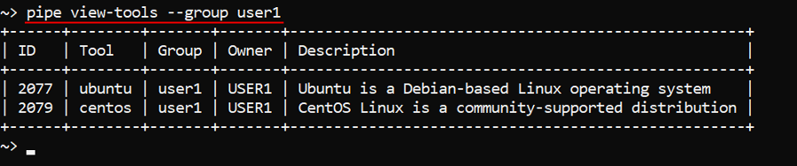

To show a tool definition with versions list:  
    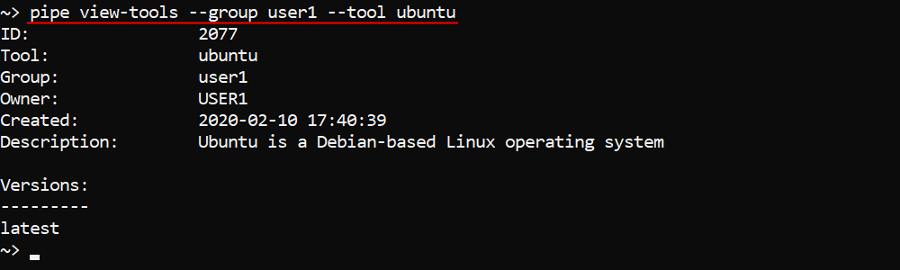

Also the specifying of "path" to the object (registry/group/tool) is supported. The "full path" format is: `<registry_name>:<port>/<group_name>/<tool_name>:<verion_name>`:  
    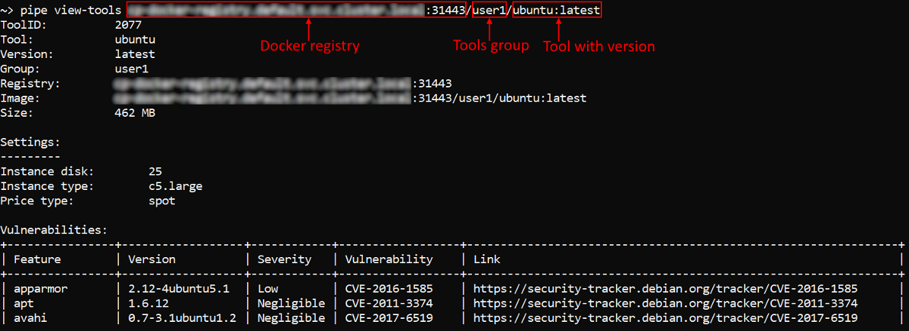

For more details and usage examples see [here](../../manual/14_CLI/14.8._View_tools_definitions_via_CLI.md).

## Storage usage statistics retrieval via `pipe`

In some cases, it may be necessary to obtain an information about storage usage or some inner folder(s).  
In the current version, the command `pipe storage du` is implemented that provides "disk usage" information on the supported data storages/path:

- number of files in the storage/path
- summary size of the files in the storage/path

In general, the command has the following format:

``` bash
pipe storage du [OPTIONS] [STORAGE]
```

Without specifying any options and storage this command prints the full list of the available storages (both types - object and FS) with the "usage" information for each of them.  
With specifying the storage name this command prints the "usage" information only by that storage, e.g.:  
    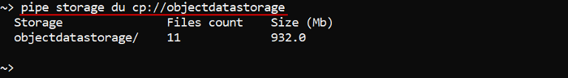  
With `-p` (`--relative-path`) option the command prints the "usage" information for the specified path in the required storage, e.g.:  
    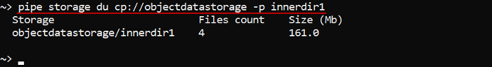  
With `-d` (`--depth`) option the command prints the "usage" information in the required storage (and path) for the specified folders nesting depth, e.g.:  
    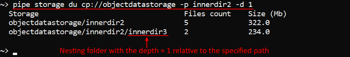

For more details about that command and full list of its options see [here](../../manual/14_CLI/14.3._Manage_Storage_via_CLI.md#show-storage-usage).

## GE Autoscaler respects CPU requirements of the job in the queue

At the moment, **GE Autoscaler** treats each job in the queue as a single-core job.  
Previously, autoscale workers could have only fixed instance type (the same as the master) - that could lead to `unschedulable` jobs in the queue - for examle, if one of the jobs requested **4** slots in the `local` parallel environment within a **2**-cored machine. Described job waited in a queue forever (as autoscaler could setup only new **2**-cored nodes).

In the current version the `hybrid` behavior for the **GE Autoscaler** was implemented, that allows processing the data even if the initial node type is not enough. That behavior allows to scale-up the cluster (attach a worker node) with the instance type distinct of the master - worker is being picked up based on the amount of unsatisfied **CPU** requirements of all pending jobs (according to required slots and parallel environment types).

There are several **System parameters** to configure that behavior:

- **`CP_CAP_AUTOSCALE_HYBRID`** (_boolean_) - enables the `hybrid` mode. In that mode the additional worker type can vary within either master instance type family (or `CP_CAP_AUTOSCALE_HYBRID_FAMILY` if specified). If `disabled` or not specified - the **GE Autoscaler** will work in a general regimen (when scaled-up workers have the same instance type as the master node)
- **`CP_CAP_AUTOSCALE_HYBRID_FAMILY`** (_string_) - defines the instance "family", from which the **GE Autoscaler** should pick up the worker node in case of `hybrid` behavior. If not specified (by default) - the **GE Autoscaler** will pick up worker instance from the same "family" as the master node
- **`CP_CAP_AUTOSCALE_HYBRID_MAX_CORE_PER_NODE`** (_string_) - determines the maximum number of instance cores for the node to be scaled up by the **GE Autoscaler** in case of `hybrid` behavior

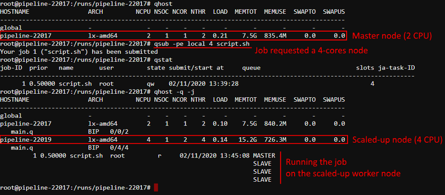

Also now, if no matching instance is present for the job (no matter - in `hybrid` or general regimen), **GE Autoscaler** logs error message and rejects such job:  
    for example, when try to request **32** slots for the autoscaled cluster launched in `hybrid` mode with the parameter `CP_CAP_AUTOSCALE_HYBRID_MAX_CORE_PER_NODE` set to **20**:  
      
    and in the logs console at the same time:  
    

For more details about **GE Autoscaler** see [here](../../manual/Appendix_C/Appendix_C._Working_with_autoscaled_cluster_runs.md).

## The ability to find the tool by its version/package name

Cloud Pipeline allows searching for the tools in the registry by its name or description. But in some cases, it is more convenient and useful to find which tool contains a specific software package and then use it.

In the current version, this ability - to find a tool by its content - is implemented based on the global search capabilities.  
Now, via the Global Search, you may find a tool by its version name, e.g.:  
      
And by the package name (from any available ecosystem), e.g.:  
    

## The ability to restrict which run statuses trigger the email notification

Cloud Pipeline can be configured to send the email to the owner of the job (or specific users) if its status is changed.  
But in certain cases - it is not desired to get a notification about all changes of the run state.  
To reduce a number of the emails in these cases, the ability to configure, which statuses are triggering the notifications, is implemented in **`v0.16`**.

Now, when the administrator configures the emails sending linked to the run status changes - he can select specific run states that will trigger the notifications.  
It is done through the `PIPELINE_RUN_STATUS` section at the **Email notifications** tab of the System Settings (the "**Statuses to inform**" field):  
      
The email notifications will be sent only if the run enters one of the selected states.  
**_Note_**: if no statuses are selected in the "**Statuses to inform**" field - email notifications will be sent as previously - for all status changes.

For more information how to configure the email notifications see [here](../../manual/12_Manage_Settings/12.9._Change_email_notification.md).

## Restrictions of "other" users permissions for the storages mounted via the `pipe storage mount` command

As was introduced in [Release Notes v.0.15](../v.0.15/v.0.15_-_Release_notes.md#mounting-data-storages-to-linux-and-mac-workstations), the ability to mount Cloud data storages (both - File Storages and Object Storages) to Linux and Mac workstations (requires **`FUSE`** installed) was added.  
For that, the `pipe storage mount` command was implemented.

Previously, Cloud Pipeline allowed read access to the mounted cloud storages for the other users, by default. This might introduce a security issue when dealing with the sensitive data.

In the current version, for the `pipe storage mount` command the new option is added: `-m` (`--mode`), that allows to set the permissions on the mountpoint at a mount time.  
Permissions are being configured by the numerical mask - similarly to `chmod` Linux command.  

E.g. to mount the storage with `RW` access to the **OWNER**, `R` access to the **GROUP** and no access to the **OTHERS**:  
    

If the option `-m` isn't specified - the default permission mask will be set - `700` (full access to the **OWNER** (`RWX`), no access to the **GROUP** and **OTHERS**).

For more details about mounting data storages via the `pipe` see [here](../../manual/14_CLI/14.3._Manage_Storage_via_CLI.md#mounting-of-storages).

## Parallel mounting of data storages

Previously, a job mounted its data storages one by one. When the user has hundreds of available storages, the `MountDataStorages` task could take a long time before the job started.

In the current version, a new launch parameter **`CP_CAP_MOUNT_THREADS`** (_int_) is introduced. It sets the number of threads that mount the data storages in parallel (e.g. `4`, `8` or `16`).  
By default, it is `1` - storages are mounted one by one, as before. To go back to the previous behavior, set the parameter to `1` or remove it.

**_Note_**:

- If a storage is mounted inside the mount point of another storage, it is mounted only after the mount command of that storage has finished.
- Storages mounted with `pipe` FUSE request their details and credentials from the API. A large number of threads makes these requests at the same time and increases the load on the API and on the cloud provider when a job (or a cluster) starts. It also uses more CPU on small nodes. Start with a small value, e.g. `4`.
- If `pipe` FUSE mounts fail by a timeout under a high load, consider increasing **`CP_PIPE_FUSE_MOUNT_TIMEOUT`** (see [`pipe storage mount` waits for the mount point](#pipe-storage-mount-waits-for-the-mount-point)).

For more details see [here](../../manual/06_Manage_Pipeline/6.1._Create_and_configure_pipeline.md#mount-storages-in-parallel).

## Checking of the Docker image version in `pipe run`

Previously, `pipe run` did not check the version (tag) of the Docker image specified via the `-di` (`--docker-image`) option. A run with a mistyped version, e.g. `library/ubuntu:latet`, was scheduled and failed only on the node, when the image could not be pulled.

In the current version, `pipe run` checks that the tool has the specified version before the launch. If it doesn't, the run is not scheduled - `pipe` prints an error with the list of the available versions and exits with the code `1`.  
If the tool versions can't be loaded, `pipe` prints a warning and continues the launch.

For more details see [here](../../manual/14_CLI/14.5._Manage_pipeline_executions_via_CLI.md#run-a-tool).

## `pipe storage mount` waits for the mount point

Previously, `pipe storage mount` waited for a fixed time (the `-w` option, `1000` ms by default; for the jobs - the `CP_PIPE_FUSE_TIMEOUT` parameter, `500` ms by default) and then only checked that the mount process was still running. If the mount process failed later, the storage was reported as mounted, but it was missing.

In the current version, `pipe storage mount` waits until the storage is actually mounted:

- it checks the mount point every **`CP_PIPE_FUSE_MOUNT_DELAY`** ms (`500` by default) until it is mounted by `pipe` FUSE. If the mount point is a symlink, its target is checked
- the `-w` (`--timeout`) option now sets the maximum time to wait, in ms. By default, it is `10000`
- the mount fails if the mount process exits, or if the storage is not mounted by `pipe` FUSE when the timeout expires (e.g. something else stays mounted at the mount point). In the last case, the mount process is stopped

For the jobs, the timeout is set by the new launch parameter **`CP_PIPE_FUSE_MOUNT_TIMEOUT`** (_int_, `10000` by default). By default, this parameter is not passed to the worker nodes of a cluster. To pass it, add its name to the **`CP_CAP_AUTOSCALE_INHERITABLE_PARAMETER_NAMES`** parameter.

> **_Note_**: the **`CP_PIPE_FUSE_TIMEOUT`** parameter is not used anymore. If it is set for a job, tool or configuration, it is ignored. Use **`CP_PIPE_FUSE_MOUNT_TIMEOUT`** instead. The new value is the maximum time to wait, not a fixed wait, so it shall not be set as low as the old one.

For more details see [here](../../manual/14_CLI/14.3._Manage_Storage_via_CLI.md#mount-a-storage).

## Node start retries for a specific run

Previously, the number of tries to start a node for a run could only be set globally, by the system preference `cluster.nodeup.retry.count`. It applied to all runs.

In the current version, it can be overridden for a specific run by the new launch parameter **`CP_NODEUP_RETRY_COUNT`** (_int_). For example, a job that requests a scarce instance type can keep trying longer, and other runs still use the global value.  
The parameter also defines when a run is relaunched in another region in case of insufficient capacity. If the value is not a positive integer, `cluster.nodeup.retry.count` is used. The parameter is passed to the worker nodes of a cluster.

## Group permissions

Admins can now let other users manage a group, in the same way as it's possible to let a user manage another user account.  
Permissions are set at the new **PERMISSIONS** tab of the group settings pop-up:

- **READ** - the user can see the group, its members and attributes
- **WRITE** - the user can also change the group members, attributes (except sensitive keys) and default data storage

Creating, deleting and blocking a group, the **Default group** flag, launch options and credentials profiles stay available to users with the **ROLE\_ADMIN** or **ROLE\_USER\_ADMIN** role only. Permissions can not be used to manage predefined system roles.

The group settings pop-up also got the **Default group** checkbox: such a group is assigned to all new users upon the registration.

For more details see [here](../../manual/12_Manage_Settings/12.6._Edit_a_group_role.md#group-permissions).

## Investigate the failure reason of a run

Users can now diagnose a failed run on their own with an external run investigation service.  
Admins configure that service in the new optional `investigation` object of the **`misc.ai.preferences`** system preference, e.g.:

``` json
{
    "investigation": {
        "url": "https://<host>/run-analyzer-gui/",
        "roles": ["ROLE_ADMIN", "ROLE_RUN_ANALYZER_USER"]
    }
}
```

If `url` is set, the **Run logs** page of a run in the `FAILURE` state shows the **Investigate failure reason** link under the run title. The link opens the `<url>/?run_id=<run ID>` page in a new browser tab.  
If `roles` is set, only the members of these roles/groups see the link. Otherwise, all users see it.

For more details see [here](../../manual/11_Manage_Runs/11._Manage_Runs.md#investigate-failure-reason).

## Run controls for an unavailable node

When the compute node of a run stops reporting its status, the run gets the `NODE_UNAVAILABLE` tag. If the node does not recover within the grace period (the `cluster.node.unavailable.grace.period.minutes` system preference, or the `NODE_UNAVAILABLE_GRACE_PERIOD_MINUTES` run parameter), the node is terminated.  
Previously, the GUI still showed the **PAUSE**, **COMMIT**, **BROWSE** and **VERSIONED STORAGE** controls for such a run, though these operations cannot complete without the node.

In the current version, these controls are hidden while the run has the `NODE_UNAVAILABLE` tag - at the **Run logs** page, at the **ACTIVE RUNS** tab, at the **Home** page and in the actions of in-app notifications. The **STOP** dialog does not offer to persist the current docker image state either. The controls are shown again once the node recovers and the tag is removed.  
For more details see [here](../../manual/11_Manage_Runs/11._Manage_Runs.md#controls).

## Read and launch access to all pipelines

Previously, access to all pipelines of the Platform could be given only by the permission settings of the pipelines (or of their parent folders) - or by the **ROLE\_ADMIN**/**ROLE\_PIPELINE\_ADMIN** roles, which also give write and owner access.  
In the current version, two new roles were introduced. Both cover every pipeline in the Platform, versioned storages included:

- **ROLE\_PIPELINE\_READER** gives the user **READ** permission to every pipeline, regardless of the pipeline permission settings: the user is able to see all pipelines, their versions, code, documents, attributes and permission settings. The user is also able to view all runs of all pipelines, regardless of the run visibility policy
- **ROLE\_PIPELINE\_EXECUTOR** gives the user **EXECUTE** permission to every pipeline, regardless of the pipeline permission settings. This permission is not passed on to the runs: changes of the runs of other users still require the permissions the user would need without the role

A user with both roles is able to see and launch every pipeline. As a launch also requires **READ** permission to the pipeline, **ROLE\_PIPELINE\_EXECUTOR** alone allows to launch only the pipelines the user is able to see. Any write access still has to be granted explicitly.

For more details see [here](../../manual/13_Permissions/13._Permissions.md#pipeline-reader-and-executor-roles).

## Access to the pipeline repositories for the pipeline roles

Previously, of the roles that give full access to all pipelines regardless of their permission settings, only **ROLE\_ADMIN** got access to the pipeline repositories in the Platform GitLab. The users with the **ROLE\_PIPELINE\_ADMIN** role were able to manage all pipelines in the Platform, but not to access their repositories in GitLab, and might have no GitLab account at all.  
In the current version, **ROLE\_PIPELINE\_ADMIN** gets the **Maintainer** access to all repositories in GitLab, as **ROLE\_ADMIN**. The new **ROLE\_PIPELINE\_READER** role (see [Read and launch access to all pipelines](#read-and-launch-access-to-all-pipelines)) gets the **Reporter** (read-only) access to all repositories. The users with these roles get GitLab accounts.

For more details see [here](../../manual/13_Permissions/13._Permissions.md#access-to-the-pipeline-repositories-in-gitlab).

## GitLab 19 support

The platform now supports GitLab CE **19.5.3** for its embedded Git (`cp-git`), with PostgreSQL 17 for the GitLab database (`cp-gitlab-db`).

A new deployment selects it with the install config values `CP_GITLAB_VERSION=19` and `GITLAB_DATABASE_VERSION=17`. On GitLab 17 and later, the installer:

- generates the GitLab `root` password, if the default one is set
- creates its GitLab tokens with an expiry date, 364 days ahead
- creates the `amcheck` extension in the GitLab database
- turns on the **`git.gitlab.hashed.repo.support`** preference

The GitLab runner is not part of the GitLab 19 image (`git-19`). The images of the earlier GitLab versions keep it.  
For more details see [GitLab versions](../../installation/gitlab/gitlab_versions.md).

An existing deployment on GitLab 15.5 moves to 19.5 by a manual procedure: GitLab passes through a list of required versions, and its database is upgraded three times, from PostgreSQL 12 to 17. See [Upgrade GitLab 15.5 to 19.5](../../installation/gitlab/upgrade_gitlab_15_to_19.md).

The platform also changes the way it works with GitLab. These changes do not break the earlier GitLab versions, so a deployment gets them before it upgrades GitLab:

- **`git.token` rotation** (GitLab 15.5 and later). On GitLab 19.5, a new access token must have an expiry date, at most 365 days ahead. The platform now checks the expiry of **`git.token`** on a schedule (every day by default). When the token is close to its expiry, the platform issues a new impersonation token, saves it to **`git.token`**, and revokes the old one. A token without an expiry date is never rotated. The rotation is set by the new preferences **`git.token.rotation.enabled`**, **`git.token.rotation.schedule`**, **`git.token.rotation.threshold.days`** and **`git.token.rotation.lifetime.days`**.  
    **_Note_**: a run gets the **`git.token`** value when it starts. After a rotation, the old value no longer works in the runs that are still active.  
    For more details see [here](../../manual/12_Manage_Settings/12.10._Manage_system-level_settings.md#git).
- **Pipeline version descriptions are saved again.** GitLab 14.0 removed the release description from the tag creation, so the `releaseDescription` of a new pipeline version (`POST /pipeline/version/register`) was lost. In the current version, on GitLab 14.0 and later, it is saved as the GitLab release of the version tag, with the GitLab Releases API.
- **A deleted pipeline's name can be reused at once.** On GitLab 18.0 and later, deleting a project only marks it for deletion (for 30 days by default), and its name stays taken. In the current version, when a pipeline is deleted with its repository, the repository is removed permanently, so a new pipeline can take the same name at once. The temporary `TMP_FORK_*` group that a pipeline copy uses is still only marked for deletion: GitLab removes it, with its projects, after the deletion delay.
- **Git tokens issued for users last at most 365 days.** GitLab does not accept a token with a longer lifetime. A lifetime over `365` days, from the **`git.default.token.duration.days`** preference or from a request, is cut to `365` days.

Other fixes keep the platform working with the new GitLab versions:

- a missing folder of a repository is treated as an empty one: GitLab 17.7 and later answer `404` for it
- tokens with dots, as GitLab 19.5 issues them, are accepted in repository URLs
- saving the Git preferences no longer rejects GitLab 18.0-18.2 and 19.5-19.9

## VS Code extension: the folder opened on connect

On connect to a run, the Cloud Pipeline Remote extension for VS Code and Cursor opens the home folder of the user it connects as.  
In the current version, a run can ask for another folder, e.g. a project folder in the image. For that, set the new system parameter **`CP_VSCODE_WORKSPACE_DIR`** to the absolute path of the folder - at launch, or as a default parameter of a tool. The extension opens this folder for any user who connects to the run, if the user can open it. Otherwise, the extension shows a warning with the reason, and opens the home folder, as before.  
On a deployment that is updated, not installed anew, the parameter is offered in the list of system parameters only after an admin adds it to the **`launch.system.parameters`** preference. Until then, it can be set as a regular parameter of a run.

## The `pipe` CLI on Python 3

The `pipe` CLI runs on Python 3.12. Its Linux binary and tarball were built with Python 2.7, and now are built with Python 3.12 on CentOS 7. Its Windows build moved from Python 3.6 to 3.12, and its macOS (arm64) build from Python 3.9 to 3.12.  
This brings the following changes:

- the Linux binary and tarball run on the Linux distributions with `glibc` 2.17 or later, e.g. CentOS / RHEL 7, Amazon Linux 2, Ubuntu 16.04, Debian 9 or later. They bring OpenSSL 3.5 with them, and take the CA certificates and the OpenSSL configuration from `/etc/pki/tls` of the system, if it has one
- the `pipe-el6` binary and tarball for CentOS 6 / RHEL 6 are no longer provided
- the NTLM proxy authentication is removed, with the NTLM proxy of the Windows build. `pipe configure` fails, if one of its options is set: `--proxy-ntlm`, `--proxy-ntlm-user`, `--proxy-ntlm-domain` or `--proxy-ntlm-pass`. If the saved configuration of an earlier version enables it, `pipe` prints a warning and uses the proxy without it
- the `--codec` option of `pipe configure` is removed, as Python 3 always uses Unicode text. `pipe configure` fails, if it is set
- the Linux binary still unpacks itself into `~/.pipe/tmp` on each start. If it cannot create this folder, e.g. when the home folder cannot be written, it now unpacks itself into the system temporary folder (`$TMPDIR`, `/tmp` by default)
- the installation from the source tarball (**Operation System** → **Source** in **Settings** → **CLI**) requires Python 3.10 or later
- `pipe` requires newer versions of several Python dependencies, as the earlier versions have published security advisories, e.g. `requests` 2.33.0, `cryptography` 50.0.0 and `PyJWT` 2.15.0 or later. The builds of `pipe` take the exact versions from `pipe-cli/constraints.txt`
- the Google Cloud Storage transfers use only the public API of the Google Cloud Storage client library, so they work with its current versions

On a deployment that is updated, not installed anew, **Settings** → **CLI** keeps the old installation hints, with the `pipe-el6` download URLs and the Python 2 requirement of the **Source** option, until an admin updates the **`ui.pipe.cli.install.template`** preference.  
For more details see [here](../../manual/14_CLI/14.1._Install_and_setup_CLI.md#how-to-install-and-setup-pipe-cli).
## pipe-common requires Python 3.12

`pipe-common` is the `pipeline` Python package of the platform. Every run installs it, and the platform scripts of a run use it, e.g. for the storage mounts, the data transfers, the cluster setup and the grid engine autoscaler. The platform services that run Python scripts install it as well. A run installs it with the platform's Python 3.12, see [Runs on Python 3.12](#runs-on-python-312).

Now, `pipe-common` runs on Python 3 only, and requires Python 3.12 or later. `pip` no longer installs it for Python 2.  
Its dependencies moved to the Python 3 versions that have the known security advisories fixed:

- `certifi` 2026.10.23, `click` 8.5.0, `cryptography` 50.0.1, `docutils` 0.23, `httplib2` 0.32.1, `idna` 3.20, `luigi` 3.8.1, `oauthlib` 4.0.1, `paramiko` 5.0.0, `psutil` 7.2.2, `pyasn1` 0.6.5, `pyasn1-modules` 0.4.2, `PyJWT` 2.15.1, `PyNaCl` 1.6.2, `pyOpenSSL` 26.4.0, `PyYAML` 6.0.3, `requests` 2.34.2, `requests-oauthlib` 2.0.0, `rsa` 4.9.1, `six` 1.16.0, `tornado` 6.6, `urllib3` 2.8.0 and `watchdog` 6.0.0
- `setuptools` 81.0.0, the last version that has `pkg_resources`
- `packaging` 26.3 is a new dependency: the AWS provider compares the `boto3` versions with it, as Python 3.12 has no `distutils`
- `pykube-ng` 23.6.0 instead of `pykube` 0.15. It provides the same `pykube` module
- the Python 2 backports `backports-abc`, `backports.ssl-match-hostname`, `enum34` and `singledispatch` are no longer installed

The Python 3 package mirror of the platform (`tools/python/pypi3/simple` in the public Cloud Pipeline bucket) serves all of these versions, for systems with `glibc` 2.17 or later, e.g. CentOS 7.

The SGE autoscaler now rounds the memory request of a job up to whole GiB, as the Slurm autoscaler does. Previously, it rounded the request down, e.g. `-l ram=500M` counted as 0 GiB and `-l ram=1500M` as 1 GiB.

Please note: a user script that imports the `pipeline` package, or a package that it brings, must run on Python 3.12, and work with these versions. E.g., the APIs of `luigi` 3, `PyJWT` 2 and `click` 8 differ from the versions that were installed before.

## Runs on Python 3.12

Previously, a run took Python 2 for the platform's scripts and the `pipeline` package (`pipe-common`): Miniconda2, if `CP_CAP_INSTALL_PRIVATE_DEPS` was set, or else the `python2` of the tool image, or the one from the OS repositories. `CP_PYTHON2_PATH` pointed to it.

Now, the runs use Python 3.12 only, as `pipe-common` requires it (see [pipe-common requires Python 3.12](#pipe-common-requires-python-312)):

- When a run starts, it installs the platform's Python 3.12 distribution into `/usr/local/python3.12`. It no longer looks for Python 2, or installs it. The distribution is downloaded from the `tools/python/3/python3.12.tar.gz` file of `GLOBAL_DISTRIBUTION_URL` (by default, the public Cloud Pipeline bucket), with `wget`, or with `curl` if `wget` fails, and without a check of the server certificate, as the other downloads of a run. The new `CP_PYTHON3_DISTRO_URL` parameter sets another location.
- If the download fails, the run uses the Python 3.12 that the tool image already has: the one in `/usr/local/python3.12` (e.g. of a committed run), or else a `python3.12` in `PATH`. If the image has neither, the run fails at startup. Previously, a run without Python 2 installed it from the OS repositories. Now, an image without Python 3.12 needs `GLOBAL_DISTRIBUTION_URL` (or `CP_PYTHON3_DISTRO_URL`) reachable from the run.
- A `python3.12` from `PATH` must have `pip` and accept packages: e.g. the one of the `python:3.12` images from Docker Hub. A Python of the OS packages, e.g. `/usr/bin/python3.12` of Ubuntu 24.04, does not do: it has no `pip`, or its `pip` refuses to install into it (PEP 668), so the run fails when it installs `pipe-common`. `pipe-common` is installed into such a Python with `pip install -I`, which replaces the versions of the packages it needs that the image has there, e.g. `requests`, `urllib3`, `cryptography`, `setuptools` and `click`.
- `CP_PYTHON_PATH` points to this Python 3.12. `pipe-common`, the platform's scripts and the shell commands of a run (e.g. `pipe_log`, the cluster and grid engine setup, the NICE DCV and NoMachine desktops) run with it.
- `CP_PYTHON2_PATH` is kept for the user scripts that call it. It points to the same Python 3.12, so such a script must run on Python 3.
- The platform's Python 3.12 comes before the Python of the tool image:
    - `/usr/local/python3.12/bin` goes first in `PATH`, for the command of the run and for its SSH sessions (`/etc/cp_env.sh`). `/usr/local/bin/python3` and `/usr/local/bin/pip3` are links to the platform's Python 3.12. The `/usr/local/python3.12` of the tool image, if it has one, is replaced at every run start.
    - So the image's own `python3` and `pip3` are shadowed in a run and in its SSH sessions, including those of conda (e.g. `/opt/conda/bin`) and of the `python` images from Docker Hub (`/usr/local/bin`). So are the commands of the packages installed into the platform's Python 3.12, e.g. `luigi`. `python` and `pip` are not linked: they stay the ones of the image.
    - A tool that starts with `#!/usr/bin/env python3` runs on the platform's Python 3.12, and does not see the modules of the image's own Python.
    - Packages installed with `pip3` go into the platform's Python 3.12, and are lost at the next run start, also in an image committed from the run. Install them into the image's own Python by its full path (e.g. `/opt/conda/bin/pip`), or into a virtual environment (e.g. `python3 -m venv /opt/venv`), instead.
    - To call the Python of the image, use its full path (e.g. `/opt/conda/bin/python3`) or its version (e.g. `python3.11`). A user script that imports the `pipeline` package must run with `$CP_PYTHON_PATH`.
- The run keeps the `/usr/local/openssl` of the image, unless the distribution has one of its own: `python3.12.tar.gz` has none, the previous `python3.12.0.tar.gz` has one.
- The `CP_CAP_INSTALL_PRIVATE_DEPS` and `CP_CONDA_DISTRO_URL` parameters no longer have an effect. A run with `CP_CAP_INSTALL_PRIVATE_DEPS` set to `true` logs a warning about it.
- When the platform's package repositories are used (`CP_REPO_ENABLED`), `pip` installs from the Python 3 package mirror. It is `CP_REPO_PYPI3_BASE_URL_DEFAULT` (and `CP_REPO_PYPI3_TRUSTED_HOST_DEFAULT`), if set. Otherwise, if `GLOBAL_DISTRIBUTION_URL` is an S3 bucket URL of the `https://<bucket>.s3.<region>.amazonaws.com/` form, it is `tools/python/pypi3/simple` of the website endpoint of that bucket (`http://<bucket>.s3-website.<region>.amazonaws.com/`). For any other `GLOBAL_DISTRIBUTION_URL`, it is the public mirror, `http://cloud-pipeline-oss-builds.s3-website.us-east-1.amazonaws.com/tools/python/pypi3/simple`. The new `CP_REPO_PYPI3_*` parameters replace `CP_REPO_PYPI_BASE_URL_DEFAULT` and `CP_REPO_PYPI_TRUSTED_HOST_DEFAULT`, which set the mirror of the Python 2 packages and no longer have an effect. A run where `CP_REPO_PYPI_BASE_URL_DEFAULT` is set, and `CP_REPO_PYPI3_BASE_URL_DEFAULT` is not, logs a warning about it.
- The NICE DCV desktop installs Flask 3.1.3 and Flask-HTTPAuth 4.8.1, and the NoMachine desktop installs Flask 3.1.3, for this Python 3.12.
- The **Python** and **Luigi** pipeline templates, and the data loader system pipeline, run their scripts with `$CP_PYTHON_PATH` instead of `python`. So do the demo pipelines.
- On CentOS 8 and Rocky Linux 8 and 9, the names of the packages that a run installs (e.g. from `CP_CAP_EXTRA_PKG`) are no longer changed from `python` to `python2`. E.g. `python3-devel` was installed as `python23-devel`, which does not exist.
- A run with `CP_PIPELINE_CLI_BINARY_NAME` set to `pipe-el6` installs the `pipe` build of the `pipe` CLI, with a warning: the CentOS 6 build is no longer published. The `pipe` CLI needs `glibc` 2.17 or later.

Committing and pausing a run also run Python code: on the node host, outside the container of the run. If the node host has no Python 3.12 in `/usr/local/python3.12`, these operations install it there, from the `tools/python/3/python3.12.tar.gz` file of `GLOBAL_DISTRIBUTION_URL`. The API passes them the distribution URL of the region of the run, or else the `base.global.distribution.url` preference. They install `pipe-common` with this Python 3.12, always from the Python 3 package mirror that this `GLOBAL_DISTRIBUTION_URL` gives, as above: the `CP_REPO_PYPI3_*` and `CP_PYTHON3_DISTRO_URL` parameters of the run do not reach the node host. The `python` and `pip` of the node host are no longer used. If the node host has no Python 3.12 and cannot get it, a pause is not done and the run keeps running, and a commit fails.

The distribution is CPython 3.12.16 with OpenSSL 3.5.9, built in the `manylinux2014` image (`glibc` 2.17), with OpenSSL, libffi, SQLite, ncurses, libedit, xz, bzip2, zlib and libuuid built into it. So its modules, but `crypt`, load in any tool image with `glibc` 2.17 or later, whatever other libraries the image has. These features do not work in all the tool images:

- **`crypt` needs `libcrypt.so.1`.** On Rocky Linux 9 and RHEL 9, it comes from the `libxcrypt-compat` package.
- **`ssl` needs the CA certificates of the image.** Minimal Debian and Ubuntu images have none until the `ca-certificates` package is installed. `pip` and `requests` work without them: they trust their own CA bundle.

For more details see [Image requirements](../../manual/10_Manage_Tools/10.3._Add_a_Tool.md#image-requirements).

Please note:

- a deployment whose distribution URL (the `base.global.distribution.url` preference, or the distribution URL of a region) is its own bucket must publish `tools/python/3/python3.12.tar.gz` and the Python 3 package mirror `tools/python/pypi3/` there, before it is updated to this version. Otherwise, the runs of the images without Python 3.12 fail at startup, and so do commits and pauses on the node hosts without Python 3.12 (a pause leaves the run running). If it is an S3 bucket URL of the `https://<bucket>.s3.<region>.amazonaws.com/` form, the runs with `CP_REPO_ENABLED`, and all commits and pauses, also cannot install `pipe-common` without the mirror
- a pipeline that runs a Python script with `python`, and imports the `pipeline` package there, must run it with `$CP_PYTHON_PATH` now. E.g. a pipeline that was created from the **Python** or **Luigi** template of an earlier version
- the `pipeline` package is installed for the platform's Python 3.12 only. The `python` of a tool image, e.g. the Python 2 of CentOS 7, no longer has it
## The API service on Python 3.12 and Rocky Linux 9.8

The image of the API service (`cp-api-srv`) moved from CentOS 7, which has reached its end of life, to Rocky Linux 9.8. The Git synchronization service (`cp-git-sync`) runs the same image.

Python in this image:

- The image has Python 3.12 only: the platform's Python 3.12 distribution, in `/usr/local/python3.12`, the version that the platform's `pipeline` package requires. It is the `python3` and `pip3` on the `PATH`. Python 2 is no longer installed, and there is no `python` command. `/usr/bin/python3` stays the Python 3.9 of Rocky Linux 9, for `dnf`.
- The API runs its Python scripts with the interpreter that the **`CP_PYTHON_PATH`** environment variable of the service names. The start scripts of the image set it to `/usr/local/python3.12/bin/python3.12`, unless the deployment sets it, and stop if that file does not exist. Previously, the API ran `python`, i.e. Python 2.7. These scripts are:
    - the scripts that create, reassign and terminate the cloud nodes of the runs (`nodeup.py`, `nodedown.py`, ...) for AWS, Azure and GCP
    - the reader of the Luigi pipeline graphs. Its path, the `luigi.graph.script` property of the image's `application.properties`, is now `/usr/local/python3.12/lib/python3.12/site-packages/scripts/deps_graph.py`
- The Git synchronization (`syncgit.py`) runs on the same Python 3.12, with the same options, including the `ROLE_PIPELINE_ADMIN` and `ROLE_PIPELINE_READER` groups.
- The cloud SDKs of these scripts are installed for Python 3.12:
    - AWS: `boto3` 1.34.69
    - Azure: `azure-common` 1.1.18, `azure-mgmt-resource` 2.0.0, `azure-mgmt-compute` 4.5.1 and `azure-mgmt-network` 2.0.0, the versions that support the auth file of an Azure region. `azure-cli-core` 2.29.2 serves a deployment that was installed with the Azure CLI login files (`azureProfile.json` and `accessTokens.json`) instead of an auth file. It is the last version that reads `accessTokens.json`
    - GCP: `google-api-python-client` 1.12.11
- `awscli`, the `azure` 4.0.0 bundle and the other Python 2 packages of the image (`psycopg2`, `sqlalchemy`, ...) are no longer installed, because nothing in the image used them.

Other platform scripts that are Python code:

- The search scripts that add the repository hooks of the pipelines and reindex the folder tree (`scripts/elasticsearch`) are Python 3 code now. They use the `pipeline` package, so they run on Python 3.12.
- The scripts of the storage synchronization of the WebDAV service (`nfs-roles-management`) are now compatible with Python 3, and still work on Python 2. The WebDAV service runs them on Python 3 when its own image moves to Python 3.

Other changes:

- The Lustre client of the image is now the el8 build of version 2.10.8, as in the Rocky Linux tool images. It replaces the el7 build of version 2.12.5.  
Please note: AWS lists the 2.10 Lustre clients as not compatible with FSx for Lustre file systems of version 2.15 ([Lustre file system and client kernel compatibility](https://docs.aws.amazon.com/fsx/latest/LustreGuide/lustre-client-matrix.html)). Only the user-space tools `mount.lustre` and `lfs` come from the image: the kernel module is the one of the node. Mounts of FSx for Lustre 2.15 file systems from the API service were not tested with this client.
- The API follows the `DEFAULT` crypto policy of Rocky Linux 9. In TLS connections and certificate chains, it now rejects SHA-1 signatures, and RSA, DSA and DH keys shorter than 2048 bits (on CentOS 7, the limit was 1024 bits). So a server that the API connects to, e.g. GitLab, a docker registry or an LDAP server, must have a certificate that meets these limits. This does not apply to the 1024-bit JWT signing keys that the installer creates.  
Java also rejects all DSA signatures and EC keys shorter than 256 bits. The API's own HTTPS certificate (`cp-api-srv-ssl.p12`) must meet these limits too. The `ssh` client that the API uses to commit and pause runs (OpenSSH 9.9) rejects RSA keys shorter than 2048 bits, so the key of the **`commit.deploy.key`** preference must have at least 2048 bits. `git` in the image (OpenSSL 3.5) has the same SHA-1 and 2048-bit limits.
- `git` in the image works in a repository that belongs to another user in the folder of the mounted NFS storages (`/opt/api/file-systems`), as the `git` of CentOS 7 did. Since version 2.35.2, `git` refuses such a repository, and it still does so in other folders.
- The Filebeat log shipper of the API runs with `seccomp` disabled. Its `seccomp` policy does not allow the `clone3` system call, which Rocky Linux 9 uses to start threads.
## Rocky Linux 9.8 for the platform services

The images of these platform services moved to Rocky Linux 9.8.

From CentOS 7, which has reached its end of life:

- the search service (`cp-search`), the notifier (`cp-notifier`) and the billing service (`cp-billing-srv`)
- the monitoring service (`cp-monitoring-srv`) and the VM monitor (`cp-vm-monitor`)
- the data sharing service (`cp-share-srv`) and the docker components scanner (`cp-docker-comp`)
- the node logger (`cp-node-logger`) and the leader elector (`cp-leader-elector`)
- the test SAML identity provider (`cp-idp`)

From Ubuntu 18.04: the Git reader (`cp-gitlab-reader`) and the storage lifecycle service (`cp-storage-lifecycle-service`).

Python in these images:

- Rocky Linux 9 has no Python 2 package. The images that installed Python 2 no longer do, because nothing in them used it.
- The storage lifecycle service runs on the platform's Python 3.12 distribution, the version that the platform's `pipeline` package requires. It ran on Python 3.6. It now uses `boto3` and `botocore` 1.34.69, which work with the `urllib3` 2.8.0 of the `pipeline` package.
- The Git reader keeps Python 3.6, now installed with `micromamba` from conda-forge, because its dependency versions are for Python 3.6.
- The leader elector runs on Python 3.9 of Rocky Linux 9. It ran on Python 3.6 of CentOS 7.

Other changes:

- The Lustre client in the search image is now the el8 build of version 2.10.8, as in the Rocky Linux tool images. It replaces the el7 build of version 2.12.5.  
    **_Note_**: AWS lists the 2.10 Lustre clients as not compatible with the FSx for Lustre file systems of version 2.15 (the 2.12 clients are). The image brings only the user space tools, e.g. `mount.lustre` and `lfs`: the Lustre kernel module is the one of the node. The mounts of FSx for Lustre 2.15 file systems from the search service with this client are not tested.
- The Java services in these images follow the `DEFAULT` crypto policy of Rocky Linux 9. In TLS connections and certificate chains, they now reject:
    - SHA-1 signatures in any certificate (on CentOS 7, only in the server certificates that chain to the CA certificates of the JDK), and DSA signatures with any hash
    - RSA, DSA and DH keys shorter than 2048 bits (on CentOS 7, 1024 bits), and EC keys shorter than 256 bits (on CentOS 7, 224 bits)

    So a server that a service connects to, for example an SMTP server, must have a certificate chain that meets these limits. The policy covers only TLS and certificate chains, so it does not apply to the 1024-bit JWT signing keys that the installer creates.
- The test identity provider runs on Node.js 24, and it accepts SHA-1 signatures, because the API signs its SAML requests with RSA-SHA1.
## Python 3.12 for EDGE, WebDAV, FS Browser and the node reporter

These platform services now run their Python scripts on the platform's Python 3.12 distribution (`tools/python/3/python3.12.tar.gz` in the public Cloud Pipeline bucket), the Python that `pipe-common` requires. They ran on Python 2, or on an older Python 3. Their images moved to Rocky Linux 9.8.

- **EDGE** (`cp-edge`, from Rocky Linux 8): the route sync (`sync-routes.py`) and the maintenance mode check (`maintenance.py`) run on Python 3.12, with `pykube-ng` 23.6.0 instead of `pykube` 0.15. As before, the route sync does not check the certificate of the Kubernetes API. The SSH web terminal (Node.js 20.17.0), the maintenance page and the Squid proxy stay as they are.
- **WebDAV** (`cp-dav`, from CentOS 7): the NFS sync (`syncnfs.py`) and the NFS mount observer run on Python 3.12.
    - The observer installs `pipe-common` with `setuptools` 81.0.0 from the Python 3 package mirror of the platform (`tools/python/pypi3/simple`). **`CP_REPO_PYPI3_BASE_URL_DEFAULT`** and **`CP_REPO_PYPI3_TRUSTED_HOST_DEFAULT`** in the `cp-config-global` config map set another mirror. The host of the mirror URL is trusted, unless another one is set. The Python 2 mirror settings (`CP_REPO_PYPI_BASE_URL_DEFAULT`) no longer apply there.
    - Azure blob storages are mounted with `blobfuse2` in its mode for the `blobfuse` 1 options (`blobfuse2 mountv1`): Rocky Linux 9 has no `blobfuse` 1.
    - The Lustre client is the el8 build of version 2.10.8, as in the Rocky Linux tool images. It replaces the el7 build of version 2.12.5.  
      Please note: AWS lists the Lustre 2.10 clients as not compatible with FSx for Lustre file systems of version 2.15. The image brings only the user-space tools (`mount.lustre`, `lfs`), the kernel module is the one of the node. A mount of an FSx for Lustre 2.15 file system from the WebDAV service is not tested with this client.
- **Node reporter** (`cp-node-reporter`, from `python:3.9.14-slim`): Python 3.12, with `psutil` 7.2.2 (5.9.2 has no build for Python 3.12) and `cryptography` 50.0.1, the versions of `pipe-common`. `CP_PYTHON_PATH` and `CP_PYTHON2_PATH` point to it, for the `pipe_log` commands of the OOM reporter.
- **FS Browser**: its executable is built with Python 3.12 on CentOS 7 (it was built with Python 3.6), so it runs on Linux with `glibc` 2.17 or later. It uses `Flask` 3.1.3, `Werkzeug` 3.1.9, `Flask-HTTPAuth` 4.8.1, `pygit2` 1.17.0 (`libgit2` 1.9.0), `flasgger` 0.9.7.1, `requests` 2.34.2 and `urllib3` 2.8.0. A folder download still skips the excluded files and folders, which Python 3.7 and later needed a fix for. The `fsbrowser` Python package requires Python 3.12, and has a version that `setuptools` accepts (PEP 440).

Other parts of the platform:

- **The Rocky Linux base tool** (`library/rockylinux`): the image no longer has Python 2, `get-pip` 2.7 and `setuptools` 44.1.1. It has the platform's Python 3.12 in `/usr/local/python3.12`, with `setuptools` 81.0.0, and `/usr/local/bin/python3` and `pip3` link to it. A run of the tool uses it if the run cannot download the Python 3.12 distribution.
- **The environment sync tool** (`deploy/contents/sync/app/sync.sh`) runs on Python 3.12. If `CP_PYTHON_PATH` (by default `/usr/local/python3.12/bin/python3.12`) is not there, it installs the platform's Python 3.12 into `/usr/local/python3.12` from **`CP_PYTHON3_DISTRO_URL`**, instead of Miniconda2 into `/conda`. It installs `requests` and `urllib3` from the Python 3 package mirror.
- **The build scripts of the package repositories** (`deploy/repos`) no longer build the Python 2 package mirror (`build-repo-pypi.sh` is removed), and the deb and rpm repositories no longer get Python 2 and `python-docutils`.
## Python 3.12 in the node images

The node images are the cloud images that the compute nodes start from. `deploy/infra/build-infra.sh` builds the AWS and Azure images, with the `install-common-node.sh` and `install-gpu-node.sh` scripts in `deploy/infra/aws` and `deploy/infra/az`. `deploy/infra/gcp` has such scripts for GCP, but `build-infra.sh` does not build GCP images.

Previously, the AWS and GCP scripts installed Python 2 (`python`) and its `pip` (`get-pip.py` 2.7). The Azure scripts installed `python`.

Now, these scripts no longer install Python 2 or its `pip`:

- The AWS images (common and GPU) have the platform's Python 3.12 distribution in `/usr/local/python3.12`, from the `tools/python/3/python3.12.tar.gz` file of the public Cloud Pipeline bucket. This is the Python 3.12 that the commit and the pause of a run use on the node host, see [Runs on Python 3.12](#runs-on-python-312). In `/usr/bin`, `python3` and `pip3` are linked to it only if the base image has no `python3` of its own. The distribution is installed only if it runs (`import ssl` and `pip`). If it cannot be downloaded or does not run, the image is still built, without Python 3.12, and the install script logs an error.
- The Azure and GCP images do not get Python 3.12.
- If the machine that builds the images has no `aws`, `build-infra.sh` installs the AWS CLI with `python3` and `pip` from the packages of the OS. Where the OS does not allow `pip` to install into its Python (PEP 668, e.g. Ubuntu 24.04), this fails: install the AWS CLI on such a machine before the build.

The Python 2 that the base image has stays. On Amazon Linux 2, `yum`, `cloud-init` and the AWS CLI v1 run on it, and the install script calls this AWS CLI to tag the instance when it is done. On CentOS 7, `yum` and the Azure VM agent run on it.

Please note: only the images that are built anew change.

## New and changed certificate files are checked between the daily scans

The VM monitor (`cp-vm-monitor`) emails the admins about the platform's certificates that expire soon ("Certificate expires soon"). Previously, it checked the certificate files only once a day (at 00:00 by default, **`CP_VM_MONITOR_PKI_MONITORING_CRON`**). So a certificate that was added close to its expiration was reported up to a day later.

In the current version, the VM monitor also checks the certificate files that are new or changed since its last scan, every minute by default. A new or changed certificate that expires soon is reported at the next such check. The check reads only those files, so the other certificates that expire soon are not reported at each check: they are still reported once a day.

A file is new or changed if its modification time, size or file key (the inode on Linux) is different. The content is not compared. So any rewrite or `touch` of a certificate file that expires soon sends another email, and a file that is overwritten in place with the same modification time and size is not checked until the next daily scan.

**`CP_VM_MONITOR_PKI_CHANGES_ENABLE`** in the `cp-config-global` config map turns this check off (`false`), and **`CP_VM_MONITOR_PKI_CHANGES_CRON`** sets its schedule (every minute by default). The VM monitor reads them when it starts. The `vm-monitor/README.md` file of the repository describes the certificate checks and their log lines.

Please note:

- the first check after a start of the VM monitor only records the files it finds, so a restart sends no emails. A certificate that was added while the VM monitor was not running is reported by the next daily scan
- a file that has a certificate file name but is not a certificate, e.g. a private key in a `.pem` file, logs an error (`Error generating certificate from <file>`) each time it changes, as it does at each daily scan
## Amazon Linux 2023 node images built with Packer

The `init_multicloud_v1.15.4.ext.sh` user data is the one for the compute nodes on Amazon Linux 2023: it installs Docker and the kubelet when a node starts. Previously, the repository had no script to build the AWS image that this user data needs.

Now, `deploy/infra/aws/packer` builds such images with Packer, as on the `develop` branch:

- `build.sh` downloads Packer 1.14.3 and builds the `cpu` image, the `gpu` image, or both, in the given region and subnet. The base is the latest Amazon Linux 2023 AMI with the 6.1 kernel, unless `--source-ami` sets another one.
- The images have `nc`, `tc`, `iptables-legacy`, `lvm2` and `jq` from the packages of Amazon Linux 2023, a static `btrfs`, the cgroup v1 hierarchy and a permissive SELinux. As the other AWS node images, they get the platform's Python 3.12 in `/usr/local/python3.12`, and no Python 2 (Amazon Linux 2023 has none). If Python 3.12 cannot be installed, the build fails.
- The `gpu` image also has the Nvidia driver (595.58.03 by default), Fabric Manager and `nvidia-persistenced`. They can come from an internal mirror instead of the Nvidia sites.
- Packer connects to the build instance through AWS Systems Manager (by default), or over SSH to its private IP. It can use an existing key pair and security group.
- The images have no Docker and no kubelet. So set `init_multicloud_v1.15.4.ext.sh` as the `init_script` of such an image in the **`cluster.networks.config`** preference, e.g. `/opt/api/scripts/init_multicloud_v1.15.4.ext.sh`. A node starts only with the fix of this user data, which downloads the Docker install script from `tools/scripts/` of the distribution URL: without it, the download fails, and the node gets no Docker and no kubelet, and never joins the cluster.
- The images do not pre-load the Kubernetes system images into `/opt/docker-system-images`, as the Amazon Linux 2 images do. The user data downloads them when a node starts, so a node of such an image has no local copy to fall back to, if that download fails.

`deploy/infra/aws/packer/README.md` describes the options, the network access and the IAM permissions that the build needs.

***

## Notable Bug fixes

### Parameter values changes cannot be saved for a tool

[#871](https://github.com/epam/cloud-pipeline/issues/871)

Previously, if a user changed only the parameter value within a tool's settings form - the **SAVE** button stayed still unavailable. One had to modify some other option (e.g. disk size) to save the overall changes.

### Packages are duplicated in the tool's version details

[#843](https://github.com/epam/cloud-pipeline/issues/843)

Previously, certain tools packages were duplicated in the **PACKAGES** details page of the tools version.

### Autoscaling cluster can be autopaused

[#819](https://github.com/epam/cloud-pipeline/issues/819)

Previously, when users launched auto-scaled clusters without default child-nodes and the `PAUSE` action was specified as action for the "idle" run (via system-levels settings), such cluster runs could be paused. Any cluster runs shall not have the ability to be paused, only stopped.

### `pipe`: not-handled error while trying to execute commands with invalid config

[#750](https://github.com/epam/cloud-pipeline/issues/750)

Previously, if `pipe` config contained some invalid data (e.g. outdated or invalid access token), then trying to execute any `pipe` command had been causing an not-handled error.

### Setting of the tool icon size

[#493](https://github.com/epam/cloud-pipeline/issues/493)

Previously, setting of any value for the maximum tool's icon size via the sytem-level preference **`misc.max.tool.icon.size.kb`** didn't lead to anything - restriction for the size while trying to change an icon was remaining the same - 50 Kb.

### `NPE` while building cloud-specific environment variables for run

[#486](https://github.com/epam/cloud-pipeline/issues/486)

For each run a set of cloud-specific environment variables (including account names, credentials, etc.) is build. This functionality resulted to fails with `NPE` when some of these variables are `null`.
Now, such `null` variables are filtered out with warn logs.

### Worker nodes fail due to mismatch of the regions with the parent run

[#485](https://github.com/epam/cloud-pipeline/issues/485)

In certain cases, when a new child run was launching in cluster, cloud region was not specified directly and it might be created in a region differing from the parent run, that could lead to fails.  
Now, worker runs inherit parent's run cloud region.

### Worker nodes shall not be restarted automatically

[#483](https://github.com/epam/cloud-pipeline/issues/483)

Cloud Pipeline has a functionality to restart so called `batch job` runs automatically when run is terminated due to some technical issues, e.g. spot instance termination. Previously, runs that were created as **child nodes** for some **parent** run were also restarted.
Now, automatically **child** reruns for the described cases with the `batch job` runs are rejected.

### Uploaded storage file content is downloaded back to client

[#478](https://github.com/epam/cloud-pipeline/issues/478)

Cloud Pipeline clients use specific POST API method to upload local files to the cloud storages. Previously, this method not only uploaded files to the cloud storage but also mistakenly returned uploaded file content back to the client. It led to a significant upload time increase.

### GUI improperly works with detached configurations in a non-default region

[#476](https://github.com/epam/cloud-pipeline/issues/476)

Saved instance type of a non-default region in a detached configuration wasn't displayed in case when such configuration was reopened (instance type field was displayed as empty in that cases).

### Detached configuration doesn't respect region setting

[#458](https://github.com/epam/cloud-pipeline/issues/458)

Region setting was not applied when pipeline is launched using detached configuration.  
Now, cloud region ID is merged into the detached configuration settings.

### Incorrect behavior of the "Transfer to the cloud" form in case when a subfolder has own metadata

[#434](https://github.com/epam/cloud-pipeline/issues/434)

Previously, when you tried to download files from external resources using metadata (see [here](../../manual/05_Manage_Metadata/5.5._Download_data_from_external_resources_to_the_cloud_data_storage.md)) and in that metadata's folder there was any subfolder with its own metadata - on the "Transfer to the Cloud" form attributes (columns) of **both** metadata files were mistakenly displaying.

### Incorrect displaying of the "Start idle" checkbox

[#418](https://github.com/epam/cloud-pipeline/issues/418)

If for the configuration form with several tabs user was setting the **Start idle** checkbox on any tab and then switched between sub-configurations tabs - the "checked" state of the **Start idle** checkbox didn't change, even if **Cmd template** field was appearing with its value (these events are mutually exclusive).

### Limit check of the maximum cluster size is incorrect

[#412](https://github.com/epam/cloud-pipeline/issues/412)

Maximum allowed number of runs (size of the cluster) created at once is limited by system preference **`launch.max.scheduled.number`**. This check used strictly "less" check rather then "less or equal" to allow or deny cluster launch.  
Now, the "less or equal" check is used.

### Fixed cluster with SGE and DIND capabilities fails to start

[#392](https://github.com/epam/cloud-pipeline/issues/392)

Previously, fixed cluster with both **`CP_CAP_SGE`** and **`CP_CAP_DIND_CONTAINER`** options enabled with more than one worker failed to start. Some of the workers failed on either `SGEWorkerSetup` or `SetupDind` task with different errors. Scripts were executed in the same one shared analysis directory. So, some workers could delete files downloaded by other workers.

### Azure: Server shall check Azure Blob existence when a new storage is created

[#768](https://github.com/epam/cloud-pipeline/issues/768)

During the creation of `AZ` Storage, the validation whether `Azure Blob` exists or not didn't perform. In that case, if `Azure Blob` had already existed, the user was getting failed request with `Azure` exception.

### Azure: `pipe` CLI cannot transfer empty files between storages

[#386](https://github.com/epam/cloud-pipeline/issues/386)

Previously, empty files couldn't be transferred within a single `Azure` storage or between two `Azure` storages using `pipe` CLI, it throwed an error. So for example, a folder that contained empty files couldn't be copied correctly.

### Azure: runs with enabled GE autoscaling doesn't stop

[#377](https://github.com/epam/cloud-pipeline/issues/377)

All `Azure` runs with enabled GE autoscaling were stuck after the `launch.sh` script has finished its execution. Daemon GE autoscaler process kept container alive. It was caused by the run process `stdout` and `stderr` aren't handled the same way for different Cloud Provider. So background processes launched from `launch.sh` directly could prevent `Azure` run finalization.

### Incorrect behavior while download files from external resources into several folders

[#373](https://github.com/epam/cloud-pipeline/issues/373)

If user was tried to download files from external resources and at the **Transfer settings** form was set **Create folders for each _path_ field** checkbox without setting any name field, all files downloaded into one folder without creating folders for each path field (column).

### Detach configuration doesn't setup SGE for a single master run

[#342](https://github.com/epam/cloud-pipeline/issues/342)

`Grid Engine` installation was mistakenly being skipped, if pipeline was launched with enabled system parameter **`CP_CAP_SGE`** via a detach configuration.

### Broken layouts

[#747](https://github.com/epam/cloud-pipeline/issues/747), [#834](https://github.com/epam/cloud-pipeline/issues/834)

Previously, **pipeline versions page** had broken layout if there "Attributes" and "Issues" panels were simultaneously opened.  
If there were a lot of node labels at the **Cluster nodes** page, some of them were "broken" and spaced to different lines.  
Some of the other page layouts also were broken.

### Tool version with upper case letters is launched in lower case

[#4616](https://github.com/epam/cloud-pipeline/issues/4616)

Previously, when a **Tool** version with upper case letters in its tag (e.g. `2023R1`) was launched from the GUI, the launch form converted the tag to lower case (`2023r1`). Docker tags are case-sensitive, so such a run could not pull its image and hung in `ImagePullBackOff`. Also, the launch form did not lock the cloud region set for such a version. Currently, the launch form keeps the tag as it is in the registry.

### Launch: a run name alias replaces the run's custom and required tags

[#4626](https://github.com/epam/cloud-pipeline/issues/4626)

Previously, if a run name alias was specified at launch, that alias became the only tag of the launched run - every custom and required tag set in the launch form was dropped.
Now, the alias is added to the run's tags alongside the tags set in the launch form.

### New nodes stop being created after failed restarts in another region

[#4641](https://github.com/epam/cloud-pipeline/issues/4641)

Previously, when a run was restarted in another region in case of insufficient capacity, the original run was stopped first, and only then the new run was launched.
If the launch of the new run failed - e.g. the instance type of the run was not allowed or not offered in the new region - the error was not logged, and the autoscaler kept counting a node creation for the stopped run until the API service was restarted.
After `cluster.nodeup.max.threads` such failures, no new nodes were created for any run.
Now, the original run is stopped only after the new run is launched. If the launch fails, the original run fails and the reason is shown in its `RestartPipelineRun` task logs. A failed restart no longer blocks the creation of new nodes.

### A run is restarted in a region where its instance type is not available

[#4642](https://github.com/epam/cloud-pipeline/issues/4642)

Previously, when a run was restarted in another region in case of insufficient capacity, the first region with the enabled option "**Run shift policy**" was taken, even if the instance type of the run was not allowed or not offered there. The restart in such a region always failed.
Now, such regions are skipped. If no remaining region allows and offers the instance type, the `RestartPipelineRun` task logs of the original run show the message `Cannot restart run '<run ID>': instance type '<type>' is not available in any of the remaining regions.`

### Unavailable cluster nodes are not detected

[#4647](https://github.com/epam/cloud-pipeline/issues/4647)

Previously, the platform checked only the first Kubernetes condition of a node to find out whether the node is unavailable. On clusters with `Flannel`, the first condition is `NetworkUnavailable`, which does not change when a node stops reporting its status. So such nodes were never detected as unavailable: their runs did not get the `NODE_UNAVAILABLE` tag, and the nodes were not terminated after the grace period.
Now, a node is unavailable when its `Ready` condition is `Unknown`, and the grace period (**`cluster.node.unavailable.grace.period.minutes`**) is counted from the moment Kubernetes marked the node unavailable.
Also, a free node is reused for a new run only if its `Ready` condition is `True`. Before, a node that was not ready, or not reachable at all, could be reused, and the new run could get stuck on it.
Please note: after the update, nodes that have already been unavailable for longer than the grace period are terminated during the first autoscaler cycle, and their runs fail.

### The `OWNER_HOME` parameter of a run is ignored

[#4708](https://github.com/epam/cloud-pipeline/issues/4708)

Previously, the `OWNER_HOME` parameter of a run was ignored: the `OWNER_HOME` environment variable of the run was always `/home/<user name>`, and the run created the owner account with that home folder.
Now, if a run is launched with the `OWNER_HOME` parameter, the `OWNER_HOME` environment variable holds its value, and the run creates the owner account with that home folder. The `cloud-data` and `workdir` links are created in that folder. Without the parameter, `/home/<user name>` is used, as before.

Please note:

- if the image already has the owner account, the home folder of that account is not changed, but the `cloud-data` and `workdir` links are still created in the `OWNER_HOME` folder
- if the parent folder of `OWNER_HOME` does not exist, the home folder may not be created
- the worker nodes of a cluster run do not get the parameter by default, so their owner home folder is `/home/<user name>`
- the SSH keys of the owner account (for the SSH between the nodes of a cluster, and the personal SSH keys) are still put into `/home/<user name>/.ssh`, so they are not used when the home folder of the account is another one

### Backup workers cannot copy the backups to the storage

[#4618](https://github.com/epam/cloud-pipeline/issues/4618)

Previously, the image of the backup workers (`cp-bkp-worker-*`) was based on CentOS 7. The `pipe` CLI was built on Rocky Linux 8 with Python 3.12, and required `glibc` 2.28 or later, while CentOS 7 has `glibc` 2.17. So a backup worker could not run `pipe`, and could not copy the backups to the storage.
In the current version, the backup worker image is based on Rocky Linux 9.8.

### The backup worker of the GitLab database always fails

[#4618](https://github.com/epam/cloud-pipeline/issues/4618)

Previously, the installer created a backup worker for the GitLab database (`cp-bkp-worker-cp-gitlab-db`), but the worker image had no backup script for it. So every scheduled run of this worker failed with "Cannot find the backup script for cp-gitlab-db", and the administrators got a failure notification. The GitLab backup of the `cp-bkp-worker-cp-git` worker still included the database.
In the current version, the worker dumps the GitLab database with `pg_dump`, and copies the dump to the backup storages, as it does for the other services.

### AWS: `pipe storage` commands fail for a storage registered by an S3 access point alias

[#4707](https://github.com/epam/cloud-pipeline/issues/4707)

Previously, an `S3` storage registered with an access point alias as its path - e.g. the alias of an access point attached to an `FSx for NetApp ONTAP` volume - could not be accessed with the temporary credentials issued by the platform.
AWS checks such requests against the access point ARN, and the issued credentials allowed only the bucket name. So the `pipe storage` commands, and file downloads and uploads in the GUI, failed with an `AccessDenied` error.
Now, an `S3` storage has an optional `accessPointArn` field, set via the REST API. If it is set, the temporary credentials also allow access via this access point.
See details in [8.1. Create and edit storage](../../manual/08_Manage_Data_Storage/8.1._Create_and_edit_storage.md#register-an-s3-access-point-alias).

### VS Code extension: the run owner's home folder is not opened on connect

[#4708](https://github.com/epam/cloud-pipeline/issues/4708)

Previously, on connect to a run as the run owner, the Cloud Pipeline Remote extension for VS Code and Cursor always opened `/home/<user name>`, even if the run owner's home folder (the `OWNER_HOME` environment variable of the run) was another one.
Now, the extension opens the folder from `OWNER_HOME` for the run owner, and `/home/<user name>` only if `OWNER_HOME` is not set or cannot be read. The folder opened for `root` (`/root`) and for other users (`/home/<user name>`) is not changed.

### Users export: the names of the date columns depend on the API time zone

[#4739](https://github.com/epam/cloud-pipeline/issues/4739)

Previously, the users export named its date columns after the default time zone of the API server, while the dates are written in UTC. So with another zone set for the API, the names did not match the data, e.g. `registrationDate Europe/Berlin`. And on an API image whose system names the zone `Etc/UTC`, as Rocky Linux 9 does, a script that looks for `registrationDate UTC` did not find the column.
Now, the columns are always named `registrationDate UTC` and `firstLoginDate UTC`.
See details in [12. Manage Settings](../../manual/12_Manage_Settings/12._Manage_Settings.md#export-users).
### AWS: a Route53 DNS record of an endpoint is reported as failed although Route53 has created it

[#4741](https://github.com/epam/cloud-pipeline/issues/4741)

Previously, the API read the status of a new Route53 DNS record once more after Route53 had already reported it as `INSYNC`. Route53 could still answer `PENDING` to that second read, and the API then reported the record as failed.
So an endpoint with the **Sub-Domain** option came up only on the next EDGE sync, and the `CreateDNSRecord` task of the run logged "Failed to create DNS record". The error message also stated a timeout that had not happened.
Now, the API uses the `INSYNC` status Route53 reported. If the record is still not `INSYNC` after `CP_API_DNS_ROUTE53_MAX_ATTEMPTS` retries, made `CP_API_DNS_ROUTE53_DELAY_SECONDS` apart, the request fails, and the message gives the attempts, the delay and the time waited.
### Launch form: the "Add system parameter" dialog drops the selected parameters

[#4740](https://github.com/epam/cloud-pipeline/issues/4740)

Previously, the **Add system parameter** dialog cleared the selected parameters and the search string each time the form behind it was redrawn, e.g. while the launch form was still loading.
So after **OK**, only the parameters selected after the last redraw were added, with no message, and a run could be launched without the others.
Now, the dialog keeps the selection and the search string while it is open, and clears them only when it is opened again. The same applies to this dialog in the tool settings.
### AWS: billing reports show the `S3 Standard` storage costs twice as high

[#4742](https://github.com/epam/cloud-pipeline/issues/4742)

Previously, the billing service added up all the prices it took from the AWS price list for a region and a storage class.
In June 2026, AWS added an "Annotations" product to the `S3` price list in almost every region, and the billing service took it as one more `Standard` price. Since then, the billing reports showed the `S3 Standard` storage costs about twice as high as the AWS prices.
The `EFS` storage costs also included the price of the `EFS Archive` storage class: $0.308 instead of $0.30 per GB-month in `us-east-1`.
Now, the billing service takes only the storage prices it bills, and skips the price list products with an unknown volume type. The storage costs that were already calculated are not changed.

Also, a price list that can't be loaded no longer stops the billing service. The service keeps the prices it loaded before, logs the error with its cause, and tries again at the next storage billing. The run billing and the other storage billings go on. If no prices were loaded yet, that storage billing is skipped for the day, and it is not written later. And if the billing service stops, its container stops too, so Kubernetes restarts it. Before, the container kept running without the service.
### Detached configuration: the old name stays in the Library after a rename

[#4756](https://github.com/epam/cloud-pipeline/issues/4756)

Previously, after a detached configuration was renamed in the **Edit configuration info** pop-up, the folder that holds the configuration and the library tree kept showing the old name until a page reload. A rename by the configuration page title had the same problem for a configuration inside a folder.
Now, the folder and the library tree show the new name right after the rename.
### Vulnerable dependencies of the SSH web terminal

Previously, `npm audit` reported 27 known vulnerabilities in the dependencies of the SSH web terminal (`wetty`, a part of the `cp-edge` service): 3 critical, 16 high, 6 moderate and 2 low. The critical ones were in `minimist` (used by `optimist`) and in `proxy-addr` (used by `express`).
Now, the dependencies are updated: `express` 5.3.0, `engine.io` 6.6.11, `ws` 8.21.3 and `socket.io-parser` 4.2.7 for `socket.io` 4.8.1, `vite` 7.3.7, and `minimist` 0.2.4 for `optimist`. `node-pty` is pinned to 1.0.0. The `eslint` tooling (the `lint` script and its packages) is removed from `wetty`: it was not used to build or run the terminal. At the time of this change, `npm audit` reports no vulnerabilities. The terminal works as before.
### The NFS mount observer of the WebDAV service does not start

Previously, the NFS mount observer of the WebDAV service (`cp-dav`) never started, for two reasons. Its cron job did not get the environment of the service, so it looked for the observer script in a wrong folder. And the image did not have the `pipeline`, `psutil` and `watchdog` Python packages, which the observer imports. So the file changes made via WebDAV in the mounts that the observer watches - the `nfs4` and `lustre` mounts by default (`CP_CAP_NFS_OBSERVER_TARGET_FS_TYPES`) - were not recorded, and were not copied to the storage set by `CP_CAP_NFS_MNT_OBSERVER_TARGET_BUCKET`.
Now, the cron job reads the environment of the service, and the service installs the `pipe-common` package with its dependencies at start, as a run does. By default, the packages come from the public Python 3 mirror `http://cloud-pipeline-oss-builds.s3-website.us-east-1.amazonaws.com/tools/python/pypi3/simple` (see [Python 3.12 for EDGE, WebDAV, FS Browser and the node reporter](#python-312-for-edge-webdav-fs-browser-and-the-node-reporter)). To use another mirror, set `CP_REPO_PYPI3_BASE_URL_DEFAULT` and `CP_REPO_PYPI3_TRUSTED_HOST_DEFAULT` in the `cp-config-global` config map. The cron job starts the observer within a minute after these installs, unless `CP_CAP_NFS_MNT_OBSERVER_DISABLED` is set, and only if the download of `pipe-common.tar.gz` and both `pip` installs succeed.
### `sge create` and `sge configure` fail in tools without `diff`

[#4758](https://github.com/epam/cloud-pipeline/issues/4758)

Previously, `sge create` and `sge configure` ran the `diff` command of the tool image to find the changes made to a grid engine profile. Many images have no `diff`: Rocky Linux 8 and 9, Red Hat UBI 8 and 9 and Amazon Linux 2023 among them. There, once the editor was closed, the commands failed with `Grid engine profiles management has failed.`, and the profile changes were lost.
Now, the commands find the changes in Python, and print them in the same format as before: `<` before an old line, and `>` before a new one.
See details in [Appendix C. Working with autoscaled cluster runs](../../manual/Appendix_C/Appendix_C._Working_with_autoscaled_cluster_runs.md#managing-queues-with-the-sge-command).
### Vulnerable dependencies of the FS Browser client

Previously, `npm audit` reported 283 known vulnerabilities in the dependencies of the FS Browser web client: 10 critical, 127 high, 123 moderate and 23 low. Many of them were in its development server (`webpack-dev-server` 3.2.1 and its dependencies, such as `node-forge`, `http-proxy-middleware`, `webpack-dev-middleware` and `sockjs`), which is not used to build the client, and in `react-dev-utils` 9 and `semver` 6.0.0.
Now, the development server (the `npm start` script) is removed from the client, `react-dev-utils` is updated to 11.0.4 and `@babel/core` to 7.29.7, and the unused `semver` 6.0.0 pin is removed. At the time of this change, `npm audit` reports 205: 11 critical, 86 high, 103 moderate and 5 low. They come from the build and test tools: webpack 4 with its loaders and plugins, PostCSS, `react-dev-utils`, Babel, Jest, ESLint and `raml2html`. Two advisories among them are new: they are in `immer` 8.0.1, which `react-dev-utils` 11.0.4 brings. The client is built with `npm run build`, as before. The built client has the same content: only the hash in the name of its main script file changes.
### Node reporter: package versions with known security advisories

[#4775](https://github.com/epam/cloud-pipeline/issues/4775)

Previously, the image of the node reporter service (`cp-node-reporter`), which serves the open files and GPU statistics of the cluster nodes, installed `Flask` 2.2.2, `Werkzeug` 2.2.2, `gunicorn` 20.1.0, `cryptography` 43.0.3 and `pyOpenSSL` 24.2.1. These versions have known security advisories.
Now, the image installs `Flask` 3.1.3, `Werkzeug` 3.1.9, `gunicorn` 23.0.0, `cryptography` 50.0.2 and `pyOpenSSL` 26.4.0, which have these advisories fixed. The statistics that the node reporter serves are not changed. The other packages of the image, which it gets from `pipe-common` (e.g. `urllib3` 1.25.9 and `requests` 2.22.0), are not changed.
### The distribution build passes when the Linux build of the `pipe` CLI fails

[#4735](https://github.com/epam/cloud-pipeline/issues/4735)

Previously, `pipe-cli/build_linux.sh`, which builds the Linux binary and tarball of the `pipe` CLI, ended with exit code 0, even if a build in its Docker containers (of `pipe-omics` or of `pipe`) failed. So the `pipe-cli:buildLinux` Gradle task, and the distribution build that runs it, passed without a new `pipe`: the distribution got the `pipe` binary and tarball left from an earlier build, or none. `pipe-cli/mount/build_mount.sh`, which builds a standalone `pipe-fuse` binary, had the same problem.
Now, when a build container ends with an error, the scripts print which build failed, and end with the exit code of the container. The `pipe-cli:buildLinux` task then fails, after it restores `pipe-cli/src/version.py`.
Please note: a container ends with the code of its last step (the `tar` of the `pipe` tarball, the `chmod` of `pipe-omics`, the PyInstaller run of `pipe-fuse`). So a failed earlier step is still not reported, if the last step works, e.g. on the files left from an earlier build.
### Slurm clusters and Rocky Linux runs: the MUNGE key is readable by all users, and other defects

[#4776](https://github.com/epam/cloud-pipeline/issues/4776)

Previously, the `MUNGE` key of a `Slurm` cluster in the shared folder of the cluster (`$SHARED_FOLDER/.slurm/munge.key`) was readable by all users of the cluster, as the shared folder gives all users read access to new files.
This is a security issue: anyone who can read the key can forge `MUNGE` credentials, e.g. as `root`, and run `Slurm` jobs as that user.
Now, the key in the shared folder is readable by `root` only. A cluster launched before the update keeps its key: relaunch such a cluster to get a new key.

The following defects are also fixed:

- **Rocky Linux runs**: the base packages install replaced `coreutils` with `coreutils-single`. On an image with the full `coreutils` package, `yum` failed on the conflict, and the run could not install its base packages. Also, a `procps-ng` package requested in `CP_CAP_EXTRA_PKG` was renamed to `procps-ng-ng`, which `yum` could not find.
  Now, `coreutils` is not installed next to `coreutils-single`, and `procps` is installed as `procps-ng` on Rocky Linux and RHEL.
- **Environment modules** (`CP_CAP_MODULES`): on the RPM-based images, the build did not install `make`, and the build of the `Tcl` modules did not install `gcc`. On images with bash 4.4 or later (e.g. Rocky Linux 8 and 9, Ubuntu 18.04 and later), the `Tcl` modules build could not enter the sources folder. On Rocky Linux 8, `Lmod` (`CP_CAP_MODULES_TYPE=lmod`) asked for packages that Rocky Linux 8 does not have, without the `PowerTools` repository that has the others.
  Now, `make` and `gcc` are installed, the build enters the sources folder, and `Lmod` on Rocky Linux 8 enables the `PowerTools` repository and installs only the packages it has.
- **Slurm autoscaling**: the worker nodes that the autoscaler added to a queue did not get the name of the queue, so they joined the queue only if the `launch.system.parameters` preference passed the queue name to the workers. Also, the autoscaler rounded the memory request of a job down to whole GiB, e.g. `--mem 500M` was counted as 0 GiB, and `--mem-per-cpu` was rounded down for each CPU.
  Now, the added workers get the name of their queue, and the memory request of a job is rounded up to whole GiB once, after it is multiplied by the number of CPUs or GPUs.
- **Slurm queues**: the additional queues of a cluster were not configured if the shared folder of the cluster (`SHARED_FOLDER`) was not `/common`, as they looked for the `Slurm` configuration in `/common/.slurm`.
  Now, they use the configuration in the shared folder of the cluster.
### A run stays at its start for good when `apt-get update` stalls

[#4781](https://github.com/epam/cloud-pipeline/issues/4781)

Previously, the `apt-get`, `yum` and `apk` calls of the launch script at the start of a run had no time limit. The apt of Ubuntu 22.04, Ubuntu 24.04 and Debian 12 can stall in `apt-get update` for good after it retries a download with a delay ([LP: #2003851](https://bugs.launchpad.net/ubuntu/+source/apt/+bug/2003851)), e.g. behind a proxy with a short `CP_REPO_ACCESS_TIMEOUT_SEC`. Such a run never finished its start, and its node was billed until someone stopped the run.
Now, these calls of the launch script have a time limit:

- a refresh of the package lists is stopped after `CP_PKG_MANAGER_UPDATE_TIMEOUT_SEC` seconds (600 by default), and is tried once more
- an install or an upgrade of packages is stopped after `CP_PKG_MANAGER_INSTALL_TIMEOUT_SEC` seconds (3600 by default)

A call that is stopped logs a `[WARN]` line in the run log and fails, and the run handles it as any other failure of that call: e.g. the Cloud Pipeline repo setup tries again, and then removes the repo. `0` means no limit, and so does a value that is not a whole number of seconds, with a `[WARN]` line. Set the variables as run parameters, or for all runs in the `launch.env.properties` preference. An image with no usable `timeout` command (e.g. an old busybox) runs the calls with no limit, as before. The setup scripts of the capabilities (e.g. SGE, Slurm, Docker in Docker, NICE DCV) still call the package managers with no limit.
### The node logger and the search services do not use the docker registry login or prefix

Previously, the pods of the node logger (`cp-node-logger`) and of the search ELK cluster from the optional `cp-search-elk-set.yaml` manifest had no image pull secret. So, if the platform images came from a docker registry that needs a login (`CP_DOCKER_DIST_USER` and `CP_DOCKER_DIST_PASS` are set), these pods could not pull their images. Also, the separate search service for the NFS files, from the optional `cp-search-srv-nfs-only-dpl.yaml` manifest, always pulled `lifescience/cloud-pipeline:search-<version>`, even if `CP_COMMON_DISTR_DOCKER_PREFIX` pointed to another repository.
Now, the node logger and the search ELK cluster pods use the `cp-distr-docker-registry-secret` secret, as the other services do, and the separate search service takes its image from `CP_COMMON_DISTR_DOCKER_PREFIX`, as the main search service does. The installer creates this secret only if a registry login is set. If the secret does not exist, the images are pulled without a login.
### A failed backup copy removes a good backup

Previously, when a backup worker (`cp-bkp-worker-*`) failed to copy the backups to a storage, it still cleaned the outdated backups in that storage. A failed copy may leave a partial date folder, and the cleaning counted it among the backups to keep (`CP_BKP_FILES_COUNT`, 10 by default). So each failed copy could remove a good backup.
Now, if the copy to a storage fails, the worker does not clean that storage, and goes on with the next storage of `CP_BKP_STORAGE_LIST`. The administrators are notified of the failure, as before.

Please note:

- the good backups are kept only while the copies keep failing, and a storage whose copies keep failing is not cleaned at all
- the partial date folder of a failed copy is not removed. The cleaning after the next successful copy counts it, and removes one good backup for each such folder. So delete the date folders of the failed copies from the storage before the next successful copy
- the cleaning removes the backups that `pipe storage ls` lists first. On AWS, these are the oldest ones, but the listing is not ordered on GCP ([#4233](https://github.com/epam/cloud-pipeline/issues/4233))
### `pipe storage cp` and `mv` fail with a file list on Windows and macOS

[#4764](https://github.com/epam/cloud-pipeline/issues/4764)

Previously, the `pipe storage cp` and `pipe storage mv` commands with the `--file-list` option failed in the Windows and macOS builds of the `pipe` CLI with the `a bytes-like object is required, not 'str'` error, as these builds run on Python 3. In the Linux build, the commands failed if a path in the list had non-ASCII characters. In all builds, a blank line in the list made them fail.
Now, all builds read the file list as UTF-8 text, with or without a byte order mark, and skip blank lines. As in a folder transfer, paths with non-ASCII characters follow the `--on-unsafe-chars` option, and are skipped by default.
### The pipeline repository is not mounted in a run when `python` is not the Python of the platform

Previously, if the image of a pipeline run has `gitfs`, the run mounts the repository of the pipeline to `/code-repository/<pipeline name>` (`REPOSITORY_MOUNT`), if the user has the **WRITE** permission for the pipeline. The run checked this permission with the `python` that was first on `PATH`, not with the Python of the platform environment of the run. If that `python` could not run the check - e.g. there was no `python`, or it had no `pipeline` package of the platform - the run logged "User is not allowed to modify GIT repository." and did not mount the repository.
Now, the permission check runs with the Python of the platform, `CP_PYTHON_PATH` (see [Runs on Python 3.12](#runs-on-python-312)).
### `pipe storage mount`: WebDAV mounts and extended attributes fail in the Windows and macOS builds

[#4725](https://github.com/epam/cloud-pipeline/issues/4725)

Previously, the Windows and macOS builds of the `pipe` CLI, which run on Python 3, had these issues in `pipe storage mount`:

- in a storage mounted over WebDAV:
    - listing a folder, or getting the status of a file, always failed, so such a mount could not be used
    - creating a file, or truncating it to a smaller size, failed
    - the data written into a file was sent as its text representation, e.g. `bytearray(b'...')`, so the file got corrupted
- the extended attributes of the files in a mounted `S3` storage, which are kept as the object tags, could not be set or read: `setfattr` and `getfattr` failed

In the Linux build, extended attributes with non-ASCII characters in their values failed in the same way.
Now, the files in a storage mounted over WebDAV can be listed, created, written and truncated in the Python 3 builds too, and the extended attribute values are kept in the storage as UTF-8 text, in all builds.

### Runs on Amazon Linux 2023 nodes get no "OOM Logs" task

[#4828](https://github.com/epam/cloud-pipeline/issues/4828)

When the kernel of a node kills a process for lack of memory, the node reporter (`cp-node-reporter`) finds the kill in the kernel log and adds its message to the **OOM Logs** task of the node's run. If `CP_OOM_TAG_RUNS` is `true` in the `cp-config-global` config map, it also tags the run (`PROC_OUT_OF_MEMORY` by default).  
Previously, the node reporter could not read the kernel log on the nodes that run Amazon Linux 2023, or another Linux that sets `kernel.dmesg_restrict` to `1`. With this setting, reading the kernel log needs the `CAP_SYSLOG` capability, which the node reporter did not have. Its log (`/opt/node-reporter/logs/<node>/oom.log`) had `dmesg: read kernel buffer failed: Operation not permitted` at each check. So the runs on such nodes got no **OOM Logs** task and no tag, even when their processes were killed.  
Now, the node reporter runs with the `CAP_SYSLOG` capability, and reports the kills on these nodes as on the other nodes. No other capability is added.  
Please note: on the nodes with `kernel.dmesg_restrict` set to `1` that already run when the update is applied, the first check also reports the earlier kills that are still in the kernel log, including those of the previous runs on the node. They go to the node's current run, or, if the node has none, to the next run on it.
### The notifier log names only the main recipient of an email

Previously, the notifier (`cp-notifier`) logged only the main recipient (To) of each email, e.g. the owner of a run with **Keep owners informed**. Its log line did not name the subject of the email, or the users who get a copy of it as BCC, e.g. the **Informed users** and, with **Keep admins informed**, the admins. So the log did not show which email was sent, and to whom.
Now, the log line of each email names its subject and all its recipients:

```
Email from message 123 with subject 'Job #14638 is now STOPPED' formed and will be send to: [owner@example.com], cc: [], bcc: [admin@example.com]
```

The `Message with id: <id> was successfully send` line with the same id shows that the mail server accepted the email. The notifier handles several messages at a time (`submit.threads`), so the lines of different emails can be mixed. The `notifier/smtp/README.md` file of the repository describes the notifier's log lines and where its log is.

Please note:

- the log now has the BCC addresses too, which an email hides from its other recipients. The To address was logged before. The log also has the subjects now, and a subject can name storages and data paths: e.g. the default `DATASTORAGE_LIFECYCLE_ACTION`, `DATASTORAGE_LIFECYCLE_RESTORE_ACTION` and `STORAGE_QUOTA_EXCEEDING` templates do, and a message sent with `POST /notification/message` can have any subject. So keep the notifier log as private as the email addresses of the users and the names of their data: it is in `/opt/notifier/logs` on the node of the notifier, and in `kubectl logs deploy/cp-notifier`
- `cc` is always empty, as the notifier sends all copies as BCC
### Amazon Linux 2023 nodes do not join the cluster: the Docker install script is not found

Previously, the `init_multicloud_v1.15.4.ext.sh` user data, which installs Docker and the kubelet when an Amazon Linux 2023 node starts, downloaded `init_multicloud_install_docker.sh` from `<distribution URL>/scripts/`. With the default distribution URL, which ends with a slash, this was `...amazonaws.com//scripts/...`, and the download failed (HTTP 403). The node then ran an empty file instead: it got no Docker and no kubelet, and never joined the cluster.
Now, the user data downloads the script from `<distribution URL>/tools/scripts/`, where the public Cloud Pipeline bucket has it, and adds the slash to a distribution URL that has none.
### Runs from RHEL images do not get the setup of the RHEL family

Previously, a run from a Red Hat Enterprise Linux image, including the UBI images (`ID=rhel` in `/etc/os-release`), got the `linux` OS family (`CP_OS_FAMILY`), not `rhel`. So the run did not install the packages of `CP_CAP_EXTRA_PKG_RHEL`, did not start systemd for `CP_CAP_SYSTEMD_CONTAINER` or `CP_CAP_KUBE`, and its Slurm setup failed with "Can't install SLURM packages". Docker in Docker installed docker `18.09.6` and asked for `btrfs-progs`, which RHEL 8 and 9 do not have. So Docker in Docker failed on every RHEL 8 and 9 image, with a subscription or not.
Now, RHEL images are in the `rhel` family, as CentOS and Rocky Linux are, and get the same setup, except the Cloud Pipeline package repository. The public repository has no RHEL packages, so a RHEL run adds it only if the repository of the deployment has a folder for its RHEL version. Otherwise, the run uses the repositories of the image only, and says so in its log. Docker in Docker installs docker `20.10.24`, as on Rocky Linux. The UBI repositories lack some packages that the run and its capabilities install, e.g. `e2fsprogs` and `xfsprogs` for Docker in Docker, `nfs-utils` and `cifs-utils` for the NFS and SMB mounts, and `munge` for Slurm. Where `e2fsprogs` and `xfsprogs` are missing, the Docker in Docker setup fails, and its log names them.

For more details see [Supported OS families](../../manual/10_Manage_Tools/10.3._Add_a_Tool.md#supported-os-families).
### System logs: no security event is stored once the `security_log` alias has no write index

Previously, the search ELK service (`cp-search-elk`), which keeps the security events of the **System logs** in daily indices behind the `security_log` alias (`CP_SECURITY_LOGS_ELASTIC_PREFIX`), only checked on start that something of that name existed. Its former versions added a new index to that alias on each start. Once the alias pointed to two indices and none of them was the write index, every write of a security event and every daily rollover failed, so no security event was stored, and a restart did not repair it. Also, a security event written before the service had created the alias (e.g. by the API while the search ELK service started) created a plain `security_log` index instead. That index was never rolled over, so the cleanup deleted it with all its events once it was older than `CP_SECURITY_LOGS_ROLLOVER_DAYS` days, and the **System logs** did not show its events.
Now, on each start, the search ELK service checks the alias:

- if neither the alias nor an index of that name exists, it creates an index of the day as the write index of the alias, e.g. `security_log-<date>-000001`. Indices of that day outside the alias are kept, and the new index takes the number after the highest of them, e.g. `security_log-<date>-000002`
- if the alias has no write index, its newest index becomes the write index. The other indices stay in the alias with their events, and are deleted after `CP_SECURITY_LOGS_ROLLOVER_DAYS` days, as before
- if the alias has a single index, with no write index flag, that index becomes its explicit write index
- if the daily rollover of the write index stopped at an error, e.g. while the alias had no write index, the rollover is resumed
- if `security_log` is a plain index, its events are copied to a new index of the alias, with the number after the highest of the day. Once all of them are copied, the alias replaces the plain index, and the plain index is deleted, in one step. The writes are blocked during the copy, so the security events sent at that time are rejected and lost. If the copy fails, e.g. if a field of the plain index has another type, the copy is removed, the plain index keeps all its events and takes the writes again, and the service logs an `[ERROR]` line. The next start tries again
- if a copy was interrupted, e.g. the service was stopped during the copy, the plain index still has all its events, and the unfinished copy and the write block of the plain index stay until the next start. If the outcome of the copy cannot be checked, e.g. Elasticsearch answers with an error, the write block is cleared, and the unfinished copy stays until the next start. The next start removes the unfinished copies of that plain index, of that day or of an earlier one, and copies the events again
- an unfinished copy of another plain index, e.g. of one that was deleted by hand, is kept outside the alias with a `[WARN]` line, as its events may be nowhere else. Its events are still shown in the **System logs**, and it is deleted after `CP_SECURITY_LOGS_ROLLOVER_DAYS` days, as the other indices

Please note:

- the security events that failed to be stored while the alias had no write index are not recovered
- do not delete a write-blocked `security_log` index by hand: restart the search ELK service instead, and it moves the events
- the moved events of a plain index are kept in the index of the day of the move. So the **System logs** show them only if the period of the filter reaches that day
### GUI: library versions with security advisories

Previously, the GUI used library versions with published security advisories:

- `ansi_up` 2, which renders the colors of the run logs: cross-site scripting
- `jquery.terminal` 1.10, the terminal of the **Miew** viewer: cross-site scripting
- `papaparse` 4, which parses the `CSV`/`TSV` files for their previews and editors: a regular expression denial of service
- `highlight.js` 9, which highlights the code in Markdown and in the bash command views: a regular expression denial of service in some languages
- `react-dev-utils` 7 and `@babel/core` 7.2, used to build the GUI: an OS command injection and an arbitrary file read
- `webpack-dev-server` 3 and its dependencies, such as `node-forge` and `webpack-dev-middleware`: the development server of the GUI (the `npm start` script), which is not used to build it

Now, the GUI uses `ansi_up` 5.2, `jquery.terminal` 2.48, `papaparse` 5.7, `highlight.js` 10.7, `react-dev-utils` 11 and `@babel/core` 7.29, and the development server is removed. The GUI is built with `npm run build`, as before. In the run logs:

- the search (**Ctrl+F**) finds a text with `&`, `<` or `>` in it. Before, it found no such text, and a search for `amp`, `lt` or `gt` broke the display of those characters
- a search for a text with `|`, `\` or `+` finds that text. Before, such a search could freeze the page, fail, or find another text
- the color at the end of a log no longer goes over to the first lines of another log, or of the next update of the same log
- the bold text is shown in bold. Before, it was shown in a brighter color
- a hyperlink of the `OSC 8` escape code is shown as a link that opens in a new tab if it is an `http` or `https` one, and is left out otherwise
- an escape code that is not complete at the end of a line, e.g. a hyperlink with no end, is shown as text, with the rest of the line

See details in [11. Manage Runs](../../manual/11_Manage_Runs/11._Manage_Runs.md#console-output).

Also, the GUI checks that the region of an AWS S3 storage is a valid part of a host name before it sends S3 requests there, as the advisory for the AWS SDK for JavaScript v2 recommends.

At the time of this change, `npm audit` reports 528 (592 before): 22 critical, 230 high, 257 moderate and 19 low. Most of them come from the build and test tools: webpack 4 with its loaders and plugins, PostCSS, `react-dev-utils`, Babel, Jest, ESLint and stylelint. The others are in libraries that the GUI includes, e.g. `lodash` 3 (of `dagre` and `pipeline-builder`), `fast-xml-parser` 4.2 (of `@aws-sdk/client-omics`) and `handsontable` 0.33. There are 2 more critical ones than before: `react-dev-utils` 11.0.4 brings `immer` 8.0.1 and `shell-quote` 1.7.2, which have critical advisories.
### GUI: the AWS HealthOmics library brings an XML parser with security advisories

Previously, the GUI used `@aws-sdk/client-omics` 3.565.0 to upload files to the AWS HealthOmics storages and to download them. Through `@aws-sdk/core` 3.556.0, this library brought `fast-xml-parser` 4.2.5, which has a critical and two high security advisories: an entity encoding bypass in the `DOCTYPE` entity names, and a denial of service through the entity expansion. The GUI did not parse XML with it: the HealthOmics API uses JSON, and the parser was not a part of the built GUI. But `npm audit` and the dependency scanners reported it.
Now, the GUI uses `@aws-sdk/client-omics` 3.974.0, and its dependencies have no `fast-xml-parser`. At the time of this change, `npm audit` reports no advisories for `@aws-sdk/client-omics` and its dependencies. Before, it reported 9: 7 for `fast-xml-parser`, 1 for `uuid` and 1 for `@smithy/config-resolver`. For the upload and the download of the HealthOmics files, the GUI sends the same requests as before.
`client/package.json` also pins the 59 AWS SDK packages that `@aws-sdk/client-omics` depends on (`@aws-sdk/*`, `@smithy/*`, `@aws-crypto/*` and `@aws/*`) to exact versions. The GUI has no lockfile on this line, and npm 6 has no `overrides`. Without these pins, each build would get the latest versions that the version ranges of these packages allow, i.e. packages that were not tested with the GUI. So a change of the `@aws-sdk/client-omics` version must update these pins together.
The GUI is built with `npm run build` on Node.js 14, as before. Most of the new AWS SDK packages declare Node.js 16 or later, so `npm install` warns about them. This does not apply to the GUI, which runs these packages in the browser.
### GUI build: the `sass` version is not pinned

Previously, the GUI asked for `sass` `^1.59.2`. The GUI has no lock file, so each build took the newest `sass` 1.x. At the time of this change, it is 1.108.2. It requires Node.js 20.19 or later, and brings `chokidar` 5, which is an ES module only. The GUI is built on Node.js 14, so a later `sass` 1.x could break the build.
Now, `sass` is pinned to 1.99.0, the latest version that supports Node.js 14. It brings `chokidar` 4, which supports Node.js 14 too. The built GUI is the same: the build gives the same files as with `sass` 1.108.2.
### Rocky Linux 9, RHEL 9 and Amazon Linux 2023 runs: `curl-minimal` and `coreutils-single` stop the base packages install

Previously, at the start of a run, the launch script installed the base packages that the image did not have (`git`, `curl`, `wget`, `fuse`, `tzdata`, `acl` and `coreutils`) with one `yum` call. The images of Rocky Linux 9, Red Hat UBI 9 and Amazon Linux 2023 have the `curl-minimal` package instead of `curl`. `yum` cannot install `curl` next to it, so the whole call failed, and the run did not get `git`, `wget` and `fuse` either. On Amazon Linux 2023, the call also failed on `coreutils`, as the image has `coreutils-single`: the launch script skipped `coreutils` next to `coreutils-single` on Rocky Linux and RHEL only.
Now, on any RPM-based image, `curl` is not installed if the image has `curl-minimal`, and `coreutils` is not installed if the image has `coreutils-single`. This applies to `curl` and `coreutils` in `CP_CAP_EXTRA_PKG` and `CP_CAP_EXTRA_PKG_RHEL` too, and with `CP_IGNORE_INSTALLED_PACKAGES`. The run log gets an `[INFO]` line for each package that is skipped. The launch script does not replace `curl-minimal`, and its `curl` supports the `file`, `ftp(s)` and `http(s)` protocols only. A tool that needs another protocol, e.g. `sftp`, `scp` or `ldap`, needs an image with the full `curl`.
### Filebeat of the API and TinyProxy services loads its own index template

Previously, the Filebeat configs of the API service (`cp-api-srv`) and of the TinyProxy service (`cp-tinyproxy`) had a misspelled `setup.tempalte.enabled: false` setting. Filebeat ignored it. So, on start, it loaded its own index template `security_log_template`, for the `security_log*` indices, if the search cluster did not have this template yet: e.g. on a new cluster, before the search service put the platform's templates. A `security_log` index created before the search service replaced that template got the Filebeat field mappings.
Now, the setting is spelled `setup.template.enabled`, as in the Filebeat configs of the EDGE service, and Filebeat does not load a template. The security logs go to the `security_log` index as before.
### The VM monitor does not check the open files on Amazon Linux 2023 nodes and other hosts with systemd 240 or later

If `CP_VM_MONITOR_NODE_ENABLE` is `true`, the VM monitor service (`cp-vm-monitor`) checks the open files on the cluster nodes with the `cloud-pipeline/cp-node-monitor=true` label (`CP_VM_MONITOR_NODE_MONITORING_NODE_LABEL`). The platform does not set this label: an administrator sets it on the nodes to check. Every minute by default (`CP_VM_MONITOR_NODE_CRON`), the service gets the number of open files and their limit from the node reporter (`cp-node-reporter`) of each such node: for the whole host, and for the processes of `CP_NODE_REPORTER_STATS_PROCS_INCLUDE` (`dockerd`, `docker-containerd` and `containerd` by default). If a number is more than the threshold percent of its hard limit (`CP_VM_MONITOR_NODE_THRESHOLDS`, `{NOFILE:60}` by default), the service sends the "Nodes exceed thresholds" email. The percent is rounded down first: with the default threshold, the email starts at 61%.  
Previously, the VM monitor read these numbers as 32-bit integers. For the whole host, the node reporter sends `fs.file-max` as the limit. systemd 240 and later set it to 9223372036854775807, e.g. on Amazon Linux 2023 and Rocky Linux 9. The VM monitor could not read the answer of such a node at all, and logged `Failed to resolve stats from <pod> for <node>.` at each check. So it checked no process of these nodes, and sent no email for them.  
Now, the VM monitor reads these numbers as 64-bit integers, and checks these nodes as the other nodes.  
Please note: with this limit, the percent of the whole host is always 0. So on these nodes, only the processes can exceed the threshold.
### Git synchronization: a new GitLab 9 user has to confirm the email

Previously, the Git synchronization service (`cp-git-sync`) created a GitLab user with the `skip_confirmation` parameter of the GitLab API v4, also when it called the API v3. The API v3 does not know this parameter. So on the API v3, a new user had to confirm the email. GitLab 9 uses the API v3: the installer leaves the **`git.gitlab.api.version`** preference at its default `v3` there. Also, if **`git.gitlab.api.version`** had no value, the synchronization called GitLab at a wrong path, e.g. `/api//users` or `/api/None/users`, and skipped the pipelines of that GitLab server.
Now, the synchronization creates a user with `confirm=no` on the API v3, and with `skip_confirmation` on the API v4, as before. If **`git.gitlab.api.version`** has no value, the synchronization calls the API v3, the default of the preference. See details in [12.10. Manage system-level settings](../../manual/12_Manage_Settings/12.10._Manage_system-level_settings.md#git).
### The timeout of the API HTTP sessions cannot be set

Previously, an HTTP session of the API service (`cp-api-srv`) always expired after 30 minutes without requests: the API set no timeout, so the default of Spring Session applied.
Now, the `CP_API_SRV_SESSION_TIMEOUT_SEC` environment variable of the API service sets this timeout, in seconds. The default is `1800` (30 minutes), as before. The timeout applies to both session stores of `CP_API_SRV_SESSION_STORE_TYPE`: `jdbc` (the default) and `HASH_MAP`. Set the variable with `-env CP_API_SRV_SESSION_TIMEOUT_SEC=<seconds>` of `pipectl install`. In an existing deployment, add it to the `cp-config-global` ConfigMap and restart the API service. A session keeps the timeout it was created with, so a new value applies to the sessions created after the restart.
### A new install points the API at the transport port of the search Elasticsearch

Previously, when `pipectl` installed the search services (`cp-search`), it set the **`search.elastic.port`** preference twice: first to the HTTP port of the search Elasticsearch (`cp-search-elk`), `CP_SEARCH_ELK_ELASTIC_INTERNAL_PORT` (`30091` by default), and then to its transport port, `CP_SEARCH_ELK_TRANSPORT_INTERNAL_PORT` (`30092` by default, port `9300` of the container). The API calls Elasticsearch over HTTP at the port of this preference. So the global search, the billing reports, the system logs and the storage request statistics failed after such an install.
Now, `pipectl` sets **`search.elastic.port`** to the HTTP port only. The transport port is used by the search Elasticsearch itself, and no preference needs it. See details in [12.10. Manage system-level settings](../../manual/12_Manage_Settings/12.10._Manage_system-level_settings.md#search).

Please note: `pipectl` sets **`search.elastic.port`** each time it deploys the search services: on every `pipectl install` without `-s` options, which deploys all the services, and on `pipectl install -s cp-search`. So a deployment where a `pipectl` of this version built since June 2024 last deployed the search services has the transport port in **`search.elastic.port`**, unless an administrator has changed it since. Check this preference (**Settings** > **Preferences** > **Search**). If it is `30092` (or the value of `CP_SEARCH_ELK_TRANSPORT_INTERNAL_PORT`), set it to the value of `CP_SEARCH_ELK_ELASTIC_INTERNAL_PORT`, `30091` by default. A re-deploy of the search services with a `pipectl` with this fix sets it too.
